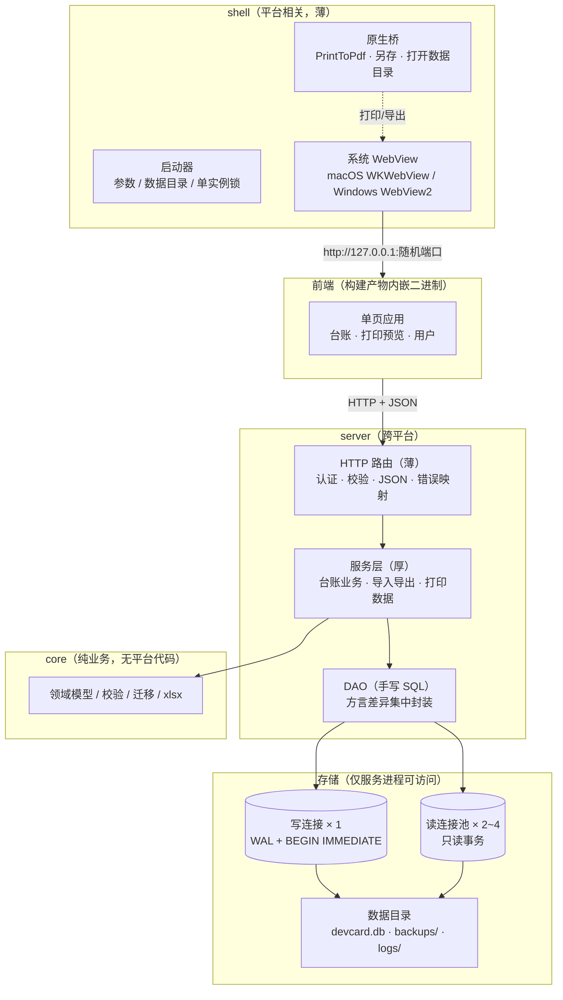

# DevCard 改造技术方案（去 Qt · B/S 内核 · 双平台）

> 文档性质：**决策文档**。回答「做不做、选哪条路、代价多大」，包含备选方案与取舍，需要评审拍板。
> 输入依据：[docs/现状技术方案.md](现状技术方案.md)（提交 `b1104b1` 的代码通读）+ 同机参考实现 `/Users/lin/Projects/xiaotu-inventory`（0.9.0）。
> 本文不包含具体施工步骤；施工设计（模块内部接口、状态机、验收脚本）在拍板后另行编写。
> 编写日期：2026-11-14。**Win7/8 部分的事实均来自微软官方文档，见第 13 节与附录 A。**

---

## 0. 结论摘要

1. **可行，且参考实现已经验证过同一条路**：小兔进销存用「C++20 + cpp-httplib + SQLite + 系统 WebView + 内嵌前端」做到了 macOS `.dmg` 2.84 MiB、单可执行文件 4.3 MB、零自带框架。DevCard 的业务量级远小于进销存，架构可以直接复用，不需要引入新发明。
2. **体积与外观的收益是数量级的**：现状 `bin/` 111 MB、exe 21 MB（其中约 20 MB 是把字体编进 qrc 导致的）；目标 Windows 安装包 ≤ 10 MB、macOS `.dmg` ≤ 5 MB、主程序 5–8 MB。UI 改由浏览器渲染，不再受 Qt Widgets 的固定像素布局限制。
3. **Win7 / Win8(8.1) 在本方案下明确不支持**。不是 C++20 的问题，而是 WebView2 运行时：官方支持列表只有 Windows 10 1709+ / Windows 11 / Server 2016+；Win7/8/8.1 在 WebView2 Runtime 109（2023-01）之后停止支持，SDK ≥ 1.0.1519.0 也不再支持，Fixed 版 > 109 在 Win7 上无法启动。详见第 13 节。
4. **建议的最低支持面**：macOS 13+（与参考实现一致，可下探到 12 需单独验证）、Windows 10 1809+ / Windows 11、Windows Server 2016+。若确有 Win7 存量客户，保留现 Qt 版 v1.1.2 作为「冻结版」，不做安全更新，不并入新架构。
5. **两个必须先拍板的点**：① 打印/PDF 走「浏览器渲染 + WebView 原生 PrintToPdf」还是保留服务端 PDF（直接决定能否删掉 libharu 与 20 MB 字体）；② 前端用原生 JS 还是引入框架（决定包体、构建复杂度与团队上手成本）。第 14 节列了 10 项决策，附建议。

---

## 1. 目标与非目标

### 1.1 目标

| 维度 | 目标 | 衡量方式 |
|---|---|---|
| 平台 | macOS 与 Windows 双系统，同一套 C++20 代码 | 两平台各自可构建、可出包、冒烟通过 |
| 形态 | 单机版与网络版同一个二进制；单机版表面是桌面窗口，内核是本地 HTTP 服务（B/S） | 不带参数 = 本地窗口；`--server` = 浏览器访问 |
| 体积 | Windows 安装包 ≤ 10 MB，macOS dmg ≤ 5 MB，主程序 ≤ 8 MB | 出包实测，记录在验收清单 |
| 性能 | 本地模式冷启动到首屏 < 1 s；1 万条设备记录列表查询 < 50 ms（分页 200/页）；导入 5000 行 xlsx < 3 s | 基准脚本可复现 |
| 外观 | 重新设计的现代界面，替换 Qt 固定坐标布局；支持 125%/150% 缩放与深浅色 | 设计走查 + 真机截图 |
| 图标 | 全新应用图标（macOS `.icns` + Windows `.ico` + Web favicon） | 16/32/48/128/256/512/1024 逐档可辨 |
| 数据 | 现有 `tb_device`、`tb_user` 两张表的数据与语义无损迁移 | 迁移前后行数、抽样字段逐条比对 |
| 工程 | 去掉 Qt、libharu、libzip、libxlsxwriter；依赖全部内嵌；前端产物内嵌二进制 | 发布包中无独立资源目录、无 Qt DLL |
| 可维护 | DAO 层集中 SQL；schema 版本化迁移；错误码稳定；有单测与 CI | 代码走查 + CI 门禁 |

### 1.2 非目标（本期明确不做）

- **不支持 Windows 7 / 8 / 8.1**（结论见第 13 节）。
- 不做移动端、不做多租户、不做云端同步。
- 不改业务语义：筛选逻辑、去重规则、导入截断、卡片版式仍以现状为基准，只修 bug，不顺手改规则。
- 不做多数据库后端（MySQL/PostgreSQL）；只在 DAO 层留出方言缝，不实现第二套方言。
- 不做完整 RBAC：保留「管理员 + 普通用户」两级，不引入权限点体系（现状只有登录校验，够用）。
- 不做自动更新（可作为后续独立议题；参考实现有 Sparkle/清单两套，本项目暂不引入）。
- 不做安装器签名与公证的强制要求：签名是参数化空位，有证书才签，没有就明确标注「未签名」。

---

## 2. 现状与改造的对应关系

| 现状模块（Qt） | 改造后归属 | 处理方式 |
|---|---|---|
| `src/ui/ui_*.h`（手写 uic 风格表单） | 删除 | 由 `web/` 页面取代，Qt 几何坐标不再保留 |
| `src/ui/login_window.* / main_window.* / user_window.*` | `web/` + `server/routes/` | 业务逻辑迁到服务层，界面重写 |
| `src/app_info.h` 全局量 | `core` 的 `Session`/`Settings` | 去掉可变全局 |
| `src/db/database.*`（每次开连接、全文本绑定、假事务） | `core/dao/` + `core/db.*` | 单写连接 + 读池、WAL、真事务、类型化绑定 |
| `src/db/initializer.*` | `core/migrations/` | 改为版本化迁移 + 种子数据 |
| `src/excel/excel_handler.*`（libzip + libxlsxwriter） | `core/io/xlsx_*`（miniz） | 自研 xlsx 读写，去掉两个动态库 |
| `src/printer/card_printer.*`（libharu） | `web/` 打印页 + 壳的原生 PrintToPdf | 默认去掉 libharu；保留服务端 PDF 为备选（D2） |
| `resources/fonts`（20 MB）、`resources.qrc` | `web/assets`（子集 woff2）或系统字体 | 字体不再整体入库，按需子集化 |
| `dev_card.pro`、`build.bat`、`Makefile*` | `CMakeLists.txt` + Presets + 打包脚本 | 只保留 CMake；删除 qmake 体系 |
| `DevCard_resource.rc` | `cmake` 生成 `version.rc`（模板） | 版本号单一来源 |
| `bin/`、`build/`、`debug/`、`release/` | 全部 gitignore，构建目录 `build/<preset>/` | 不再就地构建 |

---

## 3. 目标架构

### 3.1 总览：B/S 内核 + C/S 外观



一句话：**UI 是网页，服务是本地进程，数据库只归服务进程所有**。桌面窗口只是把浏览器内容装进系统 WebView，不承载业务逻辑。

### 3.2 分层与依赖规则（硬约束）

| 层 | 职责 | 允许依赖 | 禁止 |
|---|---|---|---|
| `shell` | 进程启动、模式判定、数据目录、WebView 创建、原生打印/另存、单实例 | `server`、`core`、平台 SDK | 业务规则、SQL |
| `server` | 路由、会话、鉴权、参数校验、事务编排、序列化 | `core` | 平台 API、在路由里写业务规则 |
| `core` | 领域模型、校验、DAO、迁移、xlsx、错误码 | 标准库、第三方通用库 | 平台头文件、`windows.h`/`Cocoa` |
| `web` | 交互、表单校验、展示、打印视图 | 仅 HTTP API + 壳桥 | 直连数据库、读本地文件 |

三条检查（可写成 CI 脚本）：

1. `core/**` 不得出现 `#ifdef _WIN32` / `__APPLE__` / 平台头文件。
2. `server` 不得 `#include` shell 的头；依赖方向单向 `shell → server → core`。
3. 发布构建中 `web/` 必须以嵌入资源进入二进制，产物目录不允许出现独立 `web/` 或 `resources/`。

### 3.3 进程模型（两个选项）

| 选项 | 形态 | 优点 | 缺点 | 建议 |
|---|---|---|---|---|
| **A. 单进程** | 主程序内：UI 线程跑 WebView，后台线程跑 HTTP 服务 | 一个二进制、无 IPC、启动快、打包最简单 | 服务崩溃连 UI 一起挂；WebView2 的 COM/消息循环与 HTTP 线程需严格隔离 | **推荐**（DevCard 单用户、数据量小，收益大于隔离需求） |
| B. 双进程 | 壳 exe + `devcard-server.exe`，壳解析子进程 stdout 取地址 | 崩溃隔离；网络版与桌面版同款服务端 | 多一个 exe、要管子进程生命周期与孤儿进程（参考实现用 Job Object） | 若后续要常驻托盘或服务化，再切 B |

参考实现：macOS 是单进程（壳直接链接 server），Windows 是双进程（壳拉起 `xiaotu-server.exe`）。本项目建议**两平台统一单进程**，降低两套启动逻辑的维护成本。

### 3.4 前端加载方式

- **发布态**：`web/` 下全部静态文件由 CMake 自定义命令转成 C++ 字节数组（参考 `cmake/embed_resources.cmake`），编进二进制；HTTP 服务从内存返回，配 `ETag`、`Cache-Control: no-cache`（HTML）/ 长缓存（带 hash 的资源名）。**发布包不落盘任何前端文件**。
- **开发态**：`-DDEVCARD_DEV_WEB=ON` 时不嵌入，服务返回 302 到 Vite/静态 dev server，或直接以 `--web-dir <path>` 读磁盘；改前端刷新即见。
- **禁止**：让用户直接打开本地 `index.html`（`file://` 下鉴权、CORS、相对路径全部失效）。

### 3.5 单机版与网络版的差异

| 维度 | 单机版（无参数） | 网络版（`--server`） |
|---|---|---|
| 监听 | `127.0.0.1:0`（系统分配端口） | `0.0.0.0:8080`（可配 `--listen/--port`） |
| 客户端 | 内嵌 WebView 打开 `http://127.0.0.1:P/#t=<一次性token>` | 局域网浏览器 |
| 认证 | 一次性 token 换 HttpOnly 会话 Cookie；token 60 秒有效、用后即废 | 用户名 + 口令，Argon2id 校验，失败锁定 |
| 用户 | 默认单管理员；保留用户管理但可隐藏 | 多用户 |
| 数据 | `<AppData>/DevCard/` | `--data` 指定目录 |
| 打印 | WebView 原生 PrintToPdf / 系统打印对话框 | 浏览器打印 |
| 关闭 | 关窗即退（服务线程随之停止） | 常驻，Ctrl+C / 信号优雅退出 |
| 并发 | 1 个前端（多标签页也走同一会话） | 目标 5–20 并发（物业内网量级） |

差别只有「谁在监听」和「第一个会话怎么拿」；`/api/*` 之后完全一致。

### 3.6 本地模式启动时序

```text
双击 App
  → 解析参数（无 --server）→ 定位数据目录（macOS: ~/Library/Application Support/com.anyewuye.devcard/
                                          Windows: %LOCALAPPDATA%\Anye\DevCard\）
  → 单实例锁（macOS: flock/LSMultipleInstancesProhibited；Windows: Local\ 命名互斥体）
  → 打开数据库 → 迁移（含首次建库）→ 启动 HTTP（127.0.0.1:0）
  → 生成一次性 token（32 字节随机，60 秒）
  → 创建 WebView，加载 http://127.0.0.1:P/#t=T
  → 前端 POST /api/session/local {token} → 换 HttpOnly Cookie → history.replaceState 清掉 token
  → GET /api/bootstrap（用户、版本、是否首次运行）→ 渲染
```

---

## 4. 模块划分

### 4.1 目标目录

```text
dev_card_cpp/
├── VERSION                       # 版本唯一来源
├── CMakeLists.txt                # 顶层：target 划分、C++20、/utf-8、静态 CRT
├── CMakePresets.json             # macos-release / macos-dev / windows-release / linux-ci
├── cmake/
│   ├── embed_resources.cmake     # web/ → C++ 字节数组
│   └── version.rc.in             # Windows 版本信息模板
├── core/                         # 纯 C++20，无平台代码
│   ├── include/devcard/
│   │   ├── db.h  error.h  models.h  ids.h
│   │   ├── dao/{device_dao.h,user_dao.h,meta_dao.h,dialect.h}
│   │   ├── service/{device_service.h,user_service.h,session_service.h}
│   │   ├── migrations.h
│   │   ├── io/{xlsx_reader.h,xlsx_writer.h}
│   │   └── platform_paths.h      # 只声明，实现在 server/shell
│   └── src/...
├── server/                       # HTTP 层 + 可执行入口
│   ├── include/devcard/{http_server.h,http_json.h,session_store.h,config.h,routes/*.h}
│   └── src/{main.cpp,http_server.cpp,session_store.cpp,routes/*.cpp}
├── shell/                        # 平台壳
│   ├── mac/{webview.mm,Info.plist,icon/*.icns}
│   └── win/{main.cpp,version.rc.in,fetch-webview2.ps1}
├── web/                          # 前端源码（发布时内嵌）
│   ├── index.html  app.js  styles.css  icons/*.svg
│   └── pages/{devices.js,print.js,users.js,settings.js}
├── tests/                        # ctest：dao/migrations/xlsx/http
├── third_party/                  # sqlite, httplib, nlohmann, miniz, argon2
├── tools/{package,icons}         # make_dmg.sh / Inno Setup / make_icons
└── docs/
```

### 4.2 `core` 内部模块

| 模块 | 内容 | 不做什么 |
|---|---|---|
| `db` | `Db`（单写连接 + 读池、WAL、`busy_timeout`、`BEGIN IMMEDIATE`）、`Stmt`（RAII 绑定/取值）、`exec_sql` | 不含业务语义 |
| `dao` | 每张表一个 DAO，方法接收/返回领域结构体；所有 SQL 只出现在这里 | 不做事务编排（由 service 决定） |
| `service` | 设备增删改查、去重、导入导出编排、用户与口令、会话 | 不碰 HTTP、不碰文件对话框 |
| `migrations` | 版本化 SQL 数组 + checksum 校验 + 迁移前备份 | 不执行数据导入（另走一次性命令） |
| `io` | xlsx 读（sharedStrings + sheet XML）、xlsx 写（miniz deflate） | 不依赖业务 DAO，只做行数据 ↔ 单元格 |
| `models` | `Device`、`User`、`Session`、`Result`/`Error` | 不放 UI 文案（文案在 web） |

### 4.3 `server`

- `http_server`：绑定/端口（0 = 系统分配）、路由注册、静态资源、优雅退出。
- `session_store`：内存会话（token 哈希、过期、空闲超时），本地模式一次性 token。
- `routes/*`：认证、参数解析、调用 service、JSON 序列化、错误码映射。路由函数不超过 ~30 行。
- `config`：命令行 > 环境变量 > `config.toml` > 默认；未知键报错（参考实现的做法）。

### 4.4 `shell`

- macOS：`WKWebView` + `NSWindow`；`createPDFWithConfiguration`（macOS 11+）导出 PDF；`NSPrintOperation` 走系统打印；编辑菜单（撤销/重做/剪切/复制/粘贴/全选）；退出确认只拦「有未保存内容」。
- Windows：Win32 窗口 + WebView2；`ICoreWebView2_16::PrintToPdfAsync`；单实例互斥体；窗口尺寸记忆；`/utf-8`；静态 CRT。
- 共同点：不解析 JSON、不做业务判断，只做「窗口 + 打印 + 文件对话框 + 数据目录」。

### 4.5 `web`

- 原生 ES Module + CSS，无框架（建议值，见 D3）；构建只做「拼接 + 可选压缩」，不引入 Node 工具链也能跑。
- 页面按路由拆 4 个文件，公共的表格/表单/弹层抽 `ui.js`（< 300 行）。
- 无状态组件优先；全局状态只有一个 `store`（当前用户、筛选条件、分页）。
- 所有网络请求走 `api.js`：统一错误码 → toast、401 → 回登录页、超时提示。

---

## 5. DAO 层设计

### 5.1 连接与事务模型

```cpp
// core/include/devcard/db.h（示意，非最终接口）
class Db {
 public:
  explicit Db(std::filesystem::path file, int read_conns = 2);
  void write(const std::function<void(sqlite3*)>& fn);   // BEGIN IMMEDIATE ... COMMIT/ROLLBACK
  void read(const std::function<void(sqlite3*)>& fn) const; // 只读事务，从池取连接
  std::int64_t schema_version() const;
};
```

- **单写连接 + 互斥**：本项目并发极低，单写连接把「先查重再插入」「先读余额再改」变成天然串行，不需要应用层锁。
- **读连接池 2~4 个**：列表查询与导出可以并行，不与写互相阻塞（WAL 下读写不互斥）。
- 每个连接启动时统一设置：`journal_mode=WAL`、`busy_timeout=5000`、`foreign_keys=ON`、`synchronous=NORMAL`。
- 事务只允许在 service 层开启；DAO 的连接级方法（`insert(conn, row)`）要求在已有事务内调用（参考实现的 `static insert(sqlite3*, ...)` 模式）。
- 失败抛 `AppError{code, message}`，由路由统一映射为 HTTP 状态码；禁止「返回 0 表示失败」的旧风格。

### 5.2 DAO 接口

| DAO | 方法（示意） |
|---|---|
| `DeviceDao` | `list(DeviceQuery)`、`find(id)`、`count(DeviceQuery)`、`insert(conn, Device&)`、`update(conn, Device)`、`erase(conn, id)`、`erase_all(conn)`、`dedupe(conn)`、`distinct_names()`、`distinct_locations()`、`all_for_export(DeviceQuery)` |
| `UserDao` | `list()`、`find_by_name()`、`insert()`、`update_password()`、`erase()`、`count_admins()` |
| `MetaDao` | `schema_version()`、`get_setting(key)`、`set_setting(key,value)`、`audit(...)`（可选） |

`DeviceQuery` 用结构体而不是「拼 SQL 字符串」：

```cpp
struct DeviceQuery {
  std::string keyword;      // 模糊查询
  std::string field;        // dev_name/location/control_range/phone，空 = 全字段
  std::string name;         // 下拉筛选，空 = 全部
  std::string location;
  int page = 0;             // 0 基
  int page_size = 200;      // 上限 1000
  std::string sort;         // "dev_id" | "dev_name" | "location"
  bool desc = false;
};
```

### 5.3 方言差异集中封装

用户要求「把 SQL 方言差异集中封装」。**先把结论说清楚：本期只有 SQLite，完整 dialect 抽象属于过度设计**。建议做法是「一个 `Dialect` 结构 + 少量 helper」，覆盖真正会变的语法点，不做 ORM、不做 SQL 生成器：

| 差异点 | SQLite 现状写法 | `Dialect` 对外形态 | 换后端时才需要变 |
|---|---|---|---|
| 自增主键 | `INTEGER PRIMARY KEY AUTOINCREMENT` | `ddl::pk_auto()` | `SERIAL` / `IDENTITY` |
| 布尔 | `INTEGER` + `CHECK(x IN (0,1))` | `ddl::boolean()` | `BOOLEAN` |
| Upsert | `INSERT ... ON CONFLICT(...) DO UPDATE SET ...` | `sql::upsert(table, keys, cols)` | `MERGE` / `ON DUPLICATE KEY` |
| 时间 | `TEXT` ISO-8601（`YYYY-MM-DD HH:MM:SS`） | `sql::now_expr()` | `NOW()` / `CURRENT_TIMESTAMP` |
| 分页 | `LIMIT ? OFFSET ?` | `sql::limit_offset()` | `OFFSET ... FETCH` |
| 标识符引用 | `"col"` | `sql::quote_ident()` | 反引号 / 方括号 |
| 大小写 | `LIKE` 对 ASCII 不敏感、对中文按字节 | `sql::like()`（必要时 `COLLATE NOCASE`） | `ILIKE` |
| 自增回填 | `sqlite3_last_insert_rowid` | `dao` 内部 | `RETURNING` / `LAST_INSERT_ID` |
| 事务开始 | `BEGIN IMMEDIATE` | `db.write()` 内部 | `BEGIN` + 行锁 |

规则：

1. **SQL 文本只允许出现在 `core/src/dao/` 与 `core/src/migrations/`**；`grep -rn "SELECT\|INSERT\|UPDATE\|DELETE" core/src --exclude-dir=dao --exclude-dir=migrations` 必须为空（CI 检查）。
2. 方言 helper 只封装「换库会变」的部分；普通 `WHERE`、`JOIN`、`GROUP BY` 直接写，不为了抽象而抽象。
3. 若拍板「永远只有 SQLite」，可以进一步退化为 `dialect.h` 里的常量 + `inline` 函数，不建接口类（D8）。

### 5.4 错误模型

```text
code        稳定字符串，前端据此分支，不解析 message
  BAD_ARGUMENT / NOT_FOUND / CONFLICT / LOCKED /
  AUTH_REQUIRED / AUTH_FAILED / FORBIDDEN /
  DB_ERROR / IO_ERROR / IMPORT_FAILED / PRINT_FAILED / INTERNAL
message     中文，给用户看
details     可选对象（字段名、行号、冲突 id）
```

HTTP 映射：`BAD_ARGUMENT→400`、`AUTH_*→401/403`、`NOT_FOUND→404`、`CONFLICT→409`、`LOCKED→423`、`IMPORT_FAILED→422`、其余 `500`。响应体固定 `{ "error": { "code", "message", "details" } }`。

### 5.5 查询与分页策略

- 列表默认 `page_size=200`，前端「加载更多」或分页器；导出走 `all_for_export`（服务端流式写 xlsx，不受分页限制）。
- 索引：`device(dev_name)`、`device(location)`、`device(dev_id)`（主键已有）；模糊查询 `%kw%` 无法走索引，1 万行内可接受；超过 10 万行再考虑 FTS5（列为后续议题）。
- 下拉选项用 `SELECT DISTINCT ... ORDER BY`，单独接口缓存 30 秒。

---

## 6. 数据模型与迁移

### 6.1 新 schema（v1）

```sql
CREATE TABLE device (
  id            INTEGER PRIMARY KEY AUTOINCREMENT,
  dev_name      TEXT    NOT NULL,
  location      TEXT    NOT NULL,
  control_range TEXT    NOT NULL,
  phone         TEXT    NOT NULL DEFAULT '',
  created_at    TEXT    NOT NULL,
  updated_at    TEXT    NOT NULL,
  CHECK (length(dev_name)    BETWEEN 1 AND 20),
  CHECK (length(location)    BETWEEN 1 AND 20),
  CHECK (length(control_range) BETWEEN 1 AND 20),
  CHECK (length(phone)       <= 20)
);
CREATE INDEX idx_device_name     ON device(dev_name);
CREATE INDEX idx_device_location ON device(location);
-- 业务唯一性（替代现在 add() 里的三字段查重）
CREATE UNIQUE INDEX uk_device_unique ON device(dev_name, location, control_range);

CREATE TABLE app_user (
  user_name            TEXT PRIMARY KEY,
  password_hash        TEXT NOT NULL,     -- Argon2id
  display_name         TEXT NOT NULL DEFAULT '',
  role                 TEXT NOT NULL DEFAULT 'admin',  -- admin | user
  must_change_password INTEGER NOT NULL DEFAULT 0,
  failed_count         INTEGER NOT NULL DEFAULT 0,
  locked_until         TEXT,
  created_at           TEXT NOT NULL,
  updated_at           TEXT NOT NULL,
  CHECK (role IN ('admin','user'))
);

CREATE TABLE app_setting (
  key   TEXT PRIMARY KEY,
  value TEXT NOT NULL
);

CREATE TABLE schema_migration (
  version    INTEGER PRIMARY KEY,
  name       TEXT NOT NULL,
  checksum   TEXT NOT NULL,
  applied_at TEXT NOT NULL
);
```

变化点与理由：

- 字段宽度从「表声明 20 / 代码截断 10、11」统一为 ≤20 的 CHECK，**截断规则仍在导入层**（保持现状行为：导入按 10/10/10/11 截断），避免迁移后同一份 Excel 导入结果不同。
- 唯一索引与 `add()` 的三字段查重一致；但导入路径**不**走唯一约束（现状允许重复导入），需要在导入层显式去重或允许冲突，见 D5。
- 密码从明文改为 Argon2id；默认账号**不再自动重建**（现状每次启动 `INSERT OR IGNORE` 会把删掉的 root 复活）。
- 时间字段为 `TEXT` ISO-8601，排序与展示都简单；不引入时区库。

### 6.2 旧表 → 新表映射

| 旧 `tb_device` | 新 `device` | 规则 |
|---|---|---|
| `dev_id` INTEGER PK AUTOINCREMENT | `id` | 原值保留；若与目标库冲突则顺延并记录映射 |
| `dev_name` VARCHAR(20) | `dev_name` TEXT NOT NULL | NULL → ''，trim；超 20 → 截断并计入告警 |
| `location` | `location` | 同上 |
| `control_range` | `control_range` | 同上 |
| `phone` | `phone` | 保留原字符（不强制转数字；只有导出时按现状「仅数字」处理） |
| — | `created_at` / `updated_at` | 迁移时刻填充（无法得知原创建时间，标记为迁移时间） |

| 旧 `tb_user` | 新 `app_user` | 规则 |
|---|---|---|
| `userName` VARCHAR(20) PK | `user_name` | 原值保留 |
| `userPwd` VARCHAR(20) 明文 | `password_hash` | 迁移时用 Argon2id 哈希；**不保留明文** |
| — | `role` | `root` → admin，其余 → user（可配） |
| — | `must_change_password` | 默认账号与长度 < 6 的口令置 1，首次登录强制改 |
| — | `failed_count/locked_until` | 初始 0 / NULL |

**注意**：旧库是明文口令，迁移过程会把明文读进内存并哈希；迁移完成后旧库文件**不删除**，改名 `devicedb.db.migrated-<时间戳>` 留在同目录，由用户自行决定是否销毁（默认提示「建议删除」，不自动删）。

### 6.3 迁移机制

- 迁移 = `struct Migration { int version; const char* name; const char* sql; }` 的静态数组，按版本升序执行。
- 启动时：读 `schema_migration` → 校验已应用版本的 checksum（sha256）→ 不一致直接拒绝启动（防止有人手改 SQL 导致新旧库结构不一致）→ 依次在事务里执行未应用项。
- 迁移前自动备份：`backups/devcard-<version>-<时间戳>.db`（`VACUUM INTO` 或文件拷贝，保留最近 N 份）。
- 迁移不可回滚（SQLite DDL 事务有限）；出问题用备份恢复，恢复入口做在「设置 → 数据维护」与命令行 `--restore`。
- 新库首次启动直接建到最新版本，并写入种子管理员（口令在首次启动时由用户设置或生成随机口令打印到日志，**不再硬编码 123456**）。

### 6.4 旧库一次性导入

不是 schema 迁移，而是数据搬迁，单独一条链路：

```text
--import-legacy <path>            显式导入并退出
或不带参数首次启动时自动探测：
  <新数据目录>/legacy/devicedb.db
  程序目录/devicedb.db（旧版安装目录）
  %LOCALAPPDATA%\... 旧路径（如已知）
```

规则：

1. 只读打开旧库（`mode=ro`），检查表存在与列名，不假设 schema。
2. 在目标库一个事务里导入 `tb_device`（保留 id）与 `tb_user`（哈希口令）；重复执行时按 `dev_id`/`user_name` 幂等跳过。
3. 导入结果写报告：总行数、成功、跳过（重复）、告警（超长截断、空字段、非法 id），前端展示可复制的报告；不静默丢数据。
4. 导入完成后在 `app_setting` 写 `legacy_imported_from` 与时间，避免重复提示。

### 6.5 回滚路径

- 新版本首次启动前自动备份；`--restore <file>` 覆盖当前库并重启。
- 旧 Qt 版程序与旧库文件保持可用（冻结版），新程序不修改旧库（只读导入）。
- 数据目录与程序目录分离后，卸载程序不删数据目录（安装器显式询问）。

---

## 7. API 设计

### 7.1 约定

- 全部 `application/json; charset=utf-8`；文件上传用 `multipart/form-data`；导出返回 `application/vnd.openxmlformats-officedocument.spreadsheetml.sheet` 流。
- 认证：`sid` HttpOnly + SameSite=Lax Cookie；写请求要求 `X-Requested-With: DevCard` 作为 CSRF 兜底。
- 分页响应：`{ "items": [...], "total": 1234, "page": 0, "page_size": 200 }`。
- 幂等：`POST /api/devices` 支持 `X-Request-Id`，重复提交返回同一条（可选，优先级低）。

### 7.2 端点清单

| 方法 | 路径 | 说明 |
|---|---|---|
| GET | `/api/health` | 免认证；版本、schema 版本、模式（local/server） |
| POST | `/api/session/local` | `{token}` → 本地会话 |
| POST | `/api/session/login` | `{username,password}` → 会话 |
| POST | `/api/session/logout` | 销毁会话 |
| GET | `/api/bootstrap` | 当前用户、版本、首次运行、数据目录告警 |
| GET | `/api/devices` | 查询：`q/field/name/location/page/page_size/sort` |
| GET | `/api/devices/{id}` | 单条 |
| POST | `/api/devices` | 新增（三字段查重 → 409） |
| PUT | `/api/devices/{id}` | 修改 |
| DELETE | `/api/devices/{id}` | 删除 |
| POST | `/api/devices/bulk-delete` | 清空（要求 `{confirm:"DELETE_ALL"}`） |
| POST | `/api/devices/dedupe` | 合并重复（返回删除条数） |
| GET | `/api/options` | 名称/位置去重列表 |
| POST | `/api/devices/import` | 上传 xlsx → 返回导入报告 |
| GET | `/api/devices/export` | 按当前筛选导出 xlsx |
| GET | `/api/print/cards` | 打印用数据（JSON，前端排版） |
| GET/POST/PUT/DELETE | `/api/users[/{name}]` | 用户维护（admin） |
| POST | `/api/users/{name}/password` | 改口令（自助 / 管理员重置） |
| POST | `/api/system/backup` | 立即备份 |
| GET | `/api/system/backups` | 备份列表 |
| POST | `/api/system/restore` | 恢复（维护态） |

### 7.3 认证与安全

- 本地模式：token 一次性、60 秒、绑定进程随机数；Cookie 仅 `127.0.0.1`；Host 头必须是 `127.0.0.1:<port>` 或 `localhost:<port>`（防 DNS rebinding）。
- 网络模式：Argon2id（`m=64MiB, t=3, p=1` 起步，实测调整）；连续 5 次失败锁定 15 分钟；口令 8–128 位；首次必须改默认口令。
- 响应头：`X-Content-Type-Options: nosniff`、`Referrer-Policy: no-referrer`、CSP（`default-src 'self'`，内嵌资源不需要 `unsafe-inline`；打印页允许 `style-src 'unsafe-inline'`）。
- 不开放 CORS；网络版建议由 nginx/自签证书提供 TLS，程序本身不内置 HTTPS（与参考实现一致）。

---

## 8. UI 重设计

### 8.1 参考小兔，学什么、不学什么

**学**：左侧固定侧栏 + 右侧内容区、`system-ui` 字体栈、表格 + 工具栏的密度、toast 通知、空状态、危险操作二次确认、键盘可达、深浅色用 CSS 变量。

**不学**：进销存的 9 大类菜单与多级导航、单据主子表、打印模板配置、权限点渲染。DevCard 只有「台账 / 打印 / 用户」三块，导航越少越好。

### 8.2 信息架构

```text
设备管理卡制作系统
├── 设备台账        默认页；查询、筛选、增删改、导入导出
├── 卡片打印        版式预览、选择范围、打印 / 导出 PDF
└── 系统
    ├── 用户管理     仅 admin
    ├── 数据维护     备份 / 恢复 / 旧库导入报告
    └── 关于         版本、版权、开源许可
```

### 8.3 布局

```text
┌────────────┬──────────────────────────────────────────────────────────┐
│  DevCard   │  设备台账                    [搜索框]  [导入] [导出] [打印] │
│            ├──────────────────────────────────────────────────────────┤
│ ▸ 设备台账 │  名称 [全部▾]  位置 [全部▾]  共 128 条        [ + 新增设备 ] │
│   卡片打印 │ ┌──────────────────────────────────────────────────────┐ │
│   系统     │ │ 编号 │ 设备名称 │ 位置 │ 控制范围 │ 维护电话 │ 操作   │ │
│            │ │  1   │ 消防…    │ 5栋2楼│ 1-5层    │ 138…     │ 编辑 删│ │
│            │ │ …    │          │      │          │          │        │ │
│            │ └──────────────────────────────────────────────────────┘ │
│  v1.2.0    │  ‹ 1 2 3 ›                                   200 条/页  │
└────────────┴──────────────────────────────────────────────────────────┘
```

- 侧栏 216 px，可折叠为 64 px；内容区最大宽度不限制，表格自适应。
- 新增/编辑用**右侧抽屉**（420 px）而不是常驻表单：列表可用面积从现状的 70% 提升到 ~100%，且不会出现「表单填了一半又去点表格」的状态错乱。
- 打印页是独立全屏视图（隐藏侧栏），A4 预览按容器宽度缩放，可切换「一页 12 张 / 一页 6 张 / 单张」，边距可调。
- 断点：≥1280 三栏（侧栏/列表/抽屉）；1024–1279 抽屉覆盖列表；<1024 提示窗口过窄（本产品不做手机端）。

### 8.4 视觉规范

| 项 | 值 |
|---|---|
| 主色 | `#0F766E`（深青，物业/设备场景稳重），hover `#0D9488` |
| 强调色 | `#F59E0B`（警示/维护），危险 `#DC2626` |
| 中性色 | 背景 `#F8FAFC` / 卡片 `#FFFFFF` / 边框 `#E2E8F0` / 主文字 `#0F172A` / 次文字 `#64748B` |
| 深色 | 背景 `#0B1220` / 卡片 `#111A2B` / 边框 `#1E293B` / 主文字 `#E2E8F0` |
| 字体 | `-apple-system, "PingFang SC", "Microsoft YaHei UI", "Segoe UI", system-ui, sans-serif`；数字用 `tabular-nums` |
| 字号 | 正文 14、表格 13、标题 20/16、辅助 12；行高 1.5 |
| 间距 | 4 的倍数：4/8/12/16/24/32 |
| 圆角 | 卡片 10、按钮 8、输入 8、标签 6 |
| 阴影 | `0 1px 2px rgba(15,23,42,.06), 0 8px 24px rgba(15,23,42,.06)`（仅浮层） |
| 动效 | 120–180 ms `ease-out`；尊重 `prefers-reduced-motion` |
| 图标 | 线性 1.5 px，20×20，`currentColor`；不引入图标字体 |

### 8.5 交互细节（逐条对应现状缺陷）

| 现状问题 | 新交互 |
|---|---|
| 增删改失败无提示（`db::exec` 返回 0 静默） | 所有写操作返回明确错误码 → toast + 表单字段标红 |
| 添加重名用户无反馈 | 409 + 「用户已存在」toast，输入框保留 |
| 导入「成功 N 条」不管实际插入结果 | 导入报告弹层：成功/跳过/告警三类计数 + 前 20 条明细 |
| 打印前顺带刷新界面、清空表单 | 打印页只读；返回列表保持原筛选与滚动位置 |
| 删除无二次确认 / 文案错字 | 危险操作统一确认框，按钮文案「删除」而非「确定」，显示影响条数 |
| 固定像素布局、字体未注册 | CSS 流式布局 + 系统字体栈；125%/150% 缩放下不重叠 |
| 表格无排序、无分页 | 列头排序、分页器、每页条数切换 |
| 下拉框名称/位置互相污染（共用 `existingName_`） | 两个独立选项源，接口分开返回 |
| 无键盘操作 | `Ctrl/Cmd+K` 聚焦搜索、`Enter` 保存、`Esc` 关抽屉、`Delete` 删除选中（需确认） |

### 8.6 表格与表单

- 表格：服务端分页 + 排序；单元格只渲染文本；行操作「编辑 / 删除」放在行尾，hover 才显示，触屏/键盘聚焦时显示。
- 虚拟滚动暂不做（200 条/页足够）；若单页 > 500 条再引入。
- 表单校验与后端一致：名称/位置/控制范围 1–20 字，电话 ≤20 且只允许数字/空格/短横线（保存时保留原样，导出时按现状取数字）。
- 未保存离开拦截：抽屉关闭 / 路由切换时提示；壳层退出确认读取同一状态（通过 `postMessage` 推送 dirty 标记）。

### 8.7 打印视图

- 用 CSS 排版，不用 Canvas：`@page { size: A4; margin: 0 }`，容器 `210mm × 297mm`，3 列 × 4 行网格，卡片 `62mm × 65mm`，间距沿用现状 PDF 的 67.5mm / 71.5mm 栅格（保证与现有实物一致）。
- 卡片内容与现状一致：Logo、公司名、「设备管理卡」、四行「标签 + 值」、分隔线、边框；电话格式 `前3 中4 后4`。
- 字体：正文用系统字体；若要保证跨机一致，使用 **子集化 woff2**（仅常用汉字，约 300–600 KB），或用 `local()` 优先、`url()` 兜底。
- 「打印」：`window.print()`（两平台 WebView 都支持，弹出系统打印对话框）。
- 「导出 PDF」：壳桥调用原生 API——macOS `WKWebView.createPDF`、Windows `ICoreWebView2_16::PrintToPdfAsync`，保存对话框由壳提供；网络版退化为浏览器「另存为 PDF」。
- 打印前校验：空数据禁用按钮；超过 12 条自动分页；提供「仅打印当前筛选结果」与「仅打印选中项」。

---

## 9. 应用图标

### 9.1 设计方向（三个候选）

| 候选 | 图形 | 语义 | 小尺寸表现 |
|---|---|---|---|
| A | 圆角卡片轮廓 + 右下角建筑窗格（2×2 方格） | 「设备卡」直接可读 | 16 px 仍能看到卡形与一个亮点 |
| B | 卡片 + 顶部一条荧光青横带（像工牌挂绳） | 工牌/门禁卡的联想 | 横带在 16 px 变成一条亮线，仍可辨 |
| C | 两张错位卡片叠放 + 中间定位针 | 「多设备 + 位置」 | 叠层在 16 px 易糊，不推荐 |

建议 **A**（卡形 + 建筑窗格），理由：与产品「设备管理卡」一一对应；几何简单、无文字、单色可印刷；在任务栏 16 px 与 Dock 128 px 都不丢特征。A/B 各出 2 版配色（深青底白卡 / 白底深青卡），做 16/32 px 对比后定稿。

### 9.2 规格与产出物

| 产出 | 规格 | 用途 |
|---|---|---|
| `icon.svg` | 1024×1024 画布，内容安全区 824×824（四周留 100），圆角矩形半径 ≈ 180 | 源文件，唯一可编辑源 |
| `icon-1024.png` | 1024×1024，sRGB，无透明边 | 生成其它尺寸的母版 |
| `icon.icns` | 16/32/64/128/256/512/1024（@1x/@2x） | macOS `.app` |
| `icon.ico` | 16/24/32/48/64/128/256 | Windows exe / 安装器 / 快捷方式 |
| `favicon.ico` + `icon-192.png` | 16/32 + 192 | Web（内嵌资源） |
| 浅色变体 | 白底深色图形 | 深色任务栏/开始菜单 |

约束：不使用文字与细线（< 2 px 在 16 px 下消失）；对比度 ≥ 4.5:1；macOS 用标准 squircle 模板（不要自己画圆角正方形，系统会再裁一次）。

### 9.3 生成流程

`tools/icons/make_icons.sh`（macOS，依赖 `sips`/`iconutil`/`rsvg-convert` 或 `qlmanage`）：

```text
icon.svg → icon-1024.png → iconset/{16,32,...,512@2x}.png → iconutil -c icns
         → Windows: ImageMagick 或 png2ico 生成多尺寸 .ico
         → web: favicon.ico + 192/512 png
```

图标与「公司 Logo（`resources/icons/logo.jpg`，PDF 卡片用）」是两件事：应用图标是产品标识，卡片上的 Logo 是甲方标识，**不要合并**。

---

## 10. 构建与打包

### 10.1 CMake 与 target

```cmake
cmake_minimum_required(VERSION 3.25)
file(READ "${CMAKE_CURRENT_SOURCE_DIR}/VERSION" DEVCARD_VERSION)
project(devcard VERSION ${DEVCARD_VERSION} LANGUAGES C CXX)
set(CMAKE_CXX_STANDARD 20)
set(CMAKE_CXX_STANDARD_REQUIRED ON)
set(CMAKE_CXX_EXTENSIONS OFF)
if(MSVC)
  add_compile_options(/utf-8)
  set(CMAKE_MSVC_RUNTIME_LIBRARY "MultiThreaded$<$<CONFIG:Debug>:Debug>")
endif()
if(APPLE AND NOT CMAKE_OSX_DEPLOYMENT_TARGET)
  set(CMAKE_OSX_DEPLOYMENT_TARGET "13.0" CACHE STRING "macOS 最低版本")
endif()
add_subdirectory(core)
add_subdirectory(server)
if(APPLE)  add_subdirectory(shell/mac) endif()
if(WIN32)  add_subdirectory(shell/win) endif()
enable_testing()
add_subdirectory(tests)
```

- `core` 编成 `devcard_core` 静态库；`server` 编 `devcard_server`（网络版 CLI）；桌面目标 `DevCard` 链接 `devcard_server`。
- Windows 桌面目标加 `/SUBSYSTEM:WINDOWS`、`version.rc`（模板由 CMake 注入版本）、`Manifest`（DPI aware: per-monitor v2）。
- macOS 桌面目标 `MACOSX_BUNDLE`，`Info.plist` 由模板生成（版本、`LSMinimumSystemVersion`、`NSAppTransportSecurity` 允许本地网络）。
- 静态 CRT（MSVC）→ 不依赖 VC++ Redistributable，安装包更干净（参考实现已采用）。

### 10.2 依赖（全部内嵌，构建不联网）

| 依赖 | 用途 | 许可 | 备注 |
|---|---|---|---|
| SQLite amalgamation | 存储 | Public Domain | 已有，升级到 3.4x 最新 |
| cpp-httplib | HTTP | MIT | 单头文件 |
| nlohmann/json | JSON | MIT | 单头文件 |
| miniz | xlsx 的 zip/deflate | MIT | 替代 libzip + libxlsxwriter |
| Argon2 参考实现 | 口令哈希 | CC0/Apache-2.0 | 可选，见 D6 |
| WebView2 SDK（Windows 构建机） | 桌面壳 | Microsoft 许可 | 构建时下载，不随源码分发 |

删除：Qt、libharu、libzip、libxlsxwriter、20 MB TTF、`.qrc`。

### 10.3 版本号单一来源

`VERSION` 文件 → CMake `project(VERSION)` → 编译定义 `DEVCARD_VERSION` → Windows `version.rc`、macOS `Info.plist`、`/api/health`、关于页。**不再出现 5 处手写 1.1.2**。

### 10.4 macOS 打包

`tools/package/make_dmg.sh`：构建 → 生成 `.app`（图标、Info.plist、内嵌前端）→ ad-hoc `codesign -s -` → `hdiutil` 生成 dmg（附「应用程序」快捷方式）。有 `DEVCARD_SIGN_IDENTITY` / `DEVCARD_NOTARY_PROFILE` 时走 Developer ID + notarytool + staple；没有就明确打印「未签名/未公证」，不假装已签名。

### 10.5 Windows 打包

- 分发形态：`DevCard.exe`（含壳与服务）+ 可选 `WebView2Loader.dll`（或用静态链接的 loader）+ 安装器。
- **WebView2 Runtime 检测**：安装器检测 `HKLM\SOFTWARE\WOW6432Node\Microsoft\EdgeUpdate\Clients\{F3017226-FE2A-4295-8BDF-00C3A9A7E4C5}` 版本；缺失时引导安装 Evergreen Bootstrapper（需联网），或提供离线 Standalone 安装包。Win11 与多数 Win10 已自带。
- 安装器：Inno Setup 6（参考实现已用），安装到 `%ProgramFiles%\DevCard`，数据在 `%LOCALAPPDATA%\Anye\DevCard`（卸载不删，显式询问）。
- 签名：`DESIGN=1` + `signtool` 才签；CI 未签名时在产物说明标注。

### 10.6 CI

| 任务 | 平台 | 内容 |
|---|---|---|
| build-macos | macOS runner（或本机 macmini） | configure + build + ctest + 打包冒烟 |
| build-windows | GitHub Actions `windows-latest` | MSVC 构建 + ctest + Inno Setup 出未签名安装包 |
| lint | 任意 | 分层检查（core 无平台头、SQL 只在 dao）、`/utf-8` 生效、clang-format |

### 10.7 体积与性能预算

| 项 | 现状 | 目标 | 依据 |
|---|---|---|---|
| 发布目录总大小 | 111 MB（`bin/`） | Windows 安装后 ≤ 15 MB；安装包 ≤ 10 MB | 去掉 Qt DLL 与 20 MB 字体 |
| 主程序 | 21 MB | 5–8 MB | 参考实现 4.3 MB（业务更大） |
| 内嵌前端 | 无 | ≤ 400 KB（未压缩） | 参考实现 270 KB |
| macOS dmg | 无 | ≤ 5 MB | 参考实现 2.84 MB |
| 冷启动到首屏 | 未测 | < 1 s | 本地 HTTP + 内嵌资源 |
| 列表查询（1 万行） | 未测 | < 50 ms | 索引 + 分页 |
| 导入 5000 行 | 未测 | < 3 s | 单事务批量插入 |

> 以上为预算值，不是实测结论；M0 阶段先做一次「空壳体积基线」，M6 出包时逐项核对。

---

## 11. 分阶段迁移路径

每阶段可独立验收，上一阶段不绿不进下一阶段；每完成一个阶段打一个 tag/提交，保留回滚点。

| 阶段 | 交付物 | 验收标准 | 相对规模 |
|---|---|---|---|
| **M0 骨架** | CMake 三 target、`Db`+`Stmt`、迁移 v1、`/api/health`、内嵌前端 hello、单机模式 token 链路、macOS 空壳 | 两平台能启动出窗口；`health` 返回版本与 schema；空壳体积基线记录 | S |
| **M1 台账闭环** | `DeviceDao`、`DeviceService`、CRUD + 筛选 + 分页接口、台账页（列表/抽屉/搜索） | 新增/修改/删除/查重与现状语义一致；1 万行基准达标；无 SQL 泄漏到路由 | M |
| **M2 导入导出** | miniz xlsx 读写、导入报告、导出流 | 与现状同一份 xlsx 导入结果逐行一致（截断/跳空行/表头）；导出可被 Excel 打开且列头一致 | M |
| **M3 迁移与用户** | 旧库导入器、Argon2id、登录/会话、用户页、备份恢复 | 旧库导入行数与抽样一致；默认口令强制改；删除用户不再复活 | M |
| **M4 打印** | 打印页、CSS 版式、壳桥 PrintToPdf、打印对话框 | 12 张/页版式与现状 PDF 叠图比对（误差 ≤ 1 mm）；导出 PDF 可打印 | M |
| **M5 双平台壳与出包** | Windows 壳、图标、dmg/安装器、CI | Win10/11 与 macOS 真机安装、启动、打印、卸载；体积达标 | M |
| **M6 网络版与加固** | `--server`、配置、日志、限流、备份策略、部署文档 | 局域网 5–20 并发可用；异常路径有明确错误码 | S–M |

依赖关系：M0 → M1 → {M2, M3} → M4 → M5 → M6。M2 与 M3 可并行（不同人）。

**冻结与切换**：M1 完成后旧 Qt 版进入只读维护；M5 出包后旧版停止分发（保留分支与安装包）；两版可共存（数据目录不同），避免迁移失败导致业务停摆。

---

## 12. 风险与工作量

### 12.1 风险

| # | 风险 | 概率 | 影响 | 应对 |
|---|---|---|---|---|
| R1 | Win7/8 客户存在，新架构无法覆盖 | 中 | 高（商务） | 明确不支持；保留旧版冻结包；见 §13 |
| R2 | 打印版式与现有 PDF 不一致（mm 误差、字体度量差异） | 中 | 高（实物印错） | M4 做叠图比对与真机打印；CSS 用 mm 单位；保留服务端 PDF 备选（D2） |
| R3 | 旧库迁移丢数据或口令错乱 | 中 | 高 | 只读导入 + 幂等 + 报告 + 自动备份 + 抽样比对 |
| R4 | WebView2 Runtime 缺失（Win10 旧版/离线环境） | 中 | 中 | 安装器检测 + Bootstrapper/离线包；文档写明 |
| R5 | 前端重写引入交互回归 | 高 | 中 | 先做 M1 的语义对照表（每个按钮对应旧行为），逐条验收 |
| R6 | 去 Qt 后 macOS 打包/签名/公证流程不熟 | 中 | 中 | 复用参考实现的 make_dmg 流程；先出未签名包 |
| R7 | C++20 + MSVC 静态 CRT 与 WebView2 SDK 的编译细节 | 低 | 中 | 参考实现已验证；M0 先跑通 |
| R8 | 字体授权（OPPOSans 随包分发） | 中 | 中 | 改用系统字体或开源字体（思源黑体 OFL），先做许可核查 |
| R9 | 单进程模型下服务崩溃拖垮 UI | 低 | 中 | 全局异常捕获 + 崩溃日志；必要时切双进程（§3.3） |
| R10 | 范围膨胀（权限、更新、多端） | 高 | 中 | 以 §1.2 非目标为准，变更需单独评审 |
| R11 | 新旧版本并存导致同一数据库被两个进程写 | 中 | 中 | 数据目录隔离 + 单实例锁 + 迁移后旧库只读 |
| R12 | CI 只有 macOS 本地，Windows 侧回归滞后 | 中 | 中 | Windows runner 跑构建/单测/出包；真机验收清单 |

### 12.2 工作量（相对规模，不给日历工期）

| 模块 | 新增/重写规模（估算） | 说明 |
|---|---|---|
| core（db/dao/service/migrations/io） | 3–4k 行 | 最大块，但逻辑确定，可单测 |
| server（路由/会话/配置） | 1.5–2k 行 | 路由薄，参考实现可对照 |
| web（4 页 + 组件 + 样式） | 3–5k 行 | 原生 JS 约 2.5k，CSS 约 1k |
| shell（mac + win） | 1–1.5k 行 | 平台代码，参考实现可复用结构 |
| 构建/打包/CI/图标 | 0.5–1k 行（脚本） | 一次性 |
| 测试 | 1–1.5k 行 | DAO/迁移/xlsx/HTTP 四类 |

比现状（约 1.2k 行 UI + 1k 行业务）净增约 3–4 倍代码量，换来跨平台、可测试与可维护。**建议按 M0–M6 分批投入，每批可独立交付**，而不是一次性重写。

---

## 13. Win7 / Win8 兼容性可行性研究

### 13.1 结论（明确）

> **在「放弃 Qt + 系统 WebView 桌面壳」的目标架构下，Windows 7 / 8 / 8.1 不支持，且没有受支持的实现路径。**
> 最低支持面定为 **Windows 10 1709+（建议 1809+）/ Windows 11 / Windows Server 2016+**。
> 若商务上必须覆盖 Win7，只能把现 Qt 版 v1.1.2 作为「冻结版」单独维护，不并入新架构。

### 13.2 逐组件核对

| 组件 | Win7 SP1 | Win8 / 8.1 | Win10 / 11 | 依据 |
|---|---|---|---|---|
| **C++20（MSVC v143 / VS2022）** | ✅ 可目标 | ✅ 可目标 | ✅ | VS 支持表把 Win7/8/8.1 列为可目标平台；C++20 是编译期语言特性，不依赖 OS |
| **MSVC 工具链（VS2026 / 14.51）** | ❌ 不再支持 | ❌ | ✅ | 「VS2026 18.0 起不再目标 Win7/8/8.1，目标平台须 Win10/Server2016+」 |
| **VC++ v14 运行库（最新）** | ❌ | ❌ | ✅ | 最新 v14 Redistributable 只支持 Win10/11、Server2016+；VS2022 时期的 v14 仍可覆盖 Win7 SP1/8.1，但需锁定工具集 |
| **WebView2 Runtime（Evergreen）** | ❌ | ❌ | ✅（Win10 1709+） | 官方支持列表只有 Win10 1709+/Win11/Server2016+；Runtime 109 是最后一个支持 Win7/8/8.1 的版本（2023-01） |
| **WebView2 SDK ≥ 1.0.1519.0** | ❌ | ❌ | ✅ | 官方公告：该版本起不再支持 Win7/8/8.1 |
| **WebView2 Fixed 版 > 109** | ❌ 无法启动 | ❌ | ✅ | 官方明确「高于 109 的 Fixed 版在 Win7/8.1 上无法启动」 |
| **Chromium 109（最后可用内核）** | ⚠️ 能跑但无安全更新 | ⚠️ | ✅ | Edge 109 之后 Win7/8/8.1 不再收到功能、安全与缺陷修复 |

### 13.3 为什么「用 VS2022 编译」不等于「能支持 Win7」

C++ 代码本身确实可以在 Win7 上跑：VS2022 的 v143 工具集仍把 Win7/8.1 列为可目标平台，静态链接 CRT 也不依赖 Redistributable。但本方案的**界面载体**是 WebView2，而 WebView2 的运行时与 SDK 从 2023 年起就不再支持 Win7/8/8.1。也就是说：

- 缺的不是编译器，是**浏览器内核**；
- 把 Runtime 钉在 109 能跑，但等于给用户一个 2023 年初的 Chromium，此后所有 CVE 都无补丁——对一个保存设备与联系电话的物业系统，这是不可接受的安全债；
- 同时新 SDK 无法在 Win7 上工作，壳层代码必须为 109 单独降级，等于维护两套壳。

### 13.4 若坚持 Win7，三个选项

| 选项 | 做法 | 代价 | 建议 |
|---|---|---|---|
| ① 冻结旧版 | 保留 Qt 版 v1.1.2 分支，只修致命 bug，不引入新功能 | 双版本维护；Qt 与旧工具链长期可用性下降 | **推荐给有存量客户的场景** |
| ② 外置浏览器 | Win7 上只跑 `--server`，用本机 Chrome 109 / Firefox 115 ESR 打开 | 不是桌面体验；浏览器同样已 EOL；无安全更新 | 仅作临时过渡，不写入支持承诺 |
| ③ 自带旧内核 | 内嵌 WebView2 Fixed 109 | 包体 +100 MB 以上；Chromium 109 无补丁；SDK 需降级 | **不建议** |

### 13.5 建议的支持矩阵

| 平台 | 最低版本 | 备注 |
|---|---|---|
| Windows | 10 1809（LTSC 2019）/ 11；Server 2016+ | WebView2 最低 1709；取 1809 与 LTSC 生命周期对齐 |
| macOS | 13 Ventura（可评估 12） | WKWebView + C++20；参考实现用 13 |
| 架构 | x64 + arm64（macOS universal）；Windows x64 | 不做 32 位 |

---

## 14. 待拍板决策清单

| # | 决策点 | 选项 | 建议 | 影响面 |
|---|---|---|---|---|
| D1 | 是否接受「不支持 Win7/8」 | 接受 / 保留旧版冻结 / 另做降级 | **接受 + 旧版冻结** | 商务与支持承诺；决定架构是否可行 |
| D2 | 打印与 PDF 路线 | A 浏览器渲染 + WebView PrintToPdf；B 保留 libharu 服务端 PDF；C 两者都做 | **A**（删 libharu、20 MB 字体；需 M4 真机比对）；网络版用浏览器打印 | 包体、版式精度、跨平台一致性 |
| D3 | 前端技术栈 | 原生 JS/CSS；Vue/React + Vite；Svelte | **原生 JS + CSS**（业务小、包体小、无 Node 依赖）；若团队更熟框架则 Vue | 包体、构建链、上手成本 |
| D4 | 进程模型 | 单进程 / 双进程 | **单进程**（两平台统一） | 启动、打包、崩溃隔离 |
| D5 | 导入去重策略 | 保持现状允许重复 / 导入时按三字段去重 / 冲突询问 | 保持现状行为（不改变用户预期），导入报告里提示重复数 | 数据一致性、迁移验收 |
| D6 | 口令与默认账号 | Argon2id + 强制改密 / 保留明文兼容 / 只做 SHA-256 | **Argon2id + 首次强制改密**；默认账号不再自动复活 | 安全、迁移复杂度 |
| D7 | 最低 macOS 版本 | 12 / 13 / 11 | **13**（与参考实现一致）；12 需单独验证 | 用户覆盖、API 可用性 |
| D8 | 方言抽象程度 | 仅 SQLite（helper 常量）/ 接口化 Dialect / 完整 SQL 生成器 | **helper 常量 + DAO 集中 SQL**，不做接口类 | 过度设计风险 |
| D9 | 网络版是否本期交付 | 本期做 / 后续做 | 本期做**最小可用**（登录 + 同一套 API + 部署文档），不做 TLS/更新 | 范围与工期 |
| D10 | 视觉风格 | 深青（推荐）/ 品牌蓝 / 跟随甲方 VI | **深青 + 浅色为主、支持深色**；图标定稿前出 2 版对比 | 设计工作量、验收标准 |

---

## 15. 参考实现映射（可直接对照的文件）

| 关注点 | 参考实现位置 | 可复用什么 |
|---|---|---|
| 顶层构建与 target 划分 | `CMakeLists.txt` | VERSION 单一来源、`/utf-8`、静态 CRT、`XIAOTU_BUILD_SHELL` 开关思路 |
| 前端内嵌 | `cmake/embed_resources.cmake` | 文件 → C++ 字节数组 + MIME + `find(path)` |
| 连接与事务 | `core/include/xiaotu/db.h` | 单写连接 + 读池 + WAL + `BEGIN IMMEDIATE` |
| 迁移与 checksum | `core/src/migrations.cpp` | 版本数组、事务执行、已应用校验 |
| DAO 形态 | `core/include/xiaotu/gen/item_dao.h` | 行结构体 + `list/find` + 事务内 `static insert(conn,…)` |
| 本地 token 链路 | `server/src/cli_main.cpp`、`server/include/xiaotu/http_server.h` | 一次性 token、端口 0、`/#t=` 交换 |
| 配置合并顺序 | `server/include/xiaotu/config.h` | 命令行 > 环境变量 > 文件 > 默认 |
| macOS 壳 | `shell/mac/webview.mm`、`shell/CMakeLists.txt` | WKWebView、Info.plist 注入、图标进 bundle、打印桥 |
| Windows 壳 | `shell/win/main.cpp` | WebView2 创建、单实例、窗口状态、子进程 Job（若选双进程） |
| 打包 | `tools/package/make_dmg.sh`、`packaging/win/xiaotu-inventory.iss` | dmg 流程、Inno Setup 参数化签名、未签名标注 |
| 体积基线 | `docs/进销存技术方案.md` §2.6 | 同架构的实测包体，作为预算依据 |

> 注意：参考实现的业务（单据、库存、往来账）与本项目无关，**只借鉴工程结构与平台细节，不搬运业务代码**。

---

## 附录 A：Win7/8 事实来源

1. Microsoft C++ 支持平台表（VS2026 18.0 起不再目标 Win7/8/8.1）：<https://learn.microsoft.com/en-us/cpp/overview/supported-platforms-visual-cpp?view=msvc-170>
2. Visual Studio 中已弃用/移除的 C++ 功能（Win7/8/8.1 支持终止说明）：<https://learn.microsoft.com/en-us/cpp/porting/features-deprecated-in-visual-studio?view=msvc-170>
3. Visual C++ Redistributable 最新支持版本（最新 v14 仅 Win10/11）：<https://learn.microsoft.com/en-us/cpp/windows/latest-supported-vc-redist?view=msvc-170>
4. WebView2 简介与受支持 Windows 版本（仅 Win10 1709+/Win11/Server2016+）：<https://learn.microsoft.com/en-us/microsoft-edge/webview2/>
5. Edge/WebView2 停止支持 Win7/8/8.1 的公告（Runtime 109 为最后版本，SDK ≥1.0.1519.0 不再支持）：<https://blogs.windows.com/msedgedev/2022/12/09/microsoft-edge-and-webview2-ending-support-for-windows-7-and-windows-8-8-1/>
6. Microsoft Edge 支持的操作系统（109 为 Win7/8.1 最后版本）：<https://learn.microsoft.com/en-us/deployedge/microsoft-edge-supported-operating-systems>

## 附录 B：本文的估算与未知项

- 包体、启动、查询耗时均为**预算目标**，未实测；M0/M6 各做一次基线记录。
- 「12 张/页与现有 PDF 叠图误差 ≤ 1 mm」需要 M4 用实物打印验证，CSS 字体度量与 libharu 可能存在差异。
- 前端代码量与 core 代码量为**规模估算**，用于拆分阶段，不作为工期承诺。
- Win7 存量客户数量、旧版冻结的维护年限、是否需要 Windows Server 部署，属于商务/运维信息，本文未假设。
- 参考实现的 macOS 最低版本为 13.0；本项目是否可下探到 12 需在 M0 实测 WKWebView API 与打包链路。
