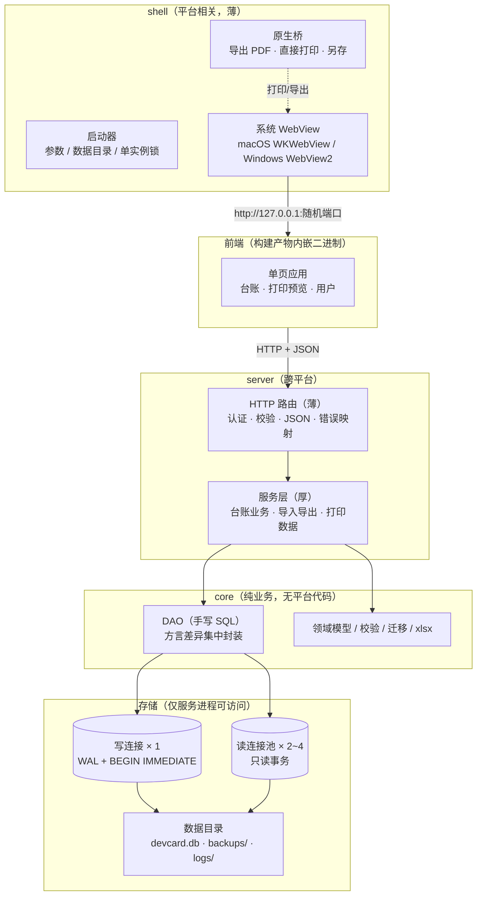

# DevCard 改造技术方案（去 Qt · B/S 内核 · 双平台）

> 文档性质：**决策文档**。回答「做不做、选哪条路、代价多大」，包含备选方案与取舍，需要评审拍板。
> 输入依据：[docs/现状技术方案.md](现状技术方案.md)（提交 `b1104b1` 的代码通读）+ 同机参考实现 `/Users/lin/Projects/xiaotu-inventory`（0.9.0）。
> 本文不包含具体施工步骤；施工设计（模块内部接口、状态机、验收脚本）在拍板后另行编写。
> 编写日期：2026-11-14。**Win7/8 部分的事实均来自微软官方文档，见第 13 节与附录 A。**

---

## 0. 结论摘要

1. **可行，且参考实现已经验证过同一条路**：小兔进销存用「C++20 + cpp-httplib + SQLite + 系统 WebView + 内嵌前端」做到了 macOS `.dmg` 2.84 MiB、单可执行文件 4.3 MB、零自带框架。DevCard 的业务量级远小于进销存，架构可以直接复用，不需要引入新发明。
2. **体积与外观的收益是数量级的**：现状 `bin/` 111 MB、exe 21 MB（其中约 20 MB 是把字体编进 qrc 导致的）；目标 Windows 安装包 ≤ 10 MB、macOS `.dmg` ≤ 5 MB、主程序 5–8 MB。UI 改由浏览器渲染，不再受 Qt Widgets 的固定像素布局限制。
3. **Win7 / Win8(8.1) 在本方案下明确不支持**。不是 C++20 的问题，而是 WebView2 运行时：官方支持列表只有 Windows 10 1709+ / Windows 11 / Server 2016+；Win7/8/8.1 在 WebView2 Runtime 109（2023-01）之后停止支持，SDK ≥ 1.0.1519.0 也不再支持，Fixed 版 > 109 在 Win7 上无法启动。详见第 13 节。
4. **最低支持面（D1 / D7 已定）**：Windows 10 1809+ / Windows 11 / Windows Server 2016+；macOS 15+。Win7 存量客户保留现 Qt 版 v1.1.2 作为「冻结版」，不做安全更新，不并入新架构。D7 取 15 的依据与后果见 §0.1、§13.5。
5. **13 项决策全部已定**（D1–D13，见第 14 节）：不支持 Win7/8；打印双通道（导出 PDF + 直接打印，两条都 ≤ 1 mm 才删 libharu）；原生 JS/CSS + 两个通用件；单进程；导入保持现状允许重复；macOS 15+；DAO 集中 SQL + 方言 helper 不做接口；网络版先做最小可用；Argon2id + 强制改密 + 命令行恢复；深青视觉；macOS 只出 DMG；Windows 安装版 + 绿色版；macOS 暂不公证，继续 ad-hoc 签名。

### 0.1 当前实际状态（2026-11-14，v1.1.3 已发布）

> 本节记录仓库与已发布产物的真实状态，与第 1–13 节的「改造目标」是两条线：**v1.1.3 仍是 Qt 6 版，不是本方案改造后的 B/S 版本。**

- **发布状态（v1.1.3）**
  - macOS：`DevCard-1.1.3-macos-arm64.dmg` 已挂到 Gitee 与 GitHub 两个 Release；体积 70,296,316 B（67 MiB），SHA256 `a4aac2045131bc43aa68c78d2f8856b095f4493a52a06515c175651f28446946`。最低 macOS 15（Apple Silicon），ad-hoc 签名、未公证。
  - Windows：绿色版 `DevCard-1.1.3-portable.zip` **尚未产出**；打包脚本 `tools/package/make_portable_win.ps1` 已就绪，但未在 Windows 机器上实跑过。旧 Qt 线本身没有 `.iss`；安装器属新架构 Windows 线（`packaging/windows/DevCard.iss`），已编译并完成 `/VERYSILENT` 安装/卸载实测，见 §10.5。
- **P0 已落地（Qt 线）**
  - 数据目录迁到 `%LOCALAPPDATA%\Anye\DevCard`；存在 `portable.mode` 时改走 `<exe>\data`。macOS 为 `~/Library/Application Support/Anye/DevCard/`。
  - 迁移顺序是「复制 → integrity_check → 改名切换」，失败明确报错并退出，不建空库；旧库保留。
  - `build.bat` 已补 `resources/` 拷贝、构建前旧库备份、打包前删除 `tb_device.xlsx`。
- **macOS 构建支持（Qt 线）**
  - 新增 `appResourcePath()`：Windows 仍取 `<exe>/resources`，macOS 回退 `Contents/Resources/resources`。
  - `.pro` 增加 `macx` 分支：Homebrew 头库路径、`QMAKE_INFO_PLIST`、`ICON`、字体/图标进 bundle。
  - 新增 `packaging/mac/Info.plist` 与 `packaging/mac/DevCard.icns`。
  - DMG 生成：qmake 出 `.app` → `macdeployqt` 收依赖（删掉用不到的 QtPdf/QtSvg/VirtualKeyboard 插件）→ `codesign --force --deep -s -` → `hdiutil create -format UDZO`。
- **tag `v1.1.3`**：当前指向 `bf3e2b4`。曾从 `8b61937` 强制移动到该提交，原因是 `8b61937` 不含 macOS 打包改动，而 DMG 正是由这批改动产出；代价是 tag 被重写，已经 fetch 过旧 tag 的协作者需要 `git fetch --tags --force`。移动时尚未创建 Release，现在两个 Release 都以新 tag 为准。
- **D7 = macOS 15（2026-11-14 定案）**：依据是 v1.1.3 的 Qt 版 DMG 所链接的 Homebrew `libharu` / `libzip` / `libxlsxwriter` 均按 15.0 构建；改造后若继续引入同类三方库，同样以 15 为基线。后果：macOS 13/14 装不上；此前从未发布过 macOS 版，存量客户都是 Windows，不影响已有客户。
- **D13 = 暂不公证（2026-11-14 定案）**：继续 ad-hoc 签名，以 `codesign --verify --deep --strict` 通过为准；不购买 Apple Developer Program，不接公证流程。后果是客户首次打开会被 Gatekeeper 拦，需要在「系统设置 → 隐私与安全性」放行或右键「打开」，该说明已写入客户可见的 Release 正文。改造后若更换壳或签名方式，此口径重新评估；将来加公证需在构建流水线补「Developer ID 签名 → notarytool 提交 → stapler 装订」三步。
- **新架构进度（分支 `macmini/new-arch`）**：M0 骨架、M1 台账、M2 导入导出、M3 迁移与用户、M4 打印版式与双通道已落地并通过 macOS 实测（G2 实物叠图除外）；M4.1 公司名/图标/更新时间、M4.2 底部状态栏已落地；M5 第一段已落地（`/api/version` + 「有新版本」提示 + `tools/package/make_dmg.sh` 一条命令出 DMG）；**M5 第二段（Windows 壳）已编译，`/VERYSILENT` 安装与卸载实测通过**，向导页 / 实物打印 / SmartScreen 等待补（见 §10.9）；M6 的**检查 + 告知已交付**（只查、只告知、给发布页）；自更新已拍板扩为「下载 + 校验 + 替换 + 重启」分三阶段，**阶段一已完成（`a4cda3a` 下载与双校验、`6f425fd` 服务端闸门与状态码表），阶段二、三未动**（见 §10.4.2、§11、§12.1 R13）。旧 Qt 线（`src/`、`dev_card.pro`、`build.bat`）保持冻结，仍可编译与发版。
- **版本口径**：新架构开发期版本为 `0.x`（仅内部，不对外发布）；正式对外版本为 **1.2.0**，单一来源 `VERSION.txt`（server 版本串、Windows 版本资源、macOS bundle 版本都从它读取）。Qt 旧线仍由 `dev_card.pro` / `project(... VERSION 1.1.3)` 决定，两条线互不影响；发版时只改 `VERSION.txt`。

---

## 1. 目标与非目标

### 1.1 目标

| 维度 | 目标 | 衡量方式 |
|---|---|---|
| 平台 | macOS 与 Windows 双系统，同一套 C++20 代码 | 两平台各自可构建、可出包、冒烟通过 |
| 形态 | 单机版与网络版同一个二进制；单机版表面是桌面窗口，内核是本地 HTTP 服务（B/S） | 不带参数 = 本地窗口（已实现）；`--server` = 浏览器/局域网访问（M7，未实现；当前浏览器访问需直接运行 `devcard-server`） |
| 体积 | Windows 安装包 ≤ 10 MB，macOS dmg ≤ 5 MB，主程序 ≤ 8 MB | 出包实测，记录在验收清单 |
| 性能 | 本地模式冷启动到首屏 < 1 s；1 万条设备记录列表查询 < 50 ms（分页 200/页）；导入 5000 行 xlsx < 3 s | 基准脚本可复现 |
| 外观 | 重新设计的现代界面，替换 Qt 固定坐标布局；支持 125%/150% 缩放与深浅色 | 设计走查 + 真机截图 |
| 图标 | 全新应用图标（macOS `.icns` + Windows `.ico` + Web favicon） | 16/32/48/128/256/512/1024 逐档可辨 |
| 数据 | 现有 `tb_device`、`tb_user` 两张表的数据与语义无损迁移 | 迁移前后行数、抽样字段逐条比对 |
| 工程 | 去掉 Qt、libharu、libzip、libxlsxwriter；依赖全部内嵌；前端产物内嵌二进制 | 发布包中无独立资源目录、无 Qt DLL |
| 可维护 | DAO 层集中 SQL；schema 版本化迁移；错误码稳定；有单测与 CI | 代码走查 + CI 门禁 |

### 1.2 非目标（本期明确不做）

- **不支持 Windows 7 / 8 / 8.1**（D1 已定，结论见第 13 节）；存量 Win7 客户保留现 Qt 版 v1.1.2 作为冻结版，不更新、不并入新架构。
- 不做移动端、不做多租户、不做云端同步。
- 不改业务语义：筛选逻辑、去重规则、导入截断、卡片版式仍以现状为基准，只修 bug，不顺手改规则。
- 不做多数据库后端（MySQL/PostgreSQL）；只在 DAO 层留出方言缝，不实现第二套方言。
- 不做完整 RBAC：保留「管理员 + 普通用户」两级，不引入权限点体系（现状只有登录校验，够用）。
- **自动更新分段交付**：M5 只做「版本检查接口 + 有新版本提示 + 跳下载页」；M6 已交付「远端检查 + 告知」（只查只告知，`285738a`，CSP 修法与断言见 `04be963`）。2026-11-14 用户拍板扩为「下载 + 校验 + 替换 + 重启」，分三阶段推进；**阶段一（下载与校验）已完成（`a4cda3a` + 服务端闸门 `6f425fd`）**，阶段二（Windows 替换与重启）、阶段三（macOS 评估）未动。见 §10.4.2、§11 阶段表与 §12.1 R13。
- 签名按 D13：ad-hoc 签名 + `codesign --verify --deep --strict` 通过；不买开发者账号、不做公证。首次打开需 Gatekeeper 手动放行，客户说明随 Release 发布。

---

## 2. 现状与改造的对应关系

| 现状模块（Qt） | 改造后归属 | 处理方式 |
|---|---|---|
| `src/ui/ui_*.h`（手写 uic 风格表单） | 删除 | 由 `web/` 页面取代，Qt 几何坐标不再保留 |
| `src/ui/login_window.* / main_window.* / user_window.*` | `web/` + `server/routes/` | 业务逻辑迁到服务层，界面重写 |
| `src/app_info.h` 全局量 | `core` 的 `Session`/`Settings` | 去掉可变全局 |
| `src/db/database.*`（每次开连接、全文本绑定、假事务） | `core/dao/` + `core/db.*` | 单写连接 + 读池、WAL、真事务、类型化绑定 |
| `src/db/initializer.*` | `core/migrations/` | 改为版本化迁移 + 种子数据 |
| `src/excel/excel_handler.*`（libzip + libxlsxwriter） | `core/io/xlsx_*`（miniz） | 自研 xlsx 读写，去掉两个动态库 |
| `src/printer/card_printer.*`（libharu） | `web/` 打印页 + 壳层双通道（导出 PDF / 直接打印） | D2 已定：两通道均达标才删除 libharu；任一不达标则该通道不上线 |
| `resources/fonts`（20 MB）、`resources.qrc` | `web/assets`（子集 woff2）或系统字体 | 字体不再整体入库，按需子集化 |
| `dev_card.pro`、`build.bat`、`Makefile*` | `CMakeLists.txt` + Presets + 打包脚本 | 只保留 CMake；删除 qmake 体系 |
| `DevCard_resource.rc` | `cmake` 生成 `version.rc`（模板） | 版本号单一来源 |
| `bin/`、`build/`、`debug/`、`release/` | 全部 gitignore，构建目录 `build/<preset>/` | 不再就地构建 |

---

## 3. 目标架构

### 3.1 总览：B/S 内核 + C/S 外观



一句话：**UI 是网页，服务是本地进程，数据库只归服务进程所有**。桌面窗口只是把浏览器内容装进系统 WebView，不承载业务逻辑。

### 3.2 分层与依赖规则（硬约束）

| 层 | 职责 | 允许依赖 | 禁止 |
|---|---|---|---|
| `shell` | 进程启动、模式判定、数据目录、WebView 创建、原生打印/另存、单实例 | `server`、`core`、平台 SDK | 业务规则、SQL |
| `server` | 路由、会话、鉴权、参数校验、事务编排、序列化 | `core` | 平台 API、在路由里写业务规则 |
| `core` | 领域模型、校验、DAO、迁移、xlsx、错误码 | 标准库、第三方通用库 | 平台头文件、`windows.h`/`Cocoa` |
| `web` | 交互、表单校验、展示、打印视图 | 仅 HTTP API + 壳桥 | 直连数据库、读本地文件 |

三条检查（可写成 CI 脚本）：

1. `core/**` 不得出现 `#ifdef _WIN32` / `__APPLE__` / 平台头文件。
2. `server` 不得 `#include` shell 的头；依赖方向单向 `shell → server → core`。
3. 发布构建中 `web/` 必须以嵌入资源进入二进制，产物目录不允许出现独立 `web/` 或 `resources/`。

### 3.3 进程模型（D4 已定：单进程）

| 选项 | 形态 | 优点 | 缺点 | 结论 |
|---|---|---|---|---|
| **A. 单进程** | 主程序内：UI 线程跑 WebView，后台线程跑 HTTP 服务 | 一个二进制、无 IPC、启动快、打包最简单 | 服务崩溃连 UI 一起挂；WebView2 的 COM/消息循环与 HTTP 线程需严格隔离 | **已定**（DevCard 单用户、数据量小，收益大于隔离需求） |
| B. 双进程 | 壳 exe + `devcard-server.exe`，壳解析子进程 stdout 取地址 | 崩溃隔离；网络版与桌面版同款服务端 | 多一个 exe、要管子进程生命周期与孤儿进程（参考实现用 Job Object） | 不采用；若将来要常驻托盘或服务化，另行立项 |

参考实现：macOS 是单进程（壳直接链接 server），Windows 是双进程（壳拉起 `xiaotu-server.exe`）。本项目建议**两平台统一单进程**，降低两套启动逻辑的维护成本。

### 3.4 前端加载方式

- **发布态**：`web/` 下全部静态文件由 CMake 自定义命令转成 C++ 字节数组（参考 `cmake/embed_resources.cmake`），编进二进制；HTTP 服务从内存返回，配 `ETag`、`Cache-Control: no-cache`（HTML）/ 长缓存（带 hash 的资源名）。**发布包不落盘任何前端文件**。
- **开发态**：`-DDEVCARD_DEV_WEB=ON` 时不嵌入，服务返回 302 到 Vite/静态 dev server，或直接以 `--web-dir <path>` 读磁盘；改前端刷新即见。
- **禁止**：让用户直接打开本地 `index.html`（`file://` 下鉴权、CORS、相对路径全部失效）。

### 3.5 单机版与网络版的差异

| 维度 | 单机版（无参数） | 网络版（`--server`） |
|---|---|---|
| 监听 | `127.0.0.1:0`（系统分配端口） | `0.0.0.0:8080`（可配 `--listen/--port`） |
| 客户端 | 内嵌 WebView 打开 `http://127.0.0.1:P/#t=<一次性token>` | 局域网浏览器 |
| 认证 | 一次性 token 换 HttpOnly 会话 Cookie；token 60 秒有效、用后即废 | 用户名 + 密码，Argon2id 校验，失败锁定 |
| 用户 | 默认单管理员；保留用户管理但可隐藏 | 多用户 |
| 数据 | `<AppData>/DevCard/` | `--data` 指定目录 |
| 打印 | 双通道：导出 PDF（PrintToPdf / createPDF）+ 系统打印对话框直接打印 | 浏览器打印 / 另存为 PDF（两通道同源打印 DOM） |
| 关闭 | 关窗即退（服务线程随之停止） | 常驻，Ctrl+C / 信号优雅退出 |
| 并发 | 1 个前端（多标签页也走同一会话） | 目标 5–20 并发（物业内网量级） |

差别只有「谁在监听」和「第一个会话怎么拿」；`/api/*` 之后完全一致。

网络版范围（D9 已定，最小可用）：登录 + 与单机版同一套 API + 部署文档；TLS 由外部反代（nginx/自签证书）提供；不做自动更新、多租户、用户自助注册、审计报表。

### 3.6 本地模式启动时序

```text
双击 App
  → 解析参数（无 --server）→ 定位数据目录（macOS: ~/Library/Application Support/com.anyewuye.devcard/
                                          Windows: %LOCALAPPDATA%\Anye\DevCard\）
  → 单实例锁（macOS: flock/LSMultipleInstancesProhibited；Windows: Local\ 命名互斥体）
  → 打开数据库 → 迁移（含首次建库）→ 启动 HTTP（127.0.0.1:0）
  → 生成一次性 token（32 字节随机，60 秒）
  → 创建 WebView，加载 http://127.0.0.1:P/#t=T
  → 前端 POST /api/session/local {token} → 换 HttpOnly Cookie → history.replaceState 清掉 token
  → GET /api/bootstrap（用户、版本、是否首次运行）→ 渲染
```

---

## 4. 模块划分

### 4.1 目标目录

```text
dev_card_cpp/
├── VERSION.txt                   # 版本唯一来源（不叫 VERSION：Windows 大小写不敏感，qmake 的 -I. 会把 <version> 解析到它）
├── CMakeLists.txt                # 顶层：target 划分、C++20、/utf-8、静态 CRT
├── CMakePresets.json             # macos-release / macos-dev / windows-release / linux-ci
├── cmake/
│   ├── embed_resources.cmake     # web/ → C++ 字节数组
│   └── version.rc.in             # Windows 版本信息模板
├── core/                         # 纯 C++20，无平台代码
│   ├── include/devcard/
│   │   ├── db.h  error.h  models.h  ids.h
│   │   ├── dao/{device_dao.h,user_dao.h,meta_dao.h,dialect.h}
│   │   ├── service/{device_service.h,user_service.h,session_service.h}
│   │   ├── migrations.h
│   │   ├── io/{xlsx_reader.h,xlsx_writer.h}
│   │   └── platform_paths.h      # 只声明，实现在 server/shell
│   └── src/...
├── server/                       # HTTP 层 + 可执行入口
│   ├── include/devcard/{http_server.h,http_json.h,session_store.h,config.h,routes/*.h}
│   └── src/{main.cpp,http_server.cpp,session_store.cpp,routes/*.cpp}
├── shell/                        # 平台壳
│   ├── mac/{webview.mm,Info.plist,icon/*.icns}
│   └── win/{main.cpp,CMakeLists.txt,app.manifest,fetch-webview2.ps1}  # SDK 由脚本下载，不入库
├── web/                          # 前端源码（发布时内嵌）
│   ├── index.html  app.js  api.js  store.js  styles.css
│   ├── ui/{table.js,modal.js}    # 仅两个通用件（D3）
│   ├── pages/{devices.js,print.js,users.js,settings.js}
│   └── icons/*.svg
├── tests/                        # ctest：dao/migrations/xlsx/http
├── third_party/                  # sqlite, httplib, nlohmann, miniz, argon2
├── tools/{package,icons}         # make_dmg.sh / Inno Setup / make_icons
└── docs/
```

### 4.2 `core` 内部模块

| 模块 | 内容 | 不做什么 |
|---|---|---|
| `db` | `Db`（单写连接 + 读池、WAL、`busy_timeout`、`BEGIN IMMEDIATE`）、`Stmt`（RAII 绑定/取值）、`exec_sql` | 不含业务语义 |
| `dao` | 每张表一个 DAO，方法接收/返回领域结构体；所有 SQL 只出现在这里 | 不做事务编排（由 service 决定） |
| `service` | 设备增删改查、去重、导入导出编排、用户与密码、会话 | 不碰 HTTP、不碰文件对话框 |
| `migrations` | 版本化 SQL 数组 + checksum 校验 + 迁移前备份 | 不执行数据导入（另走一次性命令） |
| `io` | xlsx 读（sharedStrings + sheet XML）、xlsx 写（miniz deflate） | 不依赖业务 DAO，只做行数据 ↔ 单元格 |
| `models` | `Device`、`User`、`Session`、`Result`/`Error` | 不放 UI 文案（文案在 web） |

### 4.3 `server`

- `http_server`：绑定/端口（0 = 系统分配）、路由注册、静态资源、优雅退出。
- `session_store`：内存会话（token 哈希、过期、空闲超时），本地模式一次性 token。
- `routes/*`：认证、参数解析、调用 service、JSON 序列化、错误码映射。路由函数不超过 ~30 行。
- `config`：命令行 > 环境变量 > `config.toml` > 默认；未知键报错（参考实现的做法）。

### 4.4 `shell`

- macOS：`WKWebView` + `NSWindow`，两条打印通道都由壳层提供：
  - **导出 PDF**：`createPDFWithConfiguration:`（macOS 11+）拿到 `Data`，用 `NSSavePanel` 落盘；
  - **直接打印**：`printOperation(with: NSPrintInfo)`（macOS 11+）取 `NSPrintOperation`，配置 A4、边距与缩放后 `runOperationModal` 弹系统打印面板，用户确认即出纸；
  - 代价：需 AppKit 打印面板与 `NSPrintInfo` 参数调试；只做「弹窗确认」，不做静默打印；底色/分隔线必须配 `-webkit-print-color-adjust: exact` 才不会被丢掉。
- Windows：Win32 窗口 + WebView2，同样两条通道（**已编译、静默安装与启动跑通；打印/导出桥的实物验收未做**，见 §10.9）：
  - **导出 PDF**：C++ SDK 的实际接口是 `ICoreWebView2_7::PrintToPdf(path, settings, handler)`（对应 .NET 的 `PrintToPdfAsync`），落盘对话框由壳用 `IFileSaveDialog` 提供；`PrintToPdfStream` 属 `ICoreWebView2_16`，当前未用；
  - **直接打印**：`ICoreWebView2_16::ShowPrintUI(COREWEBVIEW2_PRINT_DIALOG_KIND_SYSTEM)` 弹系统打印对话框（Chromium 打印管线），确认后出纸；
  - 分页口径与 macOS 不同：Windows 这本走 **`@page` + `@media print`**（Chromium 打印管线自己分页），macOS 那本走逐页截取后 CoreGraphics 组装；两边都必须命中「17 条 → 2 页、每页 12 张」才算通过。
  - 代价：WebView2 SDK 需锁定 ≥ 1.0.1518（低于该版本没有 `ICoreWebView2_16`）；只有带对话框打印，无静默打印；分页完全由 `@page` 与固定 mm 容器决定，驱动/纸张设置会放大误差。
- 共同点：不解析 JSON、不做业务判断，只做「窗口 + 导出 PDF + 直接打印 + 文件对话框 + 数据目录」；两条通道接收同一个壳桥消息 `{action:"exportPdf"|"print"}`，渲染源是同一份打印 DOM。

### 4.5 `web`

- 已定（D3）：原生 ES Module + CSS，**不引入框架**，也不把所有逻辑堆进单个 `app.js`。页面按路由拆 4 个入口，公共件只保留两个：
  - `ui/table.js`：列定义、排序、分页、行操作、空状态；
  - `ui/modal.js`：表单抽屉、字段校验、未保存拦截。
- 构建只做「按页面拼接 + 可选压缩」，不依赖 Node 工具链也能跑。
- 无状态组件优先；全局状态只有一个 `store`（当前用户、筛选条件、分页）。
- 所有网络请求走 `api.js`：统一错误码 → toast、401 → 回登录页、超时提示。

---

## 5. DAO 层设计

### 5.1 连接与事务模型

```cpp
// core/include/devcard/db.h（示意，非最终接口）
class Db {
 public:
  explicit Db(std::filesystem::path file, int read_conns = 2);
  void write(const std::function<void(sqlite3*)>& fn);   // BEGIN IMMEDIATE ... COMMIT/ROLLBACK
  void read(const std::function<void(sqlite3*)>& fn) const; // 只读事务，从池取连接
  std::int64_t schema_version() const;
};
```

- **单写连接 + 互斥**：本项目并发极低，单写连接把「先查重再插入」「先读余额再改」变成天然串行，不需要应用层锁。
- **读连接池 2~4 个**：列表查询与导出可以并行，不与写互相阻塞（WAL 下读写不互斥）。
- 每个连接启动时统一设置：`journal_mode=WAL`、`busy_timeout=5000`、`foreign_keys=ON`、`synchronous=NORMAL`。
- 事务只允许在 service 层开启；DAO 的连接级方法（`insert(conn, row)`）要求在已有事务内调用（参考实现的 `static insert(sqlite3*, ...)` 模式）。
- 失败抛 `AppError{code, message}`，由路由统一映射为 HTTP 状态码；禁止「返回 0 表示失败」的旧风格。

### 5.2 DAO 接口

| DAO | 方法（示意） |
|---|---|
| `DeviceDao` | `list(DeviceQuery)`、`find(id)`、`count(DeviceQuery)`、`insert(conn, Device&)`、`update(conn, Device)`、`erase(conn, id)`、`erase_all(conn)`、`dedupe(conn)`、`distinct_names()`、`distinct_locations()`、`all_for_export(DeviceQuery)` |
| `UserDao` | `list()`、`find_by_name()`、`insert()`、`update_password()`、`erase()`、`count_admins()` |
| `MetaDao` | `schema_version()`、`get_setting(key)`、`set_setting(key,value)`、`audit(...)`（可选） |

`DeviceQuery` 用结构体而不是「拼 SQL 字符串」：

```cpp
struct DeviceQuery {
  std::string keyword;      // 模糊查询
  std::string field;        // dev_name/location/control_range/phone，空 = 全字段
  std::string name;         // 下拉筛选，空 = 全部
  std::string location;
  int page = 0;             // 0 基
  int page_size = 200;      // 上限 1000
  std::string sort;         // "dev_id" | "dev_name" | "location"
  bool desc = false;
};
```

### 5.3 方言差异集中封装

用户要求「把 SQL 方言差异集中封装」。**先把结论说清楚：本期只有 SQLite，完整 dialect 抽象属于过度设计**。建议做法是「一个 `Dialect` 结构 + 少量 helper」，覆盖真正会变的语法点，不做 ORM、不做 SQL 生成器：

| 差异点 | SQLite 现状写法 | `Dialect` 对外形态 | 换后端时才需要变 |
|---|---|---|---|
| 自增主键 | `INTEGER PRIMARY KEY AUTOINCREMENT` | `ddl::pk_auto()` | `SERIAL` / `IDENTITY` |
| 布尔 | `INTEGER` + `CHECK(x IN (0,1))` | `ddl::boolean()` | `BOOLEAN` |
| Upsert | `INSERT ... ON CONFLICT(...) DO UPDATE SET ...` | `sql::upsert(table, keys, cols)` | `MERGE` / `ON DUPLICATE KEY` |
| 时间 | `TEXT` ISO-8601（`YYYY-MM-DD HH:MM:SS`） | `sql::now_expr()` | `NOW()` / `CURRENT_TIMESTAMP` |
| 分页 | `LIMIT ? OFFSET ?` | `sql::limit_offset()` | `OFFSET ... FETCH` |
| 标识符引用 | `"col"` | `sql::quote_ident()` | 反引号 / 方括号 |
| 大小写 | `LIKE` 对 ASCII 不敏感、对中文按字节 | `sql::like()`（必要时 `COLLATE NOCASE`） | `ILIKE` |
| 自增回填 | `sqlite3_last_insert_rowid` | `dao` 内部 | `RETURNING` / `LAST_INSERT_ID` |
| 事务开始 | `BEGIN IMMEDIATE` | `db.write()` 内部 | `BEGIN` + 行锁 |

规则：

1. **SQL 文本只允许出现在 `core/src/dao/` 与 `core/src/migrations/`**；`grep -rn "SELECT\|INSERT\|UPDATE\|DELETE" core/src --exclude-dir=dao --exclude-dir=migrations` 必须为空（CI 检查）。
2. 方言 helper 只封装「换库会变」的部分；普通 `WHERE`、`JOIN`、`GROUP BY` 直接写，不为了抽象而抽象。
3. 已定（D8）：**不做接口化 `Dialect`**。只有 SQLite 一个后端，方言 helper 以 `dialect.h` 的常量与 `inline` 函数实现；将来真的接入第二后端，再按上表逐项补实现。

### 5.4 错误模型

```text
code        稳定字符串，前端据此分支，不解析 message
  BAD_ARGUMENT / NOT_FOUND / CONFLICT / LOCKED /
  AUTH_REQUIRED / AUTH_FAILED / FORBIDDEN /
  DB_ERROR / IO_ERROR / IMPORT_FAILED / PRINT_FAILED / INTERNAL
message     中文，给用户看
details     可选对象（字段名、行号、冲突 id）
```

HTTP 映射：`BAD_ARGUMENT→400`、`AUTH_*→401/403`、`NOT_FOUND→404`、`CONFLICT→409`、`LOCKED→423`、`IMPORT_FAILED→422`、其余 `500`。响应体固定 `{ "error": { "code", "message", "details" } }`。

### 5.5 查询与分页策略

- 列表默认 `page_size=200`，前端「加载更多」或分页器；导出走 `all_for_export`（服务端流式写 xlsx，不受分页限制）。
- 索引：`device(dev_name)`、`device(location)`、`device(dev_id)`（主键已有）；模糊查询 `%kw%` 无法走索引，1 万行内可接受；超过 10 万行再考虑 FTS5（列为后续议题）。
- 下拉选项用 `SELECT DISTINCT ... ORDER BY`，单独接口缓存 30 秒。

---

## 6. 数据模型与迁移

### 6.1 新 schema（v1）

```sql
CREATE TABLE device (
  id            INTEGER PRIMARY KEY AUTOINCREMENT,
  dev_name      TEXT    NOT NULL,
  location      TEXT    NOT NULL,
  control_range TEXT    NOT NULL,
  phone         TEXT    NOT NULL DEFAULT '',
  created_at    TEXT    NOT NULL,
  updated_at    TEXT    NOT NULL,
  CHECK (length(dev_name)    BETWEEN 1 AND 20),
  CHECK (length(location)    BETWEEN 1 AND 20),
  CHECK (length(control_range) BETWEEN 1 AND 20),
  CHECK (length(phone)       <= 20)
);
CREATE INDEX idx_device_name     ON device(dev_name);
CREATE INDEX idx_device_location ON device(location);
-- D5 已定：保持现状允许重复导入，因此不建唯一约束；三字段查重只在「手工新增」路径做（同现状 add()）
CREATE INDEX idx_device_triplet  ON device(dev_name, location, control_range);

CREATE TABLE app_user (
  user_name            TEXT PRIMARY KEY,
  password_hash        TEXT NOT NULL,     -- Argon2id
  display_name         TEXT NOT NULL DEFAULT '',
  role                 TEXT NOT NULL DEFAULT 'admin',  -- admin | user
  must_change_password INTEGER NOT NULL DEFAULT 0,
  failed_count         INTEGER NOT NULL DEFAULT 0,
  locked_until         TEXT,
  created_at           TEXT NOT NULL,
  updated_at           TEXT NOT NULL,
  CHECK (role IN ('admin','user'))
);

CREATE TABLE app_setting (
  key   TEXT PRIMARY KEY,
  value TEXT NOT NULL
);

CREATE TABLE schema_migration (
  version    INTEGER PRIMARY KEY,
  name       TEXT NOT NULL,
  checksum   TEXT NOT NULL,
  applied_at TEXT NOT NULL
);
```

变化点与理由：

- 字段宽度从「表声明 20 / 代码截断 10、11」统一为 ≤20 的 CHECK，**截断规则仍在导入层**（保持现状行为：导入按 10/10/10/11 截断），避免迁移后同一份 Excel 导入结果不同。
- 不建唯一约束（D5 已定：导入保持现状，允许重复）。手工「新增设备」仍按三字段（名称 + 位置 + 控制范围）查重并提示已存在；导入路径不做去重、不跳过、不合并，同一份文件导入两次就是对同一批数据追加两遍，具体验收口径见 §11 M2。
- 密码从明文改为 Argon2id（D6）；默认账号**不再自动重建**（现状每次启动 `INSERT OR IGNORE` 会把删掉的 root 复活）；忘记密码时走本机命令行 `--set-password <user>` 重置，不保留任何后门账号。
- 时间字段为 `TEXT` ISO-8601，排序与展示都简单；不引入时区库。

### 6.2 旧表 → 新表映射

| 旧 `tb_device` | 新 `device` | 规则 |
|---|---|---|
| `dev_id` INTEGER PK AUTOINCREMENT | `id` | 原值保留；若与目标库冲突则顺延并记录映射 |
| `dev_name` VARCHAR(20) | `dev_name` TEXT NOT NULL | NULL → ''，trim；超 20 → 截断并计入告警 |
| `location` | `location` | 同上 |
| `control_range` | `control_range` | 同上 |
| `phone` | `phone` | 保留原字符（不强制转数字；只有导出时按现状「仅数字」处理） |
| — | `created_at` / `updated_at` | 迁移时刻填充（无法得知原创建时间，标记为迁移时间） |

| 旧 `tb_user` | 新 `app_user` | 规则 |
|---|---|---|
| `userName` VARCHAR(20) PK | `user_name` | 原值保留 |
| `userPwd` VARCHAR(20) 明文 | `password_hash` | 迁移时用 Argon2id 哈希；**不保留明文** |
| — | `role` | `root` → admin，其余 → user（可配） |
| — | `must_change_password` | 默认账号与长度 < 6 的密码置 1，首次登录强制改 |
| — | `failed_count/locked_until` | 初始 0 / NULL |

**注意**：旧库是明文密码，迁移过程会把明文读进内存并哈希；迁移完成后旧库文件**不删除**，改名 `devicedb.db.migrated-<时间戳>` 留在同目录，由用户自行决定是否销毁（默认提示「建议删除」，不自动删）。

### 6.3 迁移机制

- 迁移 = `struct Migration { int version; const char* name; const char* sql; }` 的静态数组，按版本升序执行。
- 启动时：读 `schema_migration` → 校验已应用版本的 checksum（sha256）→ 不一致直接拒绝启动（防止有人手改 SQL 导致新旧库结构不一致）→ 依次在事务里执行未应用项。
- 迁移前自动备份：`backups/devcard-<version>-<时间戳>.db`（`VACUUM INTO` 或文件拷贝，保留最近 N 份）。
- 迁移不可回滚（SQLite DDL 事务有限）；出问题用备份恢复，恢复入口做在「设置 → 数据维护」与命令行 `--restore`。
- 新库首次启动直接建到最新版本，并写入种子管理员（D6）：首次启动时由用户设置密码，或生成一次性随机密码并强制改密；**不再硬编码默认弱密码**。
- 密码恢复通道（D6）：`--set-password <user>` 直接改 `password_hash`、清 `failed_count/locked_until`，并置 `must_change_password=1`。只允许在本机对本机数据目录执行，不暴露为 HTTP 接口，也不提供万能密码。

### 6.4 旧库一次性导入

不是 schema 迁移，而是数据搬迁，单独一条链路：

```text
--import-legacy <path>            显式导入并退出
或不带参数首次启动时自动探测：
  <新数据目录>/legacy/devicedb.db
  程序目录/devicedb.db（旧版安装目录）
  %LOCALAPPDATA%\... 旧路径（如已知）
```

规则：

1. 只读打开旧库（`mode=ro`），检查表存在与列名，不假设 schema。
2. 在目标库一个事务里导入 `tb_device`（保留 id）与 `tb_user`（哈希密码）；重复执行时按 `dev_id`/`user_name` 幂等跳过。
3. 导入结果写报告：总行数、成功、跳过（重复）、告警（超长截断、空字段、非法 id），前端展示可复制的报告；不静默丢数据。
4. 导入完成后在 `app_setting` 写 `legacy_imported_from` 与时间，避免重复提示。

**M3 实现口径（2026-11-14 实测）**：

- 备份先于读取：主库与非空 `-wal` 一起复制，SHA256 与 `PRAGMA integrity_check` 双校验，并核对两表行数；之后只从备份读数据，源库不再打开。
- 旧库导入成功后改名 `devicedb.db.migrated-<时间戳>`（`-wal/-shm` 一并改名），不删除、不覆盖。
- 全新库（无旧库导入）生成 `root`（admin）与 `安业物业`（user）两个随机密码账号，一次性密码写入 `<data_dir>/初始账号密码.txt`（权限 0600），全部账号改密后自动删除。
- 本地壳自动登录：页面注入进程级 token → `POST /api/session/local`；会话 12 小时，账号仍要求密码校验。网络模式仍走 `POST /api/session/login`。
- 5 次失败锁 15 分钟；`--set-password <user>` 重置后置 `must_change_password=1`。
- 备份用 `VACUUM INTO` 生成一致性快照；恢复前自动生成 `pre-restore` 备份，恢复只替换 `device` / `app_user` / `app_setting` 三表并清空所有会话。

### 6.5 回滚路径

- 新版本首次启动前自动备份；`--restore <file>` 覆盖当前库并重启。
- 旧 Qt 版程序与旧库文件保持可用（冻结版），新程序不修改旧库（只读导入）。
- 数据目录与程序目录分离后，卸载程序不删数据目录（安装器显式询问）。

---

## 7. API 设计

### 7.1 约定

- 全部 `application/json; charset=utf-8`；文件上传用 `multipart/form-data`；导出返回 `application/vnd.openxmlformats-officedocument.spreadsheetml.sheet` 流。
- 认证：`sid` HttpOnly + SameSite=Lax Cookie；写请求要求 `X-Requested-With: DevCard` 作为 CSRF 兜底。
- 分页响应：`{ "items": [...], "total": 1234, "page": 0, "page_size": 200 }`。
- 幂等：`POST /api/devices` 支持 `X-Request-Id`，重复提交返回同一条（可选，优先级低）。

### 7.2 端点清单

| 方法 | 路径 | 说明 |
|---|---|---|
| GET | `/api/health` | 免认证；版本、schema 版本、模式（local/server） |
| POST | `/api/session/local` | `{token}` → 本地会话 |
| POST | `/api/session/login` | `{username,password}` → 会话 |
| POST | `/api/session/logout` | 销毁会话 |
| GET | `/api/bootstrap` | 当前用户、版本、首次运行、数据目录告警 |
| GET | `/api/devices` | 查询：`q/field/name/location/page/page_size/sort` |
| GET | `/api/devices/{id}` | 单条 |
| POST | `/api/devices` | 新增（三字段查重 → 409） |
| PUT | `/api/devices/{id}` | 修改 |
| DELETE | `/api/devices/{id}` | 删除 |
| POST | `/api/devices/bulk-delete` | 清空（要求 `{confirm:"DELETE_ALL"}`） |
| POST | `/api/devices/dedupe` | 合并重复（返回删除条数） |
| GET | `/api/options` | 名称/位置去重列表 |
| POST | `/api/devices/import` | 上传 xlsx → 返回导入报告 |
| GET | `/api/devices/export` | 按当前筛选导出 xlsx |
| GET | `/api/devices/template` | 下载导入模板（首个工作表仅表头，第二个工作表为填写说明） |
| GET | `/api/print/cards` | 打印用数据（JSON，前端排版；含生效公司名） |
| PUT | `/api/system/company` | 修改卡片公司名（admin，空值恢复默认） |
| POST/DELETE | `/api/system/company-logo` | 上传自定义图标 / 恢复默认图标（admin） |
| GET | `/company-logo` | 打印图标（自定义文件优先，缺失回落内嵌默认） |
| GET/POST/PUT/DELETE | `/api/users[/{name}]` | 用户维护（admin） |
| POST | `/api/users/{name}/password` | 改密码（自助 / 管理员重置） |
| POST | `/api/system/backup` | 立即备份 |
| GET | `/api/system/backups` | 备份列表 |
| POST | `/api/system/restore` | 恢复（维护态） |

### 7.3 认证与安全

- 本地模式：token 一次性、60 秒、绑定进程随机数；Cookie 仅 `127.0.0.1`；Host 头必须是 `127.0.0.1:<port>` 或 `localhost:<port>`（防 DNS rebinding）。
- 网络模式：Argon2id（`m=64MiB, t=3, p=1` 起步，实测调整）；连续 5 次失败锁定 15 分钟；密码 8–128 位；首次必须改默认密码。
- 密码恢复（D6）：只走本机命令行 `--set-password <user>`，重置后强制下次登录改密；不设「万能密码」或隐藏账号。两个默认账号（`root`、`安业物业`）迁移时一律置 `must_change_password=1`，登录后必须先改密才能进入业务页。
- 旧密码校验口径：**首次登录与管理员/命令行重置都不要求旧密码，只有用户主动改自己的密码才验旧密码**。是否免旧密码由服务端按会话账号的 `must_change_password` 判定，不依赖前端是否传 `old_password`；非强制状态下缺少旧密码直接返回 `old_password_required`。
- 响应头：`X-Content-Type-Options: nosniff`、`Referrer-Policy: no-referrer`、CSP（`default-src 'self'`，内嵌资源不需要 `unsafe-inline`；打印页允许 `style-src 'unsafe-inline'`）。
- 不开放 CORS；网络版建议由 nginx/自签证书提供 TLS，程序本身不内置 HTTPS（与参考实现一致）。

---

## 8. UI 重设计

### 8.1 参考小兔，学什么、不学什么

**学**：左侧固定侧栏 + 右侧内容区、`system-ui` 字体栈、表格 + 工具栏的密度、toast 通知、空状态、危险操作二次确认、键盘可达、深浅色用 CSS 变量。

**不学**：进销存的 9 大类菜单与多级导航、单据主子表、打印模板配置、权限点渲染。DevCard 只有「台账 / 打印 / 用户」三块，导航越少越好。

### 8.2 信息架构

```text
设备管理卡制作系统
├── 设备台账        默认页；查询、筛选、增删改、导入导出
├── 卡片打印        版式预览、选择范围、打印 / 导出 PDF
└── 系统
    ├── 用户管理     仅 admin
    ├── 数据维护     备份 / 恢复 / 旧库导入报告
    └── 关于         版本、版权、开源许可
```

### 8.3 布局

```text
┌────────────┬──────────────────────────────────────────────────────────┐
│  DevCard   │  设备台账                    [搜索框]  [导入] [导出] [打印] │
│            ├──────────────────────────────────────────────────────────┤
│ ▸ 设备台账 │  名称 [全部▾]  位置 [全部▾]  共 128 条        [ + 新增设备 ] │
│   卡片打印 │ ┌──────────────────────────────────────────────────────┐ │
│   系统     │ │ 编号 │ 设备名称 │ 位置 │ 控制范围 │ 维护电话 │ 操作   │ │
│            │ │  1   │ 消防…    │ 5栋2楼│ 1-5层    │ 138…     │ 编辑 删│ │
│            │ │ …    │          │      │          │          │        │ │
│            │ └──────────────────────────────────────────────────────┘ │
│  v1.2.0    │  ‹ 1 2 3 ›                                   200 条/页  │
└────────────┴──────────────────────────────────────────────────────────┘
```

- 侧栏 216 px，可折叠为 64 px；内容区最大宽度不限制，表格自适应。
- 新增/编辑用**右侧抽屉**（420 px）而不是常驻表单：列表可用面积从现状的 70% 提升到 ~100%，且不会出现「表单填了一半又去点表格」的状态错乱。
- 打印页是独立全屏视图（隐藏侧栏），A4 预览按容器宽度缩放，可切换「一页 12 张 / 一页 6 张 / 单张」，边距可调。
- 断点：≥1280 三栏（侧栏/列表/抽屉）；1024–1279 抽屉覆盖列表；<1024 提示窗口过窄（本产品不做手机端）。

### 8.4 视觉规范（D10 已定：深青）

| 项 | 值 |
|---|---|
| 主色 | `#0F766E`（深青，物业/设备场景稳重），hover `#0D9488` |
| 强调色 | `#F59E0B`（警示/维护），危险 `#DC2626` |
| 中性色 | 背景 `#F8FAFC` / 卡片 `#FFFFFF` / 边框 `#E2E8F0` / 主文字 `#0F172A` / 次文字 `#64748B` |
| 深色 | 背景 `#0B1220` / 卡片 `#111A2B` / 边框 `#1E293B` / 主文字 `#E2E8F0` |
| 字体 | `-apple-system, "PingFang SC", "Microsoft YaHei UI", "Segoe UI", system-ui, sans-serif`；数字用 `tabular-nums` |
| 字号 | 正文 14、表格 13、标题 20/16、辅助 12；行高 1.5 |
| 间距 | 4 的倍数：4/8/12/16/24/32 |
| 圆角 | 卡片 10、按钮 8、输入 8、标签 6 |
| 阴影 | `0 1px 2px rgba(15,23,42,.06), 0 8px 24px rgba(15,23,42,.06)`（仅浮层） |
| 动效 | 120–180 ms `ease-out`；尊重 `prefers-reduced-motion` |
| 图标 | 线性 1.5 px，20×20，`currentColor`；不引入图标字体 |

### 8.5 交互细节（逐条对应现状缺陷）

| 现状问题 | 新交互 |
|---|---|
| 增删改失败无提示（`db::exec` 返回 0 静默） | 所有写操作返回明确错误码 → toast + 表单字段标红 |
| 添加重名用户无反馈 | 409 + 「用户已存在」toast，输入框保留 |
| 导入「成功 N 条」不管实际插入结果 | 导入报告弹层：成功/跳过/告警三类计数 + 前 20 条明细 |
| 打印前顺带刷新界面、清空表单 | 打印页只读；返回列表保持原筛选与滚动位置 |
| 删除无二次确认 / 文案错字 | 危险操作统一确认框，按钮文案「删除」而非「确定」，显示影响条数 |
| 固定像素布局、字体未注册 | CSS 流式布局 + 系统字体栈；125%/150% 缩放下不重叠 |
| 表格无排序、无分页 | 列头排序、分页器、每页条数切换 |
| 下拉框名称/位置互相污染（共用 `existingName_`） | 两个独立选项源，接口分开返回 |
| 无键盘操作 | `Ctrl/Cmd+K` 聚焦搜索、`Enter` 保存、`Esc` 关抽屉、`Delete` 删除选中（需确认） |

### 8.6 表格与表单

- 表格：服务端分页 + 排序；单元格只渲染文本；行操作「编辑 / 删除」放在行尾，hover 才显示，触屏/键盘聚焦时显示。
- 虚拟滚动暂不做（200 条/页足够）；若单页 > 500 条再引入。
- 表单校验与后端一致：名称/位置/控制范围 1–20 字，电话 ≤20 且只允许数字/空格/短横线（保存时保留原样，导出时按现状取数字）。
- 导入模板：导入按钮左侧「下载模板」走 `GET /api/devices/template`，返回 xlsx。
  - 第一个工作表「设备台账」只放四列表头，表头由 `DeviceService::expected_header()` 生成，与导入校验共用同一份常量；不另写一份字符串，避免模板与校验漂移。
  - 第二个工作表「填写说明」写列含义、导入截断规则（10/10/10/11）与假号码示例 `13800000001`（卡片显示 `138 0000 0001`）。
  - 模板可原样上传：第一个工作表只有表头，导入 0 行；导入逻辑不加「跳过示例行」特例，示例只存在于第二个工作表。
  - 文件名走 `Content-Disposition` 的 `filename*=UTF-8''…`，中文名在壳层下载链路中保留。
- 未保存离开拦截：抽屉关闭 / 路由切换时提示；壳层退出确认读取同一状态（通过 `postMessage` 推送 dirty 标记）。

### 8.7 打印视图

- **已定（D2，双通道）**：打印由浏览器渲染，壳层同时提供两条通道，**不是二选一**：
  1. **导出 PDF**：渲染打印 DOM → 壳层生成 PDF 文件 → 用户保存、归档或再打印；
  2. **直接打印**：渲染同一份打印 DOM → 壳层调系统打印面板 → 确认后直接出纸。
- 两条通道共用同一份打印 DOM 与打印 CSS，只有「输出目标」不同；**不允许为两条通道各写一套版式**。
- **验收门槛 G2**：两条通道分别用目标打印机打印，与现 Qt 版 PDF 实物叠图 **均 ≤ 1 mm**（12 张/页，含边框、分隔线、文字基线），**全部通过**才删除 libharu 与 20 MB 字体；任一通道未通过，该通道不得上线，M4 不算完成。
- **回退口径**：若某通道经两轮调整仍不达标，整体回退到「服务端生成 PDF」——导出 PDF 继续可用，直接打印改为把生成的 PDF 交给系统默认 PDF 程序打印（Windows 需目标机装有关联程序）；同时下线浏览器渲染路径。**不允许长期双轨，也不允许按通道分裂成两套版式。**
- 平台接口与代价：

| 平台 | 导出 PDF | 直接打印 | 代价 / 限制 |
|---|---|---|---|
| macOS | `WKWebView.createPDFWithConfiguration:`（逐页截取）+ CoreGraphics 组装 A4 + `NSSavePanel` | 导出同一份 A4 PDF → PDFKit `PDFDocument` 打印 + `NSPrintInfo`（A4/1:1）+ 系统打印面板 | 需 AppKit 打印面板；仅弹窗确认、无静默打印；背景色/线条依赖 `print-color-adjust: exact`；原计划的 `WKWebView.printOperation(with:)` 未采用（原因见 §8.7.1） |
| Windows | `ICoreWebView2_16::PrintToPdfAsync`（SDK ≥ 1.0.1518） | `ICoreWebView2_16::ShowPrintUI(COREWEBVIEW2_PRINT_DIALOG_KIND_SYSTEM)` | 构建机须锁 SDK 版本；打印走 Chromium 预览；分页由 `@page` 控制，驱动设置会放大误差 |
| 网络版（浏览器） | 打印对话框「另存为 PDF」 | `window.print()` | 无壳层原生桥，两通道都依赖浏览器打印实现，精度随浏览器版本变化 |

> macOS 导出实现补充：`createPDFWithConfiguration:` 不按 `@page` 分页，需逐页截取后再组装成 A4；实测数据与原因见 §8.7.1。

- 用 CSS 排版，不用 Canvas：`@page { size: A4; margin: 0 }`，容器 `210mm × 297mm`，3 列 × 4 行网格，卡片 `62mm × 65mm`，间距沿用现状 PDF 的 67.5mm / 71.5mm 栅格（保证与现有实物一致）。
- 卡片内容与现状一致：Logo、公司名、「设备管理卡」、四行「标签 + 值」、分隔线、边框；电话格式 `前3 中4 后4`。
- 字体：正文用系统字体；若要保证跨机一致，使用 **子集化 woff2**（仅常用汉字，约 300–600 KB），或用 `local()` 优先、`url()` 兜底。
- 打印前校验：空数据禁用两个按钮；超过 12 条自动分页；提供「仅打印当前筛选结果」与「仅打印选中项」；导出与直接打印共用同一份数据快照，避免两次渲染内容不一致。

#### 8.7.1 M4 实现与实测（2026-11-14，macOS）

**数据与版式**

- `GET /api/print/cards` 复用台账筛选（`keyword/field/name/location`），一次返回全量并按 `id` 升序；上限 10000 条，超出返回 `truncated: true`；可选 `ids=1,2,3` 过滤。前端进入打印视图只取一次，导出 PDF 与直接打印共用这份快照。
- `@page { size: A4; margin: 0 }`；A4 容器 210×297mm，3 列 × 4 行，卡片 62×65mm，列距 5.5mm、行距 6.5mm（栅格 67.5/71.5mm），左边距 6.5mm、上边距 9.5mm、下边距 8mm，与旧 PDF 保持一致。
- 版式切换：一页 12 张（3×4）/ 一页 6 张（3×2）/ 一页 1 张；空数据时两个输出按钮禁用并显示空状态。
- 卡片内容：Logo（打印页从 `/company-logo` 取图，自定义优先，缺失回落内嵌的默认 `logo.jpg`）、公司名（来自打印接口，见 §8.7.2）、「设备管理卡」、四行「标签 + 值」、分隔线、0.8pt 边框；电话格式化 `前3 中4 后4`。

**判据（硬性，不许放宽）**

客户用的是 A4 预切 3×4 卡片纸，格位已经印好，错位就是印到切口上。因此「17 条 → 2 页、每页 12 张」是**硬判据，不是参考值**，分三层判：

| 层 | 要求 | 不通过怎么办 |
|---|---|---|
| 硬性 | 每页 12 张完整卡片、3 列 × 4 行、**无一跨页切断**、格位与纸张对齐 | 视为 `@page` / 边距 / 缩放没调对，继续调，**不许放宽判据** |
| 硬性 | 文本层可提取、汉字与图标不缺、电话按 `138 0000 0001` 分组 | 修完重出整份样张，不能用局部截图替代 |
| 可容忍 | 字体渲染与行高的微差 | ≤ 1 mm 可接受，超过按硬性处理 |

**两平台机制不同、判据相同**：macOS 是逐页截取后 CoreGraphics 组装 A4；Windows 交给 Chromium 的 `@page` / `@media print` 自己分页。**Windows 那份样张必须独立生成、独立判定，不能用 macOS 的 2 页结果替代**（§10.9 第 6 项）。

**导出 PDF（macOS）**

- 实际实现：页面切到 1:1 导出布局 → 对每个 `.sheet` 调 `WKWebView.createPDFWithConfiguration:` 截取（210×297mm）→ 用 CoreGraphics 逐页缩放到 A4（595.28×841.89pt）写入文件；用户通过 `NSSavePanel` 选择路径。
- **与 §8.7 表中写法的差异（已实测，保留记录）**：`createPDF` 不按 `@page` 分页，17 条时直接得到一张 1065×2245pt 的长页，不能作为 A4 成品；因此改为「逐页截取 + A4 组装」。原先设想的 `NSPrintOperation` + `NSPrintSaveJob` 在本机（未配置打印机）会无限分页（12 秒写出 79 MB），已弃用该导出路径。
- 截取使用 CSS px→pt 的 1:1 映射，缩放到 A4 的比例为 `595.276 / 793.7 ≈ 0.75`，文字仍为矢量，未转位图。

**直接打印（macOS）**

- 复用「导出 PDF」生成的同一份 A4 PDF，交给 PDFKit：`PDFDocument.printOperationForPrintInfo:scalingMode:autoRotate:`（`kPDFPrintPageScaleNone`）+ `NSPrintInfo`（A4、零边距）+ 系统打印面板。
- **不再走 `WKWebView.printOperation(with:)`**：本机实测该路径在未配置打印机时会无限分页（12 秒写出 79 MB，随后终止）；而且它与导出 PDF 是两条独立的排版链路，无法保证两通道输出一致。改为打印导出用的同一份 PDF 后，两条通道天然同源。
- 壳层先检查系统是否已添加打印机（名称为空视为未添加）；未添加时提示改用「导出 PDF」，避免打印任务空转。
- 本机未配置打印机，因此只能验证「同一份 2 页 PDF 可构造打印任务」；**面板确认与出纸未实测**。

**实测证据（隔离数据目录，17 条记录）**

- 预览：2 页（12 + 5），`当前筛选结果 17 条 · 每页 12 张 · 共 2 页`。
- 导出 PDF：2 页，MediaBox 595.3×841.9pt；第 1 页 12 张、第 2 页 5 张，17 条文字全部可提取，中文与 Logo 正常。
- 版式切换：切到 6 张/页为 3 页（6 + 6 + 5），切回 12 张/页恢复 2 页。
- 接口：`/api/print/cards` 全量 17 条；`keyword=消防` → 2 条；`ids=1,2,3` → 3 条。
- 直接打印通道：同一份 2 页 PDF 成功构造打印任务（`pages=2 operation=ok`）；因本机无打印机，未弹面板。
- 实物样张（**历史留档，不得作为基线来源**，理由见下）：`docs/M4-卡片打印样张-17条-2页.pdf`（**163,274 字节**，2 页 A4，17 条实测数据原样导出，SHA256 `d2cc5d18544fe3d20e1e26aa3e086dce0dab3be711c054d483f2ca5791b1b411`）。与上一版（163,269 字节 / `f35ce05b…677ff`）相比：文本内容 102 行逐行一致、图标未动、基线 `y` 全部不变，**只有 17 行公司名整体右移 3.38–3.43pt（1.19–1.21mm，列间亚像素取整）**，原因是公司名从「左对齐于 13.5mm」改为「图标右侧区域水平居中」；字节数 +5 来自文字 x 坐标数字变化，不是内容变化。
- **换字体后的样张（2026-11-14，权威基线）**：`docs/M4-卡片打印样张-17条-2页-NotoSansSC.pdf`（**166,005 字节**，SHA256 `7ffb363669a7c09b6d16a60a937fb671276e73bcde4460faaaed9cecf6dd4ee8`）。与上面 163,274 B 的基线相比：
  - **页数与卡片数一致**：2 页，12 + 5 张，版式、卡片边框、图标、坐标未变（导出仍走 `card_printer.cpp` 的 mm 参数）。
  - **文本层长度一致**：第 1 页 900 字符、第 2 页 383 字符，与基线逐页相同；所有设备名、位置、控制范围、电话分组（`138 0000 0001`）均可提取。
  - **字形/字宽有变化，不是逐字节相同**：PingFang SC 的 ToUnicode 把「水」「风」「生」映射成康熙部首码位（U+2F54 / U+2EDB / U+2F63），新字体映射到统一汉字（U+6C34 / U+98CE / U+751F）；`位　　置` 的空格从 U+3000 变为 U+2003。可读文本不变，复制粘贴比旧样张更规范。字节数 +2,731 来自字形轮廓与字宽表。
  - 两个平台必须用同一份子集字体重出并**各自独立判定**（Windows 那份不能拿这份替代）。

**基线出处（2026-11-14 定）**

- 权威基线只有一份：`docs/M4-卡片打印样张-17条-2页-NotoSansSC.pdf`，**166,005 字节**，SHA256 `7ffb363669a7c09b6d16a60a937fb671276e73bcde4460faaaed9cecf6dd4ee8`，产出提交 `3326e8c`（`feat(fonts): 用 Noto Sans SC 子集替换系统字体，界面与打印共用一份`）。后续所有「文本层是否一致」的判定只对这份。
- `docs/M4-卡片打印样张-17条-2页.pdf`（163,274 字节，SHA256 `d2cc5d18544fe3d20e1e26aa3e086dce0dab3be711c054d483f2ca5791b1b411`，提交 `c7eba2b`）**不得作为基线来源**：一是系统字体 PingFang SC 的 ToUnicode 有缺陷（把正字写成部首码位，见下），二是它已被换字体后的产物取代。只作历史留档与版式回归的参照物。
- 两份都是 macOS 通道的产物。Windows 侧必须用同一份子集字体重出、独立判定（§11.1），不得引用这里的任何一份代替。

**文本比对必须先归一（2026-11-14 定）**

直接比抽取出来的字符串会两头出错：同字不同码位被当成「文本变了」，或者真差异被「看起来一样」放过去。固定两步，顺序不能反：

1. **NFKC**（`unicodedata.normalize('NFKC', s)`）：康熙部首区 U+2F00–U+2FDF 折回统一汉字（U+2F54→U+6C34 水、U+2F63→U+751F 生），全角/半角与 U+3000、U+2003 一并归成普通空格。
2. **U+2E80–U+2EFF 显式映射表**：CJK 部首补充区 **NFKC 折不回**。实测旧 PDF 的「风」是 U+2EDB，NFKC 之后仍是 U+2EDB，只有查表才等于 U+98CE。表按 Unicode `CJKRadicals.txt`（18.0.0）生成，覆盖这一区全部 29 个有对应统一汉字的码位，其余保持原样。

> 为什么必须写成代码而不是「人眼逐行看」：部首与正字形近（⻛ / 风、⽔ / 水、⽣ / 生），从 PDF 抽出来长得几乎一样，肉眼比对发现不了；而不归一就比码位，又会把旧样张的 U+2EDB 判成「内容不同」。两种错都真实发生过。
>
> 落地：`tools/print/compare_pdf_text.py 基线.pdf 待比.pdf`，退出码 0 = 归一后文本层一致。用两份样张实测输出 `文本层一致：2 页、238 行（已按 NFKC + U+2E80–U+2EFF 映射表归一）`；如果不做第 2 步，同一对文件会报 **4 行不同**：3 行是「风」（U+2EDB → U+98CE），1 行是「门」（U+2ED4 → U+95E8）。

**样张机器验收（2026-11-15）**

- 17 条样张（12 + 5）**已机器验收通过**：`check_pdf_layout.py` 报 2 页、页 1 十二张、页 2 五张、跨页 0。
- **双计根因不是「画了两遍」**：同一张卡既有外框、又有一道内缩 0.38 pt 的内侧描边，旧的 0.1 pt 去重键凑不到一起，于是数成 34 个框（= 12×2 + 5×2，吻合）。
- **修法是 3 pt 半径按位置聚类**（远小于 191 pt 的列距），不是放宽阈值；红例 `red_13cards.pdf` 仍报 13 张、对齐 12/12、`EXIT=1`，证明判据没被削弱。
- 13 字 / 16 字两张样张的同口径对比见 §8.7.2：**基线抽 `company` 行文本 + `x1-x0`（44.35 mm），不抽 SHA**。

**未完成 / 边界**

- **G2 实物叠图 ≤ 1mm 未做**：需要目标打印机与卡片纸张，仍按 §8.7 的门槛执行；未通过前不删 libharu。
- 直接打印的打印面板与出纸未实测（本机无打印机）。
- 边距微调未做：改动页边距会破坏与旧 PDF 的 1mm 叠图基准，待 G2 通过后再评估。
- 「仅打印选中项」未做：当前按筛选结果打印；接口层的 `ids` 参数已预留，前端选择交互留到后续。
- **emoji 路径未验**：文件名/数据目录含 emoji 时，任何仍走 `.string()` 的往返都会退化；产品侧已统一走 `path_to_utf8`（§10.4.4），但这条要在 Windows 上用真实 emoji 路径跑一遍才算验过。

#### 8.7.2 公司名与图标可配置（M4 后补）

**存储**

- `app_setting.print_company_name`：卡片头部公司名；未写入或为空时回落 `深圳市安业物业管理有限公司`。
- `app_setting.company_logo_path`：图标在数据目录下的相对路径（如 `assets/company-logo.png`）；未设置或文件缺失时回落内嵌的默认 `logo.jpg`。
- `app_setting.company_logo_updated_at`：图标更新时间（`YYYY-MM-DD HH:MM:SS`），用于界面提示。
- 图标文件只落在 `<data_dir>/assets/`，不进程序包、不进仓库；`app_setting` 只存相对路径，读取时拒绝 `..` 与绝对路径。
- 新架构里原先只有 `web/app.js` 写死了公司名，现已全部改走 `/company-logo` 与打印接口返回的公司名；`src/` 是冻结的 v1.1.3 旧线，不再改动。

**公司名规则**

- 显示宽度：汉字算 1，ASCII 字母/数字/符号算 0.5；卡面上限 **13 个汉字宽度**。
- 录入上限放宽到 **16 个字符**（按 Unicode 字符计），保存原文；打印时仍按 13 字宽截断。
- 默认值「深圳市安业物业管理有限公司」正好 13 个字，因此**不设「默认值豁免」特例**，所有值走同一条规则。
- 界面在输入时实时给出「将打印为：……」预览，超出 13 字宽时明确告知会截断，让用户知情后再保存。
- 输入框最多录入 **16 个字符**，实时按 13 字宽计数并显示「将打印为：…」；超出时明确告知会截断，允许保存，打印/导出只取累计宽度 ≤13 的前缀，不在字符中间截断。
- 字号固定 11pt，原「超长自动缩字号」方案作废；超过 13 个字宽度时靠截断而不是缩字。
- **对齐：图标右侧区域水平居中、垂直基线固定**。图标仍在原位（左 3.5mm、`14.5mm − 25pt`、25pt 方形）；公司名所在区域为「左 12.32mm（= 3.5mm + 25pt，即图标右边缘）→ 卡片内右边（62mm − 0.8pt 边框）」，宽约 49.12mm。实现用 `display:flex; justify-content:center` + 内层 `span` 做 `scaleX(.88)`：13 字在内层的布局宽度（50.45mm）略大于区域宽度，用 `text-align:center` 时浏览器的溢出行会贴左（实测中心偏 1.7pt），flex 居中则两侧等量溢出，中心始终对准区域中心。基线沿用旧 PDF（卡片内 11mm 基线、11pt、`line-height: 1`、`top: 7.9mm`），不随名称长度变化。无论 3 个字还是 13 个字，行高、字号、对齐方式都不变，**不左对齐、不两端对齐、不自动换行**。
- 对齐实测（同一份 17 条数据，默认 13 字 vs 临时改 3 字「测试司」各导出一份 PDF）：两版 102 行文本逐行一致、其余 85 行坐标完全不变、公司名基线 `y=780.76pt` 相同，名称中心相差 0.03pt（0.01mm）；图标与卡片其余元素未动。
- 仅管理员可改，入口在「用户管理 › 打印设置」；留空保存恢复默认。
- **13 字 / 16 字等价口径（2026-11-15 两张样张实测）**：两张均 132,718 B、2 页、页 1 十二张、页 2 五张、跨页 0、公司名行 `x1-x0` = **44.35 mm**；16 字那张截掉末尾「分公司」，`full_text_equal=True`（整份文档文本层逐字相同），SHA 不同只因 `/CreationDate`、`/ModDate` 相差 9 秒（`/ID` 为空）。**抽基线不要用 SHA，用 `company` 行文本 + `x1-x0`；这两张可共用一份文本基线。** 前端 16 字录入与「将打印为：前 13 字宽」预览已实现并实测。

**图标规则**

- 图标框保持旧 PDF 的绘制值（`src/printer/card_printer.cpp`）：**25pt × 25pt = 8.82mm** 方形，左边 3.5mm（= 10mm − 6.5mm），上边 `14.5mm − 25pt`（卡片下边距 50.5mm + 25pt），位置与版式不动。
- 大于框的图等比缩到框内；小于框的图按原始大小居中，**不放大**；任何情况都不拉伸。
- 只接受 PNG / JPEG（按文件头识别，SVG 拒绝）；单文件 ≤ 2 MB。
- 分辨率：8.8mm 在 300dpi 需要 **104×104 像素**；低于该值时仍保存，但提示「300 dpi 打印可能发虚」。
- 宽高比超出 0.6–1.67（如横幅）**不再拒绝**，保存并提示「图片偏扁或偏窄，缩放后会显得很小，建议换成接近方形的图」。
- 打印页与导出 PDF 都从 `/company-logo` 取图。实测：上传 300×300 品红 PNG 后导出 PDF，渲染页面在 logo 区域检出 5,700 个品红像素，确认图片已嵌入 PDF 而非仅预览可见。
- 替换与恢复默认都有入口；恢复默认会删除数据目录下的自定义文件并清空设置。

**影响**

- 修改公司名或图标只影响之后打印/导出的卡片；已打印的旧卡片与新卡片并排会有差异，交付说明需注明。

#### 8.7.3 底部状态栏（M4.2）

- 位置：主界面最底部，跨侧栏与内容区整条；`position: sticky`，滚动时保持可见。
- 左：当前登录用户（`display_name`，缺省用 `user_name`）+ 运行模式。**运行模式以「是否有原生桥」判定**：桌面壳 = `单机版`，纯浏览器访问 = `网络版`；`--server` 独立服务模式属 M7，现在没有。
- 中：记录数。无筛选显示「共 N 条」；有筛选显示「筛选后 M 条 / 共 N 条」。**M 与页脚同源**，都用列表接口返回的 `total`（页脚 `#total` 与状态栏读同一个 `state.total`，不各算一次）；N 由同一次 `/api/devices` 响应新增的 `total_all` 给出，仅在存在筛选时多一次 `COUNT(*)`，无筛选时 `total_all = total`，不额外查询，也没有只给状态栏用的独立接口。
- 右：程序版本（`/api/bootstrap` 的 `version`）、schema 版本、数据目录（点击打开）。数据目录点击优先走壳桥 `openDataDir`（macOS `NSWorkspace openURL`）；浏览器模式退化为复制路径并 toast。
- 异常态：任何接口返回 5xx 或 `fetch` 直接拒绝（服务不可达）时，整条状态栏转为异常样式，显示「服务连接异常：<原因>」与「重试」按钮，并把条数、版本、schema、数据目录清成「—」，**不保留上一次的陈旧数字**；重试会重新拉取 bootstrap 与列表。401 登录失效仍按原逻辑回登录页，不算状态栏异常。
- 实测（2026-11-14，隔离数据目录 17 条）：
  - 单机版、无筛选：`root · 单机版　共 17 条　v0.1.0　schema 1　/tmp/devcard-m4/home/Library/Application Support/Anye/DevCard`
  - 单机版、按位置筛选「1栋1楼」：`root · 单机版　筛选后 3 条 / 共 17 条　…`，页脚同为「共 3 条」，两处一致
  - 异常态（浏览器访问时停掉服务再点「查询」）：`root · 网络版　服务连接异常：无法连接本地服务　重试`，`class="statusbar is-error"`，条数与右侧信息全部隐藏；该次异常验证在浏览器模式进行，所以模式标签显示「网络版」，异常渲染代码路径与单机版相同。

---


## 9. 应用图标

### 9.1 设计方向（三个候选）

| 候选 | 图形 | 语义 | 小尺寸表现 |
|---|---|---|---|
| A | 圆角卡片轮廓 + 右下角建筑窗格（2×2 方格） | 「设备卡」直接可读 | 16 px 仍能看到卡形与一个亮点 |
| B | 卡片 + 顶部一条荧光青横带（像工牌挂绳） | 工牌/门禁卡的联想 | 横带在 16 px 变成一条亮线，仍可辨 |
| C | 两张错位卡片叠放 + 中间定位针 | 「多设备 + 位置」 | 叠层在 16 px 易糊，不推荐 |

已定 **A**（卡形 + 建筑窗格），配色随 D10 固定为深青底白卡，不再准备多套备选。理由：与产品「设备管理卡」一一对应；几何简单、无文字、单色可印刷；在任务栏 16 px 与 Dock 128 px 都不丢特征。定稿前只做 16/32 px 的缩放检查，不换配色。

### 9.2 规格与产出物

| 产出 | 规格 | 用途 |
|---|---|---|
| `icon.svg` | 1024×1024 画布，内容安全区 824×824（四周留 100），圆角矩形半径 ≈ 180 | 源文件，唯一可编辑源 |
| `icon-1024.png` | 1024×1024，sRGB，无透明边 | 生成其它尺寸的母版 |
| `icon.icns` | 16/32/64/128/256/512/1024（@1x/@2x） | macOS `.app` |
| `icon.ico` | 16/24/32/48/64/128/256 | Windows exe / 安装器 / 快捷方式 |
| `favicon.ico` + `icon-192.png` | 16/32 + 192 | Web（内嵌资源） |
| 浅色变体 | 白底深色图形 | 深色任务栏/开始菜单 |

约束：不使用文字与细线（< 2 px 在 16 px 下消失）；对比度 ≥ 4.5:1；macOS 用标准 squircle 模板（不要自己画圆角正方形，系统会再裁一次）。

### 9.3 生成流程

`tools/icons/make_icons.sh`：**尚未产出**（当前仓库只有 `tools/package/`）。计划依赖 `sips`/`iconutil`/`rsvg-convert`；脚本落地前，macOS 应用图标沿用 `packaging/mac/DevCard.icns`，Windows `.ico` 与 web favicon 也未生成。

```text
icon.svg → icon-1024.png → iconset/{16,32,...,512@2x}.png → iconutil -c icns
         → Windows: ImageMagick 或 png2ico 生成多尺寸 .ico
         → web: favicon.ico + 192/512 png
```

图标与「公司 Logo（`resources/icons/logo.jpg`，PDF 卡片用）」是两件事：应用图标是产品标识，卡片上的 Logo 是甲方标识，**不要合并**。

---

## 10. 构建与打包

### 10.1 CMake 与 target

```cmake
cmake_minimum_required(VERSION 3.25)
file(READ "${CMAKE_CURRENT_SOURCE_DIR}/VERSION.txt" DEVCARD_VERSION)
project(devcard VERSION ${DEVCARD_VERSION} LANGUAGES C CXX)
set(CMAKE_CXX_STANDARD 20)
set(CMAKE_CXX_STANDARD_REQUIRED ON)
set(CMAKE_CXX_EXTENSIONS OFF)
if(MSVC)
  add_compile_options(/utf-8)
  set(CMAKE_MSVC_RUNTIME_LIBRARY "MultiThreaded$<$<CONFIG:Debug>:Debug>")
endif()
if(APPLE AND NOT CMAKE_OSX_DEPLOYMENT_TARGET)
  # 与 D7 的 macOS 15 一致：Homebrew 的 libharu / libzip / libxlsxwriter 按 15.0 构建，
  # 写 13.0 会在链接期与运行时都和实际依赖对不上。
  set(CMAKE_OSX_DEPLOYMENT_TARGET "15.0" CACHE STRING "macOS 最低版本")
endif()
add_subdirectory(core)
add_subdirectory(server)
if(APPLE)  add_subdirectory(shell/mac) endif()
if(WIN32)  add_subdirectory(shell/win) endif()
enable_testing()
add_subdirectory(tests)
```

- `core` 编成 `devcard_core` 静态库；`server` 编 `devcard_server`（网络版 CLI）；桌面目标 `DevCard` 链接 `devcard_server`。
- Windows 桌面目标加 `/SUBSYSTEM:WINDOWS`、`version.rc`（模板由 CMake 注入版本）、`Manifest`（DPI aware: per-monitor v2）。
- macOS 桌面目标 `MACOSX_BUNDLE`，`Info.plist` 由模板生成（版本、`LSMinimumSystemVersion`、`NSAppTransportSecurity` 允许本地网络）。
- 静态 CRT（MSVC）→ 不依赖 VC++ Redistributable，安装包更干净（参考实现已采用）。
- **壳目标开关**：`option(DEVCARD_BUILD_SHELL "" ON)`（仅新架构有效）。默认 ON，构建行为与之前完全一致；关掉后只编 `core`/`server`，不生成桌面壳。这是给将来 Win7/8 独立分支换壳预留的入口——**它本身不解决 Win7/8 的真正卡点**（WebView2 Runtime 必须锁 109、SDK/toolset 需降级，见 §13.4）。

### 10.2 依赖（全部内嵌，构建不联网）

| 依赖 | 用途 | 许可 | 备注 |
|---|---|---|---|
| SQLite amalgamation | 存储 | Public Domain | 已有，升级到 3.4x 最新 |
| cpp-httplib | HTTP | MIT | 单头文件 |
| nlohmann/json | JSON | MIT | 单头文件 |
| miniz | xlsx 的 zip/deflate | MIT | 替代 libzip + libxlsxwriter |
| Argon2 参考实现 | 密码哈希 | CC0/Apache-2.0 | 必需（D6 已定） |
| WebView2 SDK（Windows 构建机） | 桌面壳 | Microsoft 许可 | 构建时下载，不随源码分发 |

删除：Qt、libzip、libxlsxwriter、20 MB TTF、`.qrc`；libharu 仅在 G2（两条通道叠图均 ≤ 1 mm）通过后删除（D2，见 §8.7）。

### 10.2.1 字体（D12：思源黑体 / Noto Sans SC，OFL-1.1）

| 候选 | 许可 | 结论 |
|---|---|---|
| **思源黑体 / Noto Sans CJK SC** | SIL OFL-1.1 | **选用**：明确允许商用、嵌入、再分发；CJK 覆盖完整；有 400/500/700 字重；可按字符子集化 |
| OPPOSans（现状） | 未随仓库提供授权文件 | 排除：公开仓库与安装包再分发依据不足，且两个字重合计 19.1 MiB |
| HarmonyOS Sans / MiSans / 阿里巴巴普惠体 | 免费商用，但非 OFL，条款由厂商单方调整，嵌入与再分发需逐条核对 | 排除：许可稳定性不如 OFL，长期公开分发风险高 |
| 霞鹜文楷 | OFL-1.1 | 排除：手写风格，密集表格与卡片小字可读性差 |
| 全量思源黑体（不子集） | OFL-1.1 | 排除：单字重 OTF 十余 MB，与「体积更小」冲突 |

- **字重**：Regular 400（正文、表格）、Bold 700（标题、卡片「设备管理卡」、强调）。不引入 500，避免多一份字体文件。
- **子集范围**：GB2312 全集（6763 汉字 + 682 符号，共 7445 个）+ ASCII + 常用标点（拉丁补充、通用标点、箭头、带圈数字、制表符、几何图形、杂项符号、CJK 标点、全角字符），合并后 **8513 个码位**；只做 **TTF**，界面 `@font-face` 与打印 PDF 共用同一份文件，不做 woff2/TTF 两套。
- **许可合规**：随包携带 `OFL.txt` 与字体版权声明，关于页列出字体名称与许可。
- **上游来源与复现**（`3rdparty/fonts/noto-sans-sc/`）：
  - 仓库 `https://github.com/notofonts/noto-cjk`，tag `Sans2.004`，commit `523d033d6cb47f4a80c58a35753646f5c3608a78`，原始路径 `Sans/Variable/TTF/Subset/NotoSansSC-VF.ttf`。
  - 实际下载：`https://raw.githubusercontent.com/google/fonts/main/ofl/notosanssc/NotoSansSC%5Bwght%5D.ttf`（Google Fonts 对该 commit 的再分发；git blob SHA1 `fb0637ba…945b4bc` 与 GitHub API 一致，证明下载完整）。
  - 入库文件：`NotoSansSC-VF.ttf` 17,772,300 B / SHA256 `a3041811a78c361b1de50f953c805e0244951c21c5bd412f7232ef0d899af0da`；`OFL.txt` 4,388 B / SHA256 `1c05c68c34f9708415aada51f17e1b0092d2cea709bf4a94cd38114f9e73d7d9`。
  - 上游只有变量字体，没有单独的 Regular/Bold 静态 TTF；两个字重由 `varLib.instancer` 固定字重（`--update-name-table`）后再用 `pyftsubset` 子集，全部命令固化在 `tools/fonts/make_subset.sh`，`--verify` 可校验现有产物。
- **字体三要素（子集产物，Windows 出样张必须用同一份）**：

| 文件 | 字节数 | SHA256 |
|---|---|---|
| `web/fonts/NotoSansSC-Regular.subset.ttf` | 2,281,488 | `64afa0cd3ffa5c8144a4be3ce12932f6ad1d7cbc1da4da40f2419ba70c14a271` |
| `web/fonts/NotoSansSC-Bold.subset.ttf` | 2,278,984 | `54775a238b536e199d680e8ee1ae7069db5d7be1505ab24cfd44aa0875002b3e` |

- **子集化完整参数**（Windows 侧要逐张对照，必须同上游 + 同参数）：

  ```bash
  # fontTools 4.68.0；变量字体先定字重，再子集
  fonttools varLib.instancer 3rdparty/fonts/noto-sans-sc/NotoSansSC-VF.ttf \
      wght=400 --update-name-table -o /tmp/NotoSansSC-Regular.ttf
  pyftsubset /tmp/NotoSansSC-Regular.ttf \
      --unicodes-file=/tmp/charset.txt \
      --output-file=web/fonts/NotoSansSC-Regular.subset.ttf \
      --layout-features= \
      --no-hinting \
      --drop-tables+=DSIG,BASE,vhea,vmtx,HVAR,MATH,JSTF,STAT,gasp \
      --name-IDs=1,2,3,4,6 \
      --recalc-bounds
  # Bold 同参数，wght=700；紧接着把 head.created/modified 固定为 2020-01-01 再保存
  ```

  - 字符集口径：GB2312 全集（7445 个：6763 汉字 + 682 符号/假名/希腊字母）+ ASCII + 常用标点（拉丁补充、通用标点、箭头、带圈数字、制表符、几何图形、杂项符号、CJK 标点、全角字符），合并后 **8513 个码位**。另外扫过 `web/` 与 `server/`、`core/` 里的全部非 ASCII 字符共 695 个，除 PowerShell 文件里的 BOM（U+FEFF，不进入界面）外全部覆盖，无需补字。
  - **不保留 hinting**（`--no-hinting`）：打印与屏幕都用矢量轮廓；去掉 `fpgm`/`prep`/`cvt` 省体积。
  - **不做 woff2 压缩**：只出 TTF，界面与打印共用一份，避免两套字体走样。
  - 产物可复现：`head.created/modified` 固定后，同一输入两次生成的 SHA256 相同；`tools/fonts/make_subset.sh --verify` 可校验现有产物体积。

- **体积**（本机实测）：

| 项 | 数值 | 性质 |
|---|---|---|
| 现状 `OPPOSans-R.ttf` | 10,152,780 B（9.68 MiB） | 实测（仓库文件） |
| 现状 `OPPOSans-B.ttf` | 9,897,168 B（9.44 MiB） | 实测（仓库文件） |
| 现状合计 | 20,049,948 B（19.12 MiB） | 实测 |
| 替换后（两个字重，GB2312 子集 TTF） | **4,560,472 B（4.35 MiB）** | **实测**：2,281,488 + 2,278,984 |
| 节省 | 15,489,476 B（14.77 MiB） | 由上行相减 |
| v1.1.3（Qt）主程序 | 21 MB → 约 3–5 MB | 估算：exe 中约 20 MB 是字体 |
| 改造后安装包 / DMG | ≤ 10 MB / ≤ 5 MB | 预算，见 §10.7；DMG 实测见下 |

> 原「2.4–3.6 MB（子集 woff2，估算）」作废，以本表实测值替代。TTF 不做 woff2 压缩：只保留一份文件，界面与打印同源；DMG 的 UDZO 压缩会把 glyf 表再压掉约一半。

- **交付方式**：字体**随包进 `Resources`**（macOS：`DevCard.app/Contents/Resources/fonts/`；Windows：exe 旁 `fonts/`），**不做编译期内嵌**。理由：4.56 MB 的二进制转成 C++ 字符串字面量体积翻倍且会重新引入 MSVC `C2026` 长字面量风险（见 §11 缺口与 `embed_web.cmake`），而浏览器仍要通过 HTTP 取字体，内嵌并不能省掉这一步。服务端启动时把两份字体读进内存，通过 `/fonts/<文件名>` 白名单路由提供；缺文件时启动日志告警，`make_dmg.sh` 直接判定打包失败。
- **打印前字体就绪断言**（字体改走 HTTP 后必须有）：打印页初始化时 `await document.fonts.ready`，再用 `document.fonts.check()` 断言两个字重可用，并直接 `fetch('/fonts/…', {cache:'no-store'})` 核对两份文件的**字节数与 SHA256**（值由构建期从 `web/fonts/` 生成，见下一条）——只靠 `check()` 不够，字体 404 时 WebKit 仍可能报「可用」。任一不满足，`window.__devcardExportLayout()` 返回 `{error}`，壳层中止导出/打印并弹错误，**不产出 PDF**。
  - 负向验证（2026-11-14）：`DEVCARD_FONT_DIR` 指向空目录后跑自检导出，日志为
    `[print] 子集字体未加载或字节数不符（/fonts/ 不可用），已中止：不能用系统字体顶替，否则两张卡版式不一致` + `DEVCARD_SELFTEST FAIL`，目标路径**没有生成 PDF**；恢复字体后同一命令正常产出 2 页 166,005 B 的 PDF。

- **字符覆盖清单（唯一判据）**：服务端启动时解析随包 `NotoSansSC-Regular.subset.ttf` 的 `cmap`（格式 4/12），得到实际有字形的码位区间；`GET /api/fonts/coverage` 返回 `{available, count, ranges:[[start,end],…]}`。不做手写字表——换字体或换字符集时清单自动跟着变。当前实测 **8,071 个码位 / 3,650 个区间**（请求 8,513 个码位，其余在该字体里本身无字形）。

- **字体闸门的唯一数据源（2026-11-14 加固）**：字节数与 SHA256 都不许手写，构建期从 `web/fonts/` 读出，生成 `generated/font_manifest.h`（`cmake/font_manifest.cmake`），三处共用同一份：
  - **服务器启动**：逐份校验字节数与 SHA256，缺一份或对不上就 `throw AppError` 中止启动（`font_missing` / `font_corrupt`，消息里带期望值与实得值）。实测：`DEVCARD_FONT_DIR=/tmp/nofonts` → `启动失败: 缺少随包字体 …`，退出码 1；把 Bold 截掉 100 字节 → `字体校验失败 …：期望 2278984 字节 / SHA256 54775a23…，实得 2278884 字节 / SHA256 8aa7f7bd…`，退出码 1。
  - **`/api/fonts/coverage`**：把 `{name,url,bytes,sha256}` 一并下发，前端不再写死两个常量；`probePrintFonts()` 用 `crypto.subtle` 算 SHA256 再比，字节数只用于报错便于人读。
  - **顺序是先有基准再比对**：构建期 `cmake/font_manifest.cmake` 对两份 ttf 逐份 `file(SIZE)` + `file(SHA256)`，生成 `generated/font_manifest.h`；`devcard_web_assets_tests` 再对着 `web/fonts/` 复核一遍（清单与源文件不一致即失败）。没有这份清单，前端和服务器都只能比字节数，同大小不同内容会被放过去。
  - **为什么必须用构建期常量**：如果让服务器「报自己实际加载的大小」再由前端比，两边一起错也一致，等于没检查。权威值只能来自源文件。
  - **判据本身跑不起来，要单独报（2026-11-14）**：`crypto.subtle` 只在安全上下文里存在，缺失时 `digest` 抛 `TypeError`，若被 catch 吞成「字体校验失败」，用户看到「导出被拒绝」，真实原因是校验机制没跑。现在 `fontGateEnvironmentError()` 先查 `window.isSecureContext === true` 与 `typeof crypto.subtle.digest === 'function'`，任一不成立返回独立错误（「当前页面不是安全上下文…」/「当前环境缺少 crypto.subtle.digest…」），处置与「字体不一致」分开。
  - **实测（macOS WKWebView，`http://127.0.0.1:18080/?view=print`）**：`{"secure":true,"subtle":"object","digest":"function","error":""}`——回环地址按规范属 potentially trustworthy，WKWebView 实际也给出 `true`。Windows WebView2 需自行实测，不按规范推断。
  - **负向自检**：`DEVCARD_SELFTEST_NOSUBTLE=1` + `DEVCARD_PRINT_SELFTEST_PDF=…`，页面摘掉 `crypto.subtle` 后跑 `__devcardEnsurePrintFonts()` → `__devcardExportLayout()`。实测 `{"error":"当前环境缺少 crypto.subtle.digest，无法校验字体完整性，导出已中止","html":0}`，`DEVCARD_SELFTEST OK`，退出码 0，PDF 未产出。
  - **为什么启动即失败**：原实现缺字体只 `std::cerr` 警告后继续，表现是 `/fonts/` 404 → 前端判失败 → 导出永久中止，用户要到点导出才知道。这与「静默回退」是同一类毛病，只是换成「静默半可用」——一个能录台账却永远打不出卡的版本更糟，用户会先录一批数据再发现打不了。**单机版由壳层把这条错误弹出来（可见失败），网络版 server 直接不启动；不做「进得去但打不了」的降级。**

- **OPPOSans 的归属与口径（2026-11-14 定）**：旧 Qt 线仍引用 OPPOSans，**范围是 6 处引用 + 2 个被跟踪的 ttf（约 20 MB）**：`dev_card.pro:94`、`resources/resources.qrc:3-4`、`src/printer/card_printer.cpp:176-177`、`src/ui/ui_login.h:29`、`ui_main.h:83`、`ui_user.h:39`。
  - **这批字体只服务旧线，新架构禁止引用**（新架构统一用 Noto Sans SC 子集，界面与打印共用一份）。
  - 判据已固化为 ctest：`devcard_no_opposans_tests` 扫三处——新架构源目录（`web/ server/ shell/ core/ cmake/`）的文本引用、`devcard-server` 可执行文件里的字符串、随包 `web/fonts/` 里是否有 `*OPPOSans*`；任一命中即失败。
  - **旧线冻结保留，这 20 MB 不删**：删了冻结线就编不出来，而冻结的意义是随时能复现 v1.1.3。将来若连冻结线一起退役，再一次性处理，不提前动。

- **GB2312 口径的边界与策略（2026-11-14 定）**：
  - GB2312 之外的字（GBK 独有，如 `垚`、`龘`）不在子集内，浏览器会**逐字回退系统字体**。
  - 当前策略是**校验 + 告知**，不扩字符集：公司名、设备名称、位置、控制范围在保存时若含清单外字符，明确列出是哪几个字并说明「将以系统字体渲染，版式可能与预览不同」；**不拒绝保存**（名字是真实的，拒绝只会逼用户删字）。打印预览顶部同样集中提示。
  - 跨平台不可比：回退意味着同一张卡在 Windows 嵌微软雅黑、macOS 嵌苹方——**这是换了字体，不是 1 mm 容差**，逐张对照必然失败且没有意义。**含 GBK 独有字的样张不参与跨平台对照**，样张数据集默认避开这类字。
  - 若将来要扩到 GBK：需要重验（1）17 条样张的页数/每页张数与文本层；（2）字宽变化导致的截断与居中溢出；（3）DMG 体积；（4）Windows 侧文本基线需重抽。
  - **GBK 全集子集实测（只测不替换，2026-11-14）**：同一上游、同一 `varLib.instancer` 参数、字符集换成 GBK 全集（21,791 字符 / 22,790 码位）后，Regular **7,459,496 B** + Bold **7,448,740 B** = **14,908,236 B（14.2 MiB）**，比现用 GB2312 子集（4,560,472 B）多 10,347,764 B。按当前 DMG 里字体的压缩比 0.645 估算，DMG 约从 4.59 MB 涨到 **11.0–11.5 MB**。仓库里仍是 GB2312 子集，`make_subset.sh` 默认参数未改。

- **版式影响**：CJK 全角字宽仍为 1 em，列宽不变；但 ascent/descent、标点挤压、拉丁数字宽度会变，卡片 62×65 mm 内的四行「标签 + 值」、标题基线、分隔线位置需重新校。验收：用同一批 12 条数据分别以旧/新字重打印，叠图比对（沿用 G2 的 ≤1 mm），重点看长设备名（10 字）是否换行、电话分段是否溢出、行距是否压线。
- **新旧混打**：已用 OPPOSans 打出的旧卡片与新字体卡片并排会看出字重/字面差异。过渡期要么整批重打，要么保留旧版打印能力；不承诺两种字体混排一致。

### 10.2.2 第三方依赖怎么拿到（不许假设环境）

Windows 侧那台机器能编，是因为 `C:\msys64` 是手工铺的 26 个包，没有 MSYS2 本体、也没有 pacman。这种「只在一台机器上成立」的状态不能带进新架构。

- **已经在仓库里的**（新架构直接编，不下载）：`third_party/sqlite-amalgamation-3460100/sqlite3.c`、`third_party/httplib/httplib.h`、`third_party/nlohmann/json.hpp`。
- **后续新增的**（miniz、Argon2）同样进 `third_party/`，版本写在目录名或 `third_party/README.md`，随仓库走。
- **构建机只需两样**：CMake ≥ 3.16 与 C++20 编译器（macOS：Command Line Tools 的 clang；Windows：VS2022 Build Tools 的 MSVC）。不需要 MSYS2、pacman、vcpkg、Qt。Windows 上 `cl` 不在全局 PATH，构建脚本必须先调 `vcvars64.bat`（见 §10.8）。
- **唯一例外**：Windows 桌面的 WebView2 SDK（M5），由 `shell/win/fetch-webview2.ps1` 按固定 URL 下载并校验 SHA256，解到 `third_party/webview2/`（已 gitignore）。具体值：

  | 项 | 值 |
  |---|---|
  | 包名 / 版本 | `Microsoft.Web.WebView2` **1.0.2903.40** |
  | URL | `https://www.nuget.org/api/v2/package/Microsoft.Web.WebView2/1.0.2903.40` |
  | SHA256 | `EF128016DD1E51C59178C827ED5B8AA3322C57AFA8675D930F8109505542AD74` |
  | 包体积 | 8,769,233 B（本机实测下载） |
  | 解出后使用 | `build/native/include/WebView2.h`、`build/native/x64/WebView2LoaderStatic.lib` |
  | 离线 | `-LocalPackage <nupkg 路径>`，仍校验同一 SHA256 |

  校验失败即中断，不降级、不跳过。除此之外构建不联网。
- 旧 Qt 线的 msys64 是**现状**，不继承、不需要在新机器上复刻；它随 v1.1.3 一起冻结。

### 10.3 版本号单一来源

`VERSION.txt` 文件 → CMake `project(VERSION)` → 编译定义 `DEVCARD_VERSION` → Windows `version.rc`、macOS `Info.plist`、`/api/health`、关于页。**不再出现 5 处手写 1.1.2**。文件名带 `.txt` 后缀是有意的：Windows 上 qmake 默认 `-I.`，Qt 的 `qtconfiginclude.h` 里有 `#include <version>`，无后缀的 `VERSION` 会被当成标准库头（大小写不敏感），报 `too many decimal points in number`。

引用面清单（改名时逐处核对，已全部改完）：

| 位置 | 用途 | 处理 |
|---|---|---|
| 根 `CMakeLists.txt` | 新架构 `file(READ .../VERSION ...)` | 改读 `VERSION.txt` |
| `dev_card.pro` | `VERSION = 1.1.3`，与文件无关 | 不需要改 |
| `tools/package/make_portable_win.ps1` | 解析 `dev_card.pro` 的 `VERSION` 行取版本号 | 不需要改 |
| `build.bat` / `DevCard_resource.rc` | 不读该文件（rc 里版本号手写） | 不需要改 |
| `docs/改造技术方案.md`、`README.md` | 文档命令示例 | 文档内已同步；README 无引用 |

**验证（只能在 Windows 干净 clone 上做，macOS 验不出来）**：

1. `git clone` 到空目录（大小写不敏感是前提，NTFS 默认如此）；
2. 根目录执行 `dir VERSION` → 应报「找不到文件」；`dir VERSION.txt` → 应存在；
3. 跑 `build.bat`，qmake 阶段不再出现 `too many decimal points in number`，且构建成功；
4. `bin\DevCard.exe` → 属性 → 详细信息，文件版本仍为 `1.1.3`（证明版本源没断）。

**新架构从 `VERSION.txt` 生成的东西（旧 Qt 线不参与）**：

| 产物 | 生成方式 | 何时生效 |
|---|---|---|
| Windows `version.rc`（`FileVersion` / `ProductVersion`） | `cmake/version.rc.in` + `cmake/devcard_version.cmake` 的 `devcard_add_version_rc(<target>)`，配置期生成到构建目录，WIN32 时才编进目标 | `devcard-server` 已接；M5 的 Windows 壳同样调用该函数 |
| macOS `Info.plist` 的 `CFBundleShortVersionString` / `CFBundleVersion` | `shell/CMakeLists.txt` 用 `DEVCARD_VERSION_STRING` 填充 | 已生效 |
| `/api/health` 的 `version` | 编译定义 `DEVCARD_VERSION` | 已生效 |
| `/api/version` 的 `version` / `latest` | 编译定义 `DEVCARD_VERSION` + 数据目录 `update.json` 的 `latest` | 已生效（M5 第一段） |
| 关于页 | 从 `/api/version` 读应用版本与下载页，不再手写 | 已由顶部版本提示承担；独立关于页未做 |

**旧 Qt 线（v1.1.3 冻结）仍是两处手写**：`dev_card.pro` 的 `VERSION = 1.1.3` 与 `DevCard_resource.rc` 的 `1,1,3,0` / 字符串版本。已冻结，不再改；新架构不读这两个文件。

**版本序列**：

- 开发期（M0–M5）：`VERSION.txt` 保持 `0.x`，属于内部版本，不对客户发布。
- **正式替换 Qt 版那一次对外发 `1.2.0`**：把 `VERSION.txt` 改成 `1.2.0`，上面四个产物自动跟随。
- `/api/health` 报的是**应用版本**（即 `VERSION.txt`），不是「新架构自报版本」；开发期它显示 `0.1.0` 是预期行为，不是 bug。发行说明里要写清这条，避免客户拿它和安装包版本对比后误报。

### 10.4 macOS 打包（D11：只出 DMG）

**已实现做法（2026-11-14，M5 第一段）**：一条命令 `tools/package/make_dmg.sh`，顺序是构建 → 依赖自检 → ad-hoc 签名 → DMG → 输出体积与 SHA256；不再需要手工敲 `hdiutil`。

- `cmake -S . -B build-new -DDEVCARD_NEW_ARCH=ON -DCMAKE_BUILD_TYPE=Release` + `cmake --build --target DevCard`；版本读 `VERSION.txt`，并与 `Info.plist` 的 `CFBundleShortVersionString` 核对，不一致直接失败。
- **依赖自检不写死清单**：对产物跑 `otool -L`，把实测依赖逐条分成「系统」与「包外」；系统库只核对 `/usr/lib/`、`/System/Library/` 前缀（macOS 11 起这些库在 dyld 共享缓存里，磁盘上没有文件，用 `-e` 会误报），包外依赖必须存在且已收进 `.app`，否则失败。当前实测 11 项全部为系统依赖，包外 0 项。
- 包内容检查：`Info.plist` 版本与 `VERSION.txt` 一致、应用包内不得混入 `*.db`。
- 签名按 D13：`codesign --force --deep --sign -`，以 `codesign --verify --deep --strict` 通过为准。
- DMG：暂存目录放 `DevCard.app` 与「应用程序」快捷方式软链，`hdiutil create -format UDZO`，随后 `hdiutil verify`；产物为 `dist/DevCard-<版本>-macos-<arch>.dmg`，脚本打印字节数、可读体积与 SHA256。
- **字体随包自检（2026-11-14 加）**：`Contents/Resources/fonts/` 下必须存在两个字集 TTF，且与仓库 `web/fonts/` **逐字节一致**（`cmp`），否则直接失败；脚本同时打印两者的字节数与 SHA256。字体没进包＝bug，不能只警告。
- **实测体积构成（2026-11-14，含子集字体）**：

  | 项 | 字节数 | 说明 |
  |---|---|---|
  | DMG（UDZO） | **4,593,677** | SHA256 `531f9fc42593e77e31c0362e907da04ec5c6527027e8ddff23381191cdc5ec23` |
  | 其中 `.app` 内主程序 | 2,967,552 | 含内嵌 `index.html` / `styles.css` / `app.js` / `logo.jpg` |
  | 其中 `Resources/fonts` | 4,560,472 | 两个子集 TTF（未压缩）；DMG 内经 UDZO 后约占 2.9 MB |
  | 上一版（无字体） | 1,651,241 | SHA256 `24bdae6c…cd13e`；差额 2,942,436 B 基本就是字体压缩后的体积 |

- 支持 `--skip-build`、`--out <目录>`；签名仍为 ad-hoc、不公证，首次打开需按下面「Gatekeeper」放行。

**v1.1.3 的实际做法（Qt 线，一次性）**：qmake 生成 `bin/DevCard.app` → `macdeployqt` 收集 Qt 与三方 dylib → 删除未使用的 QtPdf/QtSvg/VirtualKeyboard 插件 → `codesign --force --deep -s -` → `hdiutil create -volname "DevCard 1.1.3" -srcfolder <stage> -format UDZO`。资源放在 `Contents/Resources/resources/{fonts,icons}`，`appResourcePath()` 负责定位；`Info.plist` 写 `LSMinimumSystemVersion 15.0`。DMG 内不含数据库与 `tb_device.xlsx`。

**Gatekeeper（不公证时）**：用户首次双击会看到「无法打开，因为 Apple 无法检查其是否包含恶意软件」或「无法验证开发者」。放行方式：在 Finder 中右键（或 Control-点击）应用 →「打开」→ 再点「打开」；或到「系统设置 → 隐私与安全性」底部点「仍要打开」。系统会记住该选择。说明文案与 Windows SmartScreen 放在同一页（安装说明/Release 描述）。

**签名与公证（D13 已定：暂不公证）**：

- 继续使用 **ad-hoc 签名**：`codesign --force --deep --sign -`，以 `codesign --verify --deep --strict` 通过为准。
- 不购买 Apple Developer Program，不接 `notarytool` / `stapler` 公证流程。
- 后果：客户首次打开会被 Gatekeeper 拦，需在「系统设置 → 隐私与安全性」放行或右键「打开」；该说明必须写进客户可见的发行说明（v1.1.3 的 Release 正文已包含）。
- 改造后如果更换应用壳或签名方式，本口径需重新评估。
- 将来要加公证：在构建流水线补「Developer ID Application 签名 → `notarytool` 提交 → `stapler` 装订」三步，并管理 CI 凭据。

### 10.4.1 版本检查（M5 第一段：只提示，不自动更新）

`GET /api/version`（需登录，与其他 `/api/*` 一致）返回：

| 字段 | 含义 |
|---|---|
| `version` / `schema_version` | 当前应用版本（`VERSION.txt`）与数据库 schema |
| `latest` | 更新清单里的最新版本；没有清单时为 `null` |
| `update_available` | `latest` 按点分数字逐段比较后大于当前版本 |
| `download_url` / `download_page` | 清单里的安装包直链（可空）/ 下载页；后者默认项目 Release 页，可用环境变量 `DEVCARD_DOWNLOAD_PAGE` 覆盖 |
| `notes` | 清单里的发行说明，作为提示按钮的 tooltip |
| `manifest` / `checked_at` / `error` | 读取的清单路径（没有则 `null`）、检查时间、清单错误 |

**更新清单**：`<数据目录>/update.json`，由发布/运维投放，每次请求重新读取，改完不需要重启：

```json
{"latest": "1.2.0", "download_url": "https://…/DevCard-1.2.0-macos-arm64.dmg", "notes": "1.2.0：新架构正式版"}
```

- 清单缺失不算错误，界面不显示提示；清单非法时 `error` 给出原因，界面同样不显示提示（不打扰业务操作）。
- 界面在顶栏显示「有新版本 vX」，点击打开下载页（壳内走 `openExternal`，仅放行 http/https；浏览器模式走新标签页）。**不自动下载、不自动替换、不静默安装**。
- 远端检查见 §10.4.2（已交付，只查/只告知；自更新已拍板但尚未落地）。

### 10.4.2 自动更新（检查已交付；自更新分三阶段，尚未落地）

**已交付范围（只查、只告知）**：M6 固定为三件事——查、告知、给发布页地址；弹窗里按平台写清手动更新步骤。安装包没有代码签名（Windows 不买 Authenticode、macOS 不公证），因此这一阶段不做任何自下载自替换，避免未签名二进制覆盖自身被 SmartScreen / Gatekeeper / 杀软拦。

**自更新（2026-11-14 用户拍板，取代上面的「不做自替换」）**：扩为「下载 + 校验 + 替换 + 重启」，分三阶段、每阶段可独立验收。**状态：阶段一已完成（`a4cda3a` 下载与双校验、`6f425fd` 服务端闸门与状态码表）；阶段二、阶段三未动。**

**阶段一的验证边界（不许写成「已完整验收」）**：端到端跑过**假 curl + 本地清单**（注入 fetcher 与 `DEVCARD_CURL` 替身），真实下载只验到「**真实进程按这条链去拉**」——48 MB 的包、本机 28 KB/s，没有跑完并校验 SHA256。白名单四域名按 curl 的实际跳转定：`github.com` →（302）→ `release-assets.githubusercontent.com`，**第 2 跳换主机**，所以放行按主机名逐跳核对，而不是只约束清单里的初始 URL。

实现要点：

- 检查放在**页面侧** `fetch`（壳里走系统 TLS 栈），不放 C++ 侧：httplib 没编 OpenSSL，走 C++ 会让 Windows 多带 libssl/libcrypto 两份 DLL。
- `/api/version` 增 `check{enabled,endpoint,interval_hours}`，三项都来自 `<数据目录>/update.json`，默认值：

```json
{"check_enabled": true,
 "check_endpoint": "https://api.github.com/repos/LinYuwei82/dev_card_cpp/releases/latest",
 "check_interval_hours": 24}
```

- 节流：启动后延迟 4s 再查，单次 3s 超时，每 `check_interval_hours` 最多一次（上次检查时间落 `localStorage`）；`check_enabled=false` 整体关闭，`/api/version` 之外不新增接口。
- 失败静默：超时 / DNS 失败 / 返回非 JSON / 版本号格式不对，四种都必须与「没有新版本」在界面上不可区分——不弹窗、不改业务行为。
- 自检入口：`DEVCARD_SELFTEST_UPDATE=1`（四失败用例）、`=live`（真实接口）、`=replay`（fixture 回放 + WebView 快照）。

**自更新三期**

| 阶段 | 范围 | 硬要求 | 状态 |
|---|---|---|---|
| 一 | 下载 + 校验，不做替换 | 包落在 `<数据目录>/updates/`，不进安装目录；清单里的 SHA256 + 字节数缺一不可；清单与包只能来自固定 HTTPS 域名，地址不可被配置成任意值；失败必须退回「只提示」且不阻塞应用 | **已完成**（`a4cda3a`；服务端闸门 `6f425fd`）。边界见上：真实下载只验到「真实进程按这条链去拉」，未完整下完并校验 |
| 二 | Windows 替换与重启 | 独立 updater 进程：主程序退出 → updater 替换 → 拉起新版本；失败回滚旧版本；文件占用 / 杀软拦截 / 权限不足三种情况给不同可读提示 | 未开始 |
| 三 | macOS 单独评估 | 先实测「未公证 + quarantine 下替换后能否自动启动」；若必须用户手动允许一次，则只做「下载 + 提示」 | 未开始 |

阶段一的实现口径（以 `a4cda3a` 为准）：

- 落盘 `<数据目录>/updates/`，先写 `<name>.part`，SHA256 与字节数都匹配后才原子改名为正式文件；启动时清理上次中断留下的 `.part` 与 curl 日志。
- 下载器是**系统 curl**：`CreateProcessW` 直接起 `curl`（Windows 上即 `C:\Windows\System32\curl.exe`，实测 8.22.0 / Schannel），参数 `--fail --silent --show-error --location --proto =https --proto-redir =https --tlsv1.2`；固定参数、不经 shell；TLS 与证书校验交给系统栈。**不是 WinHTTP / WinINet 实现**，所以代理行为按 curl 的口径，不按平台。
- 地址白名单硬编码在 `is_trusted_update_url`：只接受 `https://` 且 host 为 `github.com` / `api.github.com` / `objects.githubusercontent.com` / `release-assets.githubusercontent.com`，拒绝 userinfo 与非默认端口；清单里的版本号、文件名也由服务端清洗后才落盘。
- **整包重下，不做断点续传**：避免 Range 状态机与半包元数据的一致性负担；失败时删掉 `.part`，下次整包重来，代价只是重下带宽。
- 接口要求会话 + 管理员（`require_admin`），强制改密前不放行；同一时间只允许一个下载任务（`update_busy`）。理由：未认证就能触发几十 MB 的落盘，等于免费的内容缓存与磁盘写放大器。
- 稳定错误码：`endpoint_not_allowed` 400、`no_update` 400、`update_disabled` 403、`manifest_invalid` 502、`download_failed` 502、`checksum_mismatch` 502、`update_busy` 409。`no_update` / `update_disabled` 由**服务端真拦**（`6f425fd`）——页面不展示入口不等于接口安全，直接调接口同样要拒。
- **错误码只有一张表**：所有路由会抛的 `AppError` 类型都必须在 `status_for` 的单张 map 里有对应码，缺一条就会把 4xx 渲染成 500。`devcard_web_assets_tests` 的 `check_status_map` 逐条核对清单，并扫描 `server/src/server.cpp` 里新增的 `throw AppError("…")`，未登记即红（2026-11-15 补：`unauthorized` 之前就漏在这张表外）。
- **代理口径（按实现，不按平台）**：curl 只读 `HTTP_PROXY` / `HTTPS_PROXY` / `ALL_PROXY`，**不读 IE / WinHTTP 的系统代理设置**。Windows 实测：三个环境变量全空，`netsh winhttp show proxy` 为 `Direct access`，注册表 `ProxyEnable=0` 而 `ProxyServer=127.0.0.1:10811` 存在但未启用，下载期间**没有任何到代理端口的连接**；链路 `github.com` →302→ `release-assets.githubusercontent.com`，**第 2 跳换主机**。
- **白名单触发器（不许只写「实测通过」）**：上述判据绑在 **curl 的行为**上——放行 4 个主机（实测链路只经过 `github.com` 与 `release-assets.githubusercontent.com`，`objects.githubusercontent.com` / `api.github.com` 为资产与 API 预留），因为是逐跳按主机名核对，所以 302 换主机也挡得住。**将来换下载器（WinHTTP/WinINet、自编 libcurl、浏览器下载）必须重验这张白名单与代理口径**，否则文档会静默过期。原先「代理存在时目标域名不出现在报文里」的说法是 WinHTTP/WinINet 的行为，**对本实现作废**。

**信任边界（必须如实写）**：没有 Authenticode / 公证，信任锚只有「固定 HTTPS 域名 + 清单中的版本与哈希」。它挡的是传输损坏、错版本、缓存污染，**挡不住连清单带包一起伪造**——能改清单的人也能改哈希。因此界面与文档都不得写成「安全校验通过」，只能写「版本与字节数校验通过」。

**四步失败路径（阶段一为实测口径，替换/重启为计划口径）**

| 步骤 | 失败情形 | 用户会看到 |
|---|---|---|
| 下载 | endpoint 不在白名单 / 清单非法 | 页面不给下载入口；直接调接口返回 400/502 与可读原因，仍按 M6 显示「有新版本」并给发布页 |
| 下载 | 断网、超时、curl 失败 | 「下载失败：curl 退出码 N：<原因>；已删除残件，可用下载页手动更新。」台账不受影响 |
| 校验 | 字节数不符 | 「更新包校验失败，已删除残件：字节数不符：清单 X，实际 Y」，不产生正式文件 |
| 校验 | SHA256 不符 | 「更新包校验失败，已删除残件：SHA256 不符：…」，错误码 `checksum_mismatch` |
| 替换（Win） | 文件占用 / 杀软拦截 / 权限不足 | 三种分别提示（占用：请关闭程序后重试；杀软：请放行；权限：请以有权限的账号运行），不笼统说「更新失败」 |
| 重启（Win） | 新版本启动失败 | 回滚旧版本目录并提示「已回滚到 vX」 |
| macOS | Gatekeeper / quarantine 拦截 | 阶段三实测后再定；若必须手动允许，只做「下载 + 提示」，不自动替换 |

**`Load failed` 根因（2026-11-14 定位）**：不是 DNS、不是 TLS、不是代理、也不是沙箱网络策略，是**本程序自己发的 CSP**。修复前 `/` 的响应头为 `default-src 'self'; img-src 'self' data:; style-src 'self'`，没有 `connect-src`，跨域 `fetch` 一律被 `default-src` 兜住；WebKit 对 CSP 拦截只报 `TypeError: Load failed`，看起来像网络故障，实际请求根本没出进程。同机同 URL、只换页面来源的对照：

| 页面来源 | 结果 |
|---|---|
| `https://example.com`（无 CSP） | `HTTP 200 len=15` |
| 本地 `python3 -m http.server`（无 CSP） | `HTTP 200 len=15` |
| 本程序 `http://127.0.0.1:<port>`（有 CSP） | `TypeError: Load failed` |

修法：CSP 增加 `connect-src 'self' https: http:`。按 scheme 放行而不写死域名，因为检查地址允许运维配置到内网 http 清单；`script-src` 仍为 `'self'`，外部脚本注入不进来。

**验收证据（两份都在仓库里）**：

- 真机联网：`docs/assets/m6_update_live.png`（`takeSnapshotWithConfiguration` 快照，可见「当前版本 v0.1.0，最新版本 v1.1.3」与真实 release notes）；同次运行的 `docs/assets/m6_update_live.json`，`status=parsed`、`rawLen=6280`、`endpoint` 为真实 GitHub 接口。
- fixture 回放：`tests/fixtures/release_latest_20261114T143647Z.json`（真实响应体，8,198 字节，SHA256 `c05aedbe8acebdc2a0e76965cfe55ff947de4f18e7d0c0d04df25f3c57ff2a93`，抓取时间 2026-11-14T14:36:47Z）回放到界面提示，链路与截图见 `tests/fixtures/README.md`、`docs/assets/m6_update_ui.png`。注意：这是「真实响应体 + 本地回放」，不是真机联网验证；真机联网那次是上面那条。

### 10.4.3 验收清单（M6）与 `Load failed` 排查口径

CSP 这条坑固化成判据，不靠人记得：

- [x] **自动化断言**：`devcard_web_assets_tests` 的 `check_csp` 必须绿。它起一次真实服务、取 `/` 的响应头，要求 `Content-Security-Policy` 含 `connect-src`，且该指令覆盖 `https:` 与 `http:`（内网 http 清单要用）。缺任一项直接 `[失败]` 退出非 0。变异验证：临时删掉 `connect-src`，该测试必须红（2026-11-14 实测红，恢复后绿）。
- [x] **排查顺序**：前端 `fetch` 报 `Load failed` 时，**先看自己的 CSP 有没有 `connect-src`**，再查 DNS / TLS / 代理。理由是 WebKit 对「CSP 拦截」和「网络故障」报同一个错误（`TypeError: Load failed`），2026-11-14 因此绕了很远。
- [x] **三条特征同时成立即可判定为 CSP**：① 错误只有 `TypeError: Load failed`，没有更细的错误码；② 同机 `curl`（哪怕在同一个沙箱里）能通；③ 换页面来源（如 `https://example.com` 或无 CSP 的本地静态服务）就正常。
- [x] **联网证据**：`DEVCARD_SELFTEST_UPDATE=live` 能打出真实响应并显示版本号（截图 + 结果 JSON 见上）。
- [x] **回放证据**：`DEVCARD_SELFTEST_UPDATE=replay` 用 fixture 走同一条解析/比较/提示链路。
- [x] **失败静默**：超时 / DNS / 非 JSON / 版本号非法四例与「没有新版本」界面不可区分。

以上六项在 2026-11-14 的 M6 收口中全部完成：`check_csp` 随每次 `ctest` 运行，其余五项为截图、结果 JSON 与 fixture 回放证据。

### 10.4.4 通用判据：中文路径不走窄字符，判据看落盘码元

**原则**：`std::filesystem::path` / `fopen` / `rename` / `remove` / `CreateFile` / `CopyFile` 这类接受窄字符路径的调用，**不许**把 UTF-8 文本直接当 `const char*` 传进去。Windows 上 `path` 的窄字符构造函数按 **ACP（简中即 GBK）** 解释字节，源码里的 UTF-8 字面量会落盘成乱码目录项。

**已知故障样本（2026-11-15）**：首次启动的种子文件，磁盘上实际目录项码元是
`9352 6FC6 E750 7490 FE40 5F7F 9359 FF44 62A4 002E 0074 0078 0074`（13 个），
正确值是 `521D 59CB 8D26 53F7 5BC6 7801 002E 0074 0078 0074` 对应的 10 个码元（`初始账号密码.txt`）。

**判据必须写成「磁盘上实际的目录项码元」**，不是「界面显示对」——这个 bug 的特征恰恰是界面看着没问题、落盘才错。

**代码口径（规范）**：

- **出路径 → SQLite / JSON / 日志与错误消息**：一律 `devcard::path_to_utf8`（Windows 分支就是 `WideCharToMultiByte(CP_UTF8)`，与 `path::u8string()` 等价，不是 ACP）。
- **UTF-8 串 → 路径**：一律 `devcard::path_from_utf8`。方向只有这两个，别混用。
- **不产生窄 argv**：起子进程一律 `CreateProcessW` + 宽命令行（`path.wstring()`），不用 `CreateProcessA`、窄 `system()`、`popen`。`path_to_utf8` **不用于 argv**——窄参数由谁解释取决于对方进程，喂 UTF-8 反而会把字节搞坏（实测 `test_embed_web` 的 `-DINPUT_DIR=` 落成 `￤ﾸﾭ￦ﾖﾇ`）。
- **curl 的命令行不得含非 ASCII 路径（已改，未验）**：用 `lpCurrentDirectory` 把工作目录设成 `<data_dir>/updates/`（宽路径），`-o` / `--stderr` 只给 ASCII 临时名（`.devcard-download.tmp` / `.devcard-download.log`），下载完在进程内改名；改名失败回 `rename_failed`，与 `checksum_mismatch` 分开报。
  - **为什么记「未验」**：Windows 那次用 `中文更新目录` 落盘成功，但这几个字 GBK 全能表达——curl 的 CRT 即使把宽命令行按 ACP 转回去，结果一样正确。**所以那次成功区分不了「宽通道真的通了」还是「碰巧 ACP 能表达」。** 能分开的只有 emoji 路径，那条还没测；要等 Windows 在 `D:\work\😀\data` 上跑完再回填。这属于**判据缺陷**，不是进度问题。
- `.string()` **只许给控制台输出，以及 `paths.cpp` 的 POSIX 分支**（那里窄编码就是 UTF-8）。Win32 A 接口不在我们的调用范围内，也不该用。
- **测试夹具同样适用**：夹具用窄串打开中文文件时，Windows 上打开的是乱码名（`test_web_assets` 曾因此报「找不到 root 初始密码」）。**只修产品、不修夹具会得到假绿。**

**三向对照（Windows 实测，cmake 4.4.4 / Kitware）**：

| | ACP + 窄 | UTF-8 + 窄 | 宽命令行 |
|---|---|---|---|
| 中文路径 | 通过 | 失败 | 通过 |
| emoji 路径 | 无法表达 | 失败 | 通过 |

- emoji 那格 `CreateProcessA` 都没走到——GBK 编不出来，直接 `ENCODE_ERROR`。
- **工作目录同样是窄的**，所以「选 ACP」不是稳妥解，只是把同一类问题留到下次。
- 结论：唯一正确的方向是**宽命令行**（+ 需要时用工作目录承载中文路径）。`a268c48` 里「把 cmake 参数按 `path_to_utf8` 喂」的方向在 Windows 上确认是反的，已回退；`test_embed_web.cpp` 的宽命令行改造由 `win-m5` 独家负责，本分支不写第二份，等它落地后对齐。

**自动化断言**：`devcard_core_tests` 的 `run_path_encoding_case` 落盘后再枚举目录项，逐码点比对；另有 emoji 文件名往返（`样张-📇.pdf`）——ACP/GBK 表达不了 emoji，这一条能把「按 UTF-8 转」和「按 ACP 转」区分开。变异验证用 GBK 字节模拟 ACP 解释，该用例必须红（2026-11-15 实测红，恢复后绿）。另一条在 `devcard_web_assets_tests`：`status_for` 的单张 map 必须覆盖路由会抛的全部错误码，`server.cpp` 里新增 `throw AppError("…")` 而未登记时直接红。

**跨平台交叉验证（2026-11-15，Windows `win-m5` 线 rebase 到 `456c701` 之后）**：`ctest` **4/4 全绿**（core 3.43 s、web_assets 0.95 s、no_opposans 0.72 s、embed_web 2.77 s），在 **ACP 默认代码页（简中 GBK）的机器上**验证了 UTF-8 ↔ path 转换：`run_path_encoding_case` 未红、`check_status_map` 通过（`unauthorized` → 401 在表里）。四条断言同时成立——`utf8_codepoints("初始账号密码.txt") == 10`、往返不变形、落盘名一致、枚举目录项逐码点比无乱码。

> 注意这条不能读成「Windows 上原来就没问题」：rebase 后那条分支直接用的是 `456c701` 里的**同一份** `paths.h` 实现，**没有第二份**。它证明的是**转换层**在 `Default=gb2312` 的机器上正确，**不证明 12 处调用点都已改到**——`win-m5` 那条分支上当时还剩三处命中（`user_service.cpp:276-278`、`update_package.cpp:294-299`、`server.cpp:748`），正在 `win/m7-server` 上收口。要让「绿了」覆盖全部调用点，得等收口完成后在那条分支再跑一次；在此之前只写「转换层已在 ACP 机器上验过」，调用点写「12 处待收口后复跑」。

### 10.5 Windows 打包（D11：安装版 + 绿色版两份产物）

两份产物来自**同一份源码、同一个版本号**，区别只在分发形态与数据目录。

| | 安装版 | 绿色版 |
|---|---|---|
| 产物 | `DevCard-<ver>-setup.exe`（Inno Setup） | `DevCard-<ver>-portable.zip` |
| 安装位置 | `%LOCALAPPDATA%\Programs\DevCard`（按用户安装，`PrivilegesRequired=lowest`） | 解压到任意可写目录，如 `D:\Tools\DevCard\` |
| 数据目录 | `%LOCALAPPDATA%\DevCard\data` | `<解压目录>\data` |
| 快捷方式 | 开始菜单 + 可选桌面快捷方式 | 无（用户自行发送快捷方式） |
| 卸载 | 只删 `{app}`；**不删数据目录，结束时提示数据路径** | 直接删目录；数据在 `data\` 内，随目录一起走 |
| 体积目标（改造后） | 安装包 ≤ 10 MB；安装后 ≤ 25 MB | zip ≤ 10 MB；解压后 ≤ 25 MB |

**形态判定（Windows 侧已实现，`platform_paths.cpp`）**：显式覆盖（命令行/环境变量/设置）优先，形态默认排在最后——安装版落 `%LOCALAPPDATA%\DevCard\data`，便携版落 exe 旁 `data\`；候选目录都不可写时抛 `data_dir_unwritable` 并列出四条候选，**不回退临时目录**。启动时打印形态、来源与绝对路径，便于现场排障。macOS 为 `~/Library/Application Support/Anye/DevCard`（代码实值；本文早前写成不带 `Anye` 的路径，已按 `platform_paths.cpp` 更正）。

**旧数据导入（Windows 侧已实现，`main.cpp`）**：安装版首次启动扫描 `<exe>\data\devicedb.db` 与 `<exe>\bin\devicedb.db`，确认是旧库才导入；源文件以只读方式打开，**不改名、不删**；目标用户目录已有台账时拒绝导入，并报出两边路径与记录数。统计目标库用 `SQLITE_OPEN_READONLY` 直接 `COUNT`，避免读写连接在关闭时的 checkpoint 改掉库文件字节，让哈希断言自己变红。

**打开数据目录**：`POST /api/system/open-data-dir`，仅管理员，路径只取服务端 `state.data_dir`，Windows 用 `ShellExecuteW` 打开；设置页「数据维护」有按钮。

**Inno Setup 脚本**（`packaging/windows/DevCard.iss`，Windows 线已存在）：

- `DefaultDirName={localappdata}\Programs\DevCard`、`PrivilegesRequired=lowest`，不注册服务。
- 打进两个 exe 与 `fonts\NotoSansSC-*.subset.ttf`，创建开始菜单入口。
- **卸载只删 `{app}`**，结束时提示数据目录路径；数据目录不随卸载删除。
- 未做 Authenticode 签名（D11 附带决定）：首次运行会被 SmartScreen 拦。用户看到「Windows 已保护你的电脑」→ 点「更多信息」→「仍要运行」。该说明放在安装包同目录的 `安装说明.txt` 与 Release 描述里，不依赖用户猜。
- 版本号：`VERSION.txt` 文件 → `MyAppVersion`、exe 文件属性、`/api/health`、关于页四处一致。

**编译 / 安装 / 卸载实测（2026-11-15，Windows 线）**：

- ISCC 编译 **2.4 s**，产出 `DevCard-1.1.3-setup.exe` **5,656,004 B**（删掉 `web\*` 后比上一版小 **17,682 B**）。
- 安装进程 `is_elevated=False`，**全程无 UAC 提示**；落盘 `%LOCALAPPDATA%\Programs\DevCard`。
- 启动后打印的数据目录来源是「**形态默认（安装版）**」，`/api/health` 返回 **200**。
- 卸载后程序目录消失；**数据目录逐文件 SHA256 前后一致**；卸载框提示「台账数据仍保留在：…」。
- **`.iss` 已删掉 `web\*`**：装完安装目录下 `web\` 不存在，而 `GET /`、`/styles.css`、`/app.js` 分别返回 **16,266 / 20,238 / 89,675 B**，与仓库 `web/` 逐字节一致。**页面来自编译期内嵌，磁盘上的 `web/` 对服务端是死资源**——所以安装包不该带它，带了反而是两份可能不一致的副本。

**仍未验（不许写成已验）**：

1. 只走了 `/VERYSILENT`，**向导页没有逐页点过**（界面文案、默认路径控件、完成页行为均未逐项确认）。
2. 「数据目录路径不存在时的可读提示」未实跑（服务运行期间目录被占用，造不出该失败）。
3. 非私有源 IP 的 403 需要第二台机器验证。
4. emoji 路径经 `.string()` 往返会退化——产品侧已改走 `path_to_utf8`（§10.4.4），但未在 Windows 用真实 emoji 路径跑过。
5. 更新的「跑完 + SHA256 校验」只验到「真实进程按这条链去拉」（48 MB，本机 28 KB/s），没有完整下完并校验。

**这一组 Windows 项的状态**：`.iss` 已完成编译 / 安装 / 卸载实测（含上面五条未验与「不得写成安装包已完整验收」的限制）；数据目录、旧库导入、打开数据目录均已在 Windows 线实现并按上述口径验过一部分。

**WebView2 Runtime 检测**：安装器读取 `HKLM\SOFTWARE\WOW6432Node\Microsoft\EdgeUpdate\Clients\{F3017226-FE2A-4295-8BDF-00C3A9A7E4C5}` 版本；缺失时引导安装 Evergreen Bootstrapper（需联网）或提供离线 Standalone 包。绿色版不写注册表，只在启动时检测并提示。

### 10.5.1 Windows 运行时依赖 DLL：`3rdparty\bin` 是空的

**现状（Qt 线，实测）**：`build.bat` 会先清空 `bin\`，再从 `3rdparty\bin` 拷贝 DLL；但 `3rdparty\bin` 从未入库、当前是空目录。于是每次跑完 `build.bat` 都必须手工补 8 个 DLL 才能过打包脚本自检（`DevCard-1.1.3-portable.zip` 就是这么打出来的）。

**先纠正一个错误结论**：`windeployqt` **不能**收掉 `3rdparty\bin` 这个坑。它只收集 Qt 自带的运行时（Qt6Core/Gui/Widgets/Network/Svg、`platforms\qwindows.dll`、`styles`、`imageformats`、`tls`、`opengl32sw`、`D3Dcompiler_47` 等），`libhpdf`、`libzip`、`libxlsxwriter` 是独立第三方库，`windeployqt` 一个都不会带。谁把「装了 Qt 就等于依赖齐了」写进流程，出包必然缺 DLL。

依赖链按实测保留：`libxlsxwriter` **只依赖 `zlib1`**（自带 zip 实现），`libbz2-1`/`liblzma-5`/`libzstd` 由 **libzip** 拉，`libpng16-16` + `zlib1` 是 **libharu** 的依赖。完整分析见 [runtime-dll-inventory.md](runtime-dll-inventory.md) 与 [windows-third-party-dll-provenance.md](windows-third-party-dll-provenance.md)。

**基线（2026-11-14 定案）：取 v1.1.3 实际发布的那套**

- Windows 侧对「仓库 `bin\`、`C:\msys64` 解包、v1.1.3 发布 zip 解压」三份逐一比对 SHA256，**8/8 逐字节一致**；发布物自证。
- **Mac 侧早先用于比对的 `bin/` 副本不对应任何提交，也不是发布物**（与发布包 6/8 不同，是另一套 MSYS2 快照），**不得作为来源依据**。它只保留一个用途：证明「那套副本无 PE 版本资源」。
- 锁定三要素：**包名（含 `pkgrel`）+ 包 SHA256 + 包内 DLL SHA256**。缺一不可。

| DLL | 角色 | 源包 | 包 SHA256 | DLL 字节数 | DLL SHA256 | 依赖 | 新架构归属 |
|---|---|---|---|---:|---|---|---|
| `libhpdf.dll` | libharu（PDF）库本体 | `mingw-w64-x86_64-libharu-2.4.6-1` | `2BF2CD55…EC08BF` | 758,740 | `B9245363…BEAF65` | libpng16-16、zlib1 | 打印改浏览器渲染（D2）后**随 libharu 下线**；M4 双通道验收通过即删 |
| `libzip.dll` | libzip 库本体 | `mingw-w64-x86_64-libzip-1.12-1` | `924CDC57…075D2EB` | 172,912 | `802D6DC5…445B3C67` | bz2、lzma、zstd、zlib1 | M2 已用 miniz 替代后下线 |
| `libxlsxwriter.dll` | libxlsxwriter 库本体 | `mingw-w64-x86_64-libxlsxwriter-1.2.4-1` | `56F0D39D…3A48CF9F` | 469,331 | `AD2DA343…B42EF8CC22` | zlib1 | **若后续仍用 libxlsxwriter，则保留**，按三要素锁定 |
| `libpng16-16.dll` | libharu 传递依赖 | `mingw-w64-x86_64-libpng-1.6.59-2` | `8CF4E17E…131CFC20` | 260,070 | `4A330073…F6C58506` | zlib1 | 随 libharu 下线 |
| `zlib1.dll` | libpng / libxlsxwriter 依赖 | `mingw-w64-x86_64-zlib-1.4-2` | `2A065FB3…9D908CD` | 191,257 | `72DF18F3…8436535A29` | — | 随 libharu 下线；若保留 libxlsxwriter 也要一并管理 |
| `libbz2-1.dll` | libzip 依赖 | `mingw-w64-x86_64-bzip2-1.0.8-4` | `123768F3…F6CBFFC7` | 108,633 | `A4FBB97C…E2E66673` | — | 随 libzip 下线 |
| `liblzma-5.dll` | libzip 依赖 | `mingw-w64-x86_64-xz-5.8.4-1` | `2DE0F26D…80146BBC8` | 190,709 | `CCB6A179…18CF97CE1` | — | 随 libzip 下线 |
| `libzstd.dll` | libzip 依赖 | `mingw-w64-x86_64-zstd-1.5.7-2` | `1ADD6705…34F6E0907` | 1,218,273 | `B95C223A…96F0DD40D` | — | 随 libzip 下线 |

完整 64 位哈希、三方比对与复核命令见 [windows-third-party-dll-provenance.md](windows-third-party-dll-provenance.md)（§3、§6.1、附录 A/C）。源包来自 TUNA `msys2/mingw/mingw64/`，包原始文件保留在 Windows 侧。

**版本资源口径（已定案：样本不同）**

- 结论收窄为：**Mac 上这 8 个副本没有 PE 版本资源**。读法：解析 PE 可选头的资源目录项，`IMAGE_DIRECTORY_ENTRY_RESOURCE` 的 RVA 为 0 即判无版本资源；版本串来自 `.rdata` 段的 ASCII 扫描（如 libpng 完整横幅、zlib 的 `ZLIB_VERSION`）。
- Windows 基线的实测不同：`zlib1.dll` 可读出 `FileVersion/ProductVersion = 1.4`，`liblzma-5.dll` 可读出 `5.8.4`，其余六个为空。两套文件不同，**本项标记「已定案：样本不同」**，不再列为待查。

**已作废的结论（2026-11-14）**：原文「实测内嵌版本一律比包版本低一个 patch（libharu 2.4.5 vs 2.4.6 等）」**整段作废**。原因：该比较是拿 Mac `bin/` 旧快照去对 Windows 新包，属于两套不同快照/构建，差值本身没有意义；不得再用它推断「DLL 构建早于包」。

**锁定要素（三要素，缺一不可）**：

- 包名精确到 `pkgrel`（如 `1.2.4-1`，不写「1.2.x」）；
- 源包 SHA256；
- 包内 DLL 的 SHA256。

理由：DLL 的版本资源与内嵌串都可能缺失或滞后，镜像重取时同一版本号也可能对应重建过的二进制，只有包与文件两段哈希能确认同一个字节流。三项写入 `third_party/runtime/sources.json`，脚本校验失败即中断，不降级、不跳过。

**来源链现状**：Windows 侧已完成三份比对（仓库 `bin\` / msys64 解包 / 发布 zip），8/8 一致；包内 DLL 与发布物是同一字节流。Mac 快照不在链上，无需再补比对。

**改造版怎么收掉**：

1. **不再靠人记**：第三方依赖统一由脚本收集，手工拷贝这一步从流程里删掉。Qt 自身（仅旧线）用 `windeployqt`；**非 Qt 的 DLL 一律不走 `windeployqt`**，走第 2 条。
2. **依赖放进仓库管理的目录**：构建机把依赖 DLL 解压到 `third_party/runtime/win-x64/`（入库存校验和清单，不入库二进制大件则用脚本按 `third_party/runtime/sources.json` 下载并校验 SHA256），CMake 构建后统一拷入 `bin\`。若 M2 保留 libxlsxwriter，需要管理的是 `libxlsxwriter.dll` + `zlib1.dll` 两个，**不涉及 libzip 那组压缩库**。
3. **打包脚本做存在性校验**：`tools/package/make_portable_win.ps1` 的自检阶段按清单逐个检查，缺任何一个就失败并打印缺失文件名与来源说明，不产出一个「能压出来但跑不起来」的 zip。清单是**按当前实际依赖**算的，不写死 8 个——libharu 下线后清单里就不该再有 `libhpdf`。
4. **可核对**：用 `dumpbin /dependents DevCard.exe` 的输出与清单比对，多出的算漏项、缺失的算断链。

**验收（必须在 Windows 大小写不敏感文件系统的干净 clone 上做）**：干净 clone → 跑 `build.bat` → 不手工补任何 DLL → 打包脚本自检通过 → 解压启动到主界面。macOS 上验不出这条。

### 10.6 CI

| 任务 | 平台 | 内容 | 对应 preset |
|---|---|---|---|
| build-macos | macOS runner（或本机 macmini） | configure + build + ctest + 打包冒烟 | `macos-release` |
| build-windows | GitHub Actions `windows-latest` | MSVC 构建 + ctest + Inno Setup 出未签名安装包 | `windows-release` |
| lint | 任意（`linux-ci`） | 只做静态检查：分层检查（core 无平台头、SQL 只在 dao）、`/utf-8` 生效、clang-format。**不产出 Linux 可执行物**，本方案不支持 Linux 发布 | `linux-ci` |

`CMakePresets.json` 已入库（`macos-release` / `macos-dev` / `windows-release` / `windows-dev` / `linux-ci` 五个 configure preset + 对应 build preset）；preset 只是入口，不改变各平台的实际构建参数。Windows 的 `windows-*` 用 Ninja，必须在已跑过 `vcvars64.bat` 的终端里使用（见 §10.8.1 第 1 项）。

### 10.7 体积与性能预算

| 项 | 现状 | 目标 | 依据 |
|---|---|---|---|
| 发布目录总大小 | 111 MB（`bin/`） | Windows 安装后 ≤ 25 MB | 去掉 Qt DLL |
| Windows 安装版 | 无 | ≤ 10 MB | Inno Setup LZMA2 |
| Windows 绿色版 zip | 无 | ≤ 10 MB | 同安装版内容，deflate |
| 主程序 | 21 MB | 5–8 MB | 去掉 19.1 MiB 字体后约 3–5 MB，业务代码另计 |
| 字体资源 | 19.12 MiB（两个 TTF） | **4.35 MiB（4,560,472 B，子集 TTF，实测）** | §10.2.1；两个文件三要素已公布 |
| macOS dmg（实测） | 70,296,316 B（v1.1.3，含 Qt 与全量字体） | **4,593,677 B（4.4 MiB）**/ `531f9fc42593e77e31c0362e907da04ec5c6527027e8ddff23381191cdc5ec23` | `make_dmg.sh` 实测 |
| 内嵌前端 | 无 | ≤ 400 KB（未压缩） | 参考实现 270 KB |
| macOS dmg | 无 | ≤ 5 MB | 参考实现 2.84 MB |
| 冷启动到首屏 | 未测 | < 1 s | 本地 HTTP + 内嵌资源 |
| 列表查询（1 万行） | 未测 | < 50 ms | 索引 + 分页 |
| 导入 5000 行 | 未测 | < 3 s | 单事务批量插入 |

> 以上为预算值，不是实测结论；M0 阶段先做一次「空壳体积基线」，M6 出包时逐项核对。

### 10.8 Windows 构建环境清单（按机器分列，2026-11-14）

同一份代码至少在两类机器上跑过，**不要合并成一份「Windows 环境」**：两台的 Windows SDK、Qt 与工具链版本不同，混写会抹掉「哪台验过什么」。

**A 机（更早的验证机；Qt 6.8.3 基线与 qmake 冒烟在这台）**

| 项 | 实测值 |
|---|---|
| Visual Studio | Community 2022 **17.14.45** |
| VC 工具集 | **14.44.35207** |
| `cl` | **19.44.35230** |
| MSBuild | **17.14.60.43110** |
| Windows SDK | **10.0.22621.0** |
| Qt（仅旧 Qt 线） | `C:\Qt\6.8.3\msvc2022_64` |
| `qmake -v` | `QMake version 3.1` / `Using Qt version 6.8.3 in C:/Qt/6.8.3/msvc2022_64/lib` |
| qmake spec / arch | `win32-msvc` / `x86_64` |

**B 机（12600k；Windows 侧本轮核对）**

| 项 | 实测值 |
|---|---|
| Windows SDK | **10.0.26100.0** |
| Qt（仅旧 Qt 线） | **6.9.3**；另有 6.6.3 两套、5.13.2、5.8.0，均**不是**基线 |
| CMake | **4.4.4** |
| Ninja | **1.13.2** |

**CMake 版本下限核查（2026-11-14）**：全仓只有根 `CMakeLists.txt:1` 一处 `cmake_minimum_required(VERSION 3.16)`，没有更低的子目录声明（`3rdparty` 下无独立工程）。CMake 4.x 已不接受 `< 3.5`，3.16 在 4.x 下正常；`CMakePresets.json` 的 `cmakeMinimumRequired` 为 3.21，也满足。本机 CMake 4.4.2 与 Windows 侧 4.4.4 均可用，但两个版本的构建树互不通用，跨机器一律用独立构建目录。
| Visual Studio / VC 工具集 / `cl` / MSBuild | **待实测**（本轮未提供，不照抄 A 机的值） |

**B 机暂不安装 Qt 6.8.3**：安装条件只有两个——客户报 Qt 版 bug，或需要出 v1.1.x 补丁。在此之前 B 机只承担新架构（CMake + C++20）的构建验证，不装 Qt。注意事项：`C:\Qt\MaintenanceTool.exe` 卸载会整删 `C:\Qt`，不要拿它当「只删一个 kit」用；装或卸之前先确认没有别的线在用。

**结论口径**：

- **旧 Qt 线锁定 Qt 6.8.3**（v1.1.3 即由它构建）；B 机上的 6.9.3 只作试验，**不得作为基线**。理由：同一 commit 在两台机上行为可能不同，出了问题无法归因。
- 新架构不依赖 Qt，但「CMake + C++20 能不能编」必须在 B 机上重新验（§10.8.1）；A 机的 qmake 冒烟不能当作新架构的证据。

**已做的冒烟验证（A 机上，不是只装上）**：

- `qmake` + `nmake` 编一个只有 `QApplication` + `QWidget` 的程序，exit 0，`smoke.exe` 14,848 字节。
- `windeployqt` exit 0，自动补齐 Qt6Core/Gui/Widgets/Network/Svg、`platforms\qwindows.dll`、`styles`、`imageformats`、`tls`、`opengl32sw`、`D3Dcompiler_47`，程序启动正常。
- 注意：这次冒烟验的是 **A 机 + 旧 Qt 线**，只能说明 Qt + MSVC 工具链可用，**不代表新架构（CMake + C++20）能编**；新架构的冒烟要在 B 机上单独做。

**必须遵守的四条约束**：

1. **`cl` 不在全局 PATH**，只在 `vcvars64.bat` 或 VS 开发者命令提示符里可用。CMake 构建脚本必须自己在构建前调用一次 `vcvars64.bat`，不能假设环境已就绪。
2. **旧 Qt 线锁 Qt 6.8.3**（v1.1.3 由它构建），不升 6.11 / 6.12；B 机的 6.9.3 仅作试验，不得作为基线。理由：同一 commit 在两台机上行为可能不同，出问题无法归因。换版本等于重跑全套验收。
3. **卸载陷阱**：`C:\Qt\MaintenanceTool.exe` 卸载会删掉整个 `C:\Qt`，msvc 与 mingw 两个 kit 一起没，别指望它只删一个。要动 Qt 安装目录前先确认没有别的线在用。
4. **旧环境未被改动（A 机）**：旧 mingw_64 kit（1,799.2 MB / 16,215 个文件）、`C:\msys64`、系统 PATH 均保持原样。磁盘占用：msvc kit 1,959.4 MB，整套新增约 2.28 GB。

**仍待补（未到货，不猜）**：

| 项 | 状态 |
|---|---|
| CMake 版本 | **4.4.4**（B 机实测） |
| Ninja 版本（若使用） | **1.13.2**（B 机实测） |
| `libxlsxwriter` 与 8 个 DLL 的「包内 vs `bin/` 副本」SHA256 比对 | **已完成（Windows 侧）**：仓库 `bin\` / msys64 解包 / v1.1.3 发布 zip 三份 8/8 逐字节一致；Mac 快照不参与 |
| 8 个运行时 DLL 的来源包（名称 / 版本 / 地址 / SHA256） | **已定案**：包名 + 包 SHA256 + DLL SHA256 三要素见 §10.5.1 |

### 10.8.1 M5 待验清单：Windows 上的 CMake 工具链

**前提要写死**：上面的冒烟走的是 **qmake + nmake**，所以「MSVC 上 CMake + C++20 能不能编」在写这一节时**没有证据**。`cl` 与 `windeployqt` 已确认可用，**不等于** CMake 工具链可用。2026-11-15 Windows 侧已完成一次 CMake + MSVC 构建并产出 `DevCard-1.1.3-setup.exe`，说明工具链可用；但逐项命令输出没有归档，因此下面 1–3 记「实践通过、输出未归档」，第 4 项仍未验。

| # | 待验项 | 必须回答的问题 | 状态 |
|---|---|---|---|
| 1 | generator 选择 | 用 Ninja 还是 VS generator？两者对 `vcvars64.bat` 的依赖不同：Ninja 必须在已初始化的环境里运行，VS generator 可自行定位工具集。选定后写进构建脚本，不留给使用者猜 | 实践通过（2026-11-15 出过安装包），命令输出未归档 |
| 2 | CRT 链接方式 | 动态 `/MD` 还是静态 `/MT`？与旧 Qt 线的 `/MD` 是否一致？静态 CRT 会影响多份 CRT 混用与第三方 DLL 的堆分配边界，必须实测确认 | 实践通过，具体方式待归档 |
| 3 | `/utf-8` 与编码 | 源码、`.rc` 资源、内嵌前端字符串在 `/utf-8` 下是否都正确？中文常量、`R"(...)"` 原始字面量、版本资源字符串需要分别确认 | 实践通过（中文界面正常），逐项确认未归档；**注意据此仍不能推断路径编码正确**（见第 5 项） |
| 4 | 中文路径 | 工程放在含中文的路径下能否 configure + build + 运行？产出的 exe 放在中文目录能否启动？构建脚本里的路径引用是否加引号 | 未验证。已知反例：种子文件名曾按 ACP 解释 UTF-8，落盘成 13 个乱码码元（§10.4.4），已修但未在 Windows 复验 |

验收口径：四项都拿到实测记录（命令 + 输出 + 结论），任一项失败则调整构建脚本或源码后重跑，不允许「先过 M5 再说」。

### 10.8.2 Windows 编译与测试命令清单（对 `8e52c49` 核过文件，2026-11-14）

> 依据实际文件：`CMakePresets.json` 的 preset 名（`windows-release` / `windows-dev`，Ninja，`build-win` / `build-win-dev`）、根 `CMakeLists.txt` 的选项（`DEVCARD_NEW_ARCH` 默认 OFF、`DEVCARD_BUILD_SHELL` 默认 ON、`DEVCARD_WEBVIEW2_DIR` 默认 `third_party/webview2`、MSVC 静态 CRT + `/utf-8`）、`tests/CMakeLists.txt` 注册的 4 条测试（core / web_assets / embed_web / no_opposans）。
> **`build.bat` 是旧 Qt 线**（qmake + windeployqt + `bin\`），不产出新架构的任何东西；新架构一律走下面的 CMake 命令。

**前置条件（三条，缺一条就别往下走）**

| 项 | 要求 | 自查 |
|---|---|---|
| 终端 | 「x64 Native Tools Command Prompt for VS 2022」（已跑 `vcvars64.bat`）；Ninja 依赖它定位 `cl.exe` | `where cl ninja cmake` |
| CMake | ≥ 3.21（`CMakePresets.json` 是 version 3） | `cmake --version` |
| WebView2 SDK | `third_party\webview2\build\native\include\WebView2.h` 与 `...\x64\WebView2LoaderStatic.lib` 存在；仓库不存二进制，用 `shell\win\fetch-webview2.ps1` 取 | `dir third_party\webview2\build\native\include\WebView2.h` |
| 字体 | `web\fonts\NotoSansSC-Regular.subset.ttf`、`-Bold.subset.ttf` 在仓库里（随 git 走，不需要额外下载） | `dir web\fonts\*.ttf` |

**cmd 版（全部命令）**

```bat
cd /d <仓库根目录>

powershell -ExecutionPolicy Bypass -File shell\win\fetch-webview2.ps1

cmake --preset windows-release
cmake --build --preset windows-release
ctest --preset windows-release

cmake -S . -B build-win-noshell -G Ninja -DDEVCARD_NEW_ARCH=ON -DDEVCARD_BUILD_SHELL=OFF -DCMAKE_BUILD_TYPE=Release
cmake --build build-win-noshell
ctest --test-dir build-win-noshell --output-on-failure

ctest --test-dir build-win -R devcard_core_tests --output-on-failure
ctest --test-dir build-win -R devcard_web_assets_tests --output-on-failure
ctest --test-dir build-win -R devcard_embed_web_tests --output-on-failure

ctest --test-dir build-win -R devcard_embed_web_tests --output-on-failure

dir build-win\shell\win\DevCard.exe
dir build-win\server\devcard-server.exe
dir build-win\shell\win\fonts\*.ttf
dir build-win\server\fonts\*.ttf
```

**PowerShell 版（等价）**

```powershell
Set-Location <仓库根目录>

powershell -ExecutionPolicy Bypass -File shell\win\fetch-webview2.ps1

cmake --preset windows-release
cmake --build --preset windows-release
ctest --preset windows-release

cmake -S . -B build-win-noshell -G Ninja -DDEVCARD_NEW_ARCH=ON -DDEVCARD_BUILD_SHELL=OFF -DCMAKE_BUILD_TYPE=Release
cmake --build build-win-noshell
ctest --test-dir build-win-noshell --output-on-failure

ctest --test-dir build-win -R devcard_core_tests --output-on-failure
ctest --test-dir build-win -R devcard_web_assets_tests --output-on-failure
ctest --test-dir build-win -R devcard_embed_web_tests --output-on-failure

ctest --test-dir build-win -R devcard_embed_web_tests --output-on-failure

Get-ChildItem build-win\shell\win\DevCard.exe, build-win\server\devcard-server.exe, build-win\shell\win\fonts\*.ttf, build-win\server\fonts\*.ttf
```

**用 VS 生成器时（可选，两条命令的差别）**

```bat
cmake -S . -B build-win-vs -G "Visual Studio 17 2022" -A x64 -DDEVCARD_NEW_ARCH=ON -DCMAKE_BUILD_TYPE=Release
cmake --build build-win-vs --config Release
ctest --test-dir build-win-vs -C Release --output-on-failure
```

**各命令的目录 / 前置 / 预期输出**

| 命令 | 目录 | 前置 | 预期输出 |
|---|---|---|---|
| `fetch-webview2.ps1` | 仓库根 | 能联网，或 `-LocalPackage D:\offline\Microsoft.Web.WebView2.<版本>.nupkg` | `SHA256 校验通过：…`，生成 `third_party\webview2\` |
| `cmake --preset windows-release` | 仓库根 | vcvars64 已跑、SDK 已就位 | `DevCard 新架构版本：1.1.3`，构建目录 `build-win\` |
| `cmake --build --preset windows-release` | 仓库根 | configure 成功 | 产出 `build-win\shell\win\DevCard.exe`、`build-win\server\devcard-server.exe`、`build-win\tests\devcard_{core,web_assets,embed_web}_tests.exe`（`no_opposans` 是 `cmake -P` 脚本测试，无独立 exe）；`fonts\` 各 2 个 ttf（`DevCard` 与 `devcard-server` 各一份） |
| `ctest --preset windows-release` | 仓库根 | 上一步成功 | `4/4 Test #1..#4 ... Passed`（core / web_assets / no_opposans / embed_web），`100% tests passed` |
| `-DDEVCARD_BUILD_SHELL=OFF` 那套 | 仓库根 | 同 configure 前置（不需要 WebView2 SDK，因为不编壳） | 只有 `devcard-server.exe` 与 3 个测试 exe；`build-win-noshell\server\fonts\` 仍有 2 个 ttf |
| `ctest --test-dir build-win -R devcard_embed_web_tests` | 仓库根 | 已构建 | `embed_web 验收用例通过`，并打印两行耗时（200 KB LF 源几十毫秒、220 KB 对抗输入约 1.4 s） |

**出包前必须单独跑的一条**：`devcard_embed_web_tests`。它在 MSVC 侧同时验证「切口不跨字符」「块数/字节数自洽」「CR 检测会拦」「大输入不崩」。失败形态是 `FAIL` + 行号，其中非法 UTF-8 一项在 Windows 上还会连带 `C4828`/内容缺失，出包前必须绿。

**常见失败形态**

| 现象（报错原文片段） | 查哪里 |
|---|---|
| `CMake Error ... 缺少 WebView2 SDK（…）` + `先执行：powershell ... fetch-webview2.ps1` | SDK 没下或路径不对；用 `-DDEVCARD_WEBVIEW2_DIR=<别的目录>` 指过去，或确认 `build\native\x64\WebView2LoaderStatic.lib` 存在 |
| `embed_web：…\app.js 含 CR（0x0D），首处位于第 N 字节（0 起）` → `MSB8066` / `ninja: build stopped` | 工作区被 `core.autocrlf` 检出成 CRLF：`git rm --cached -r web` 后 `git reset --hard`，或删掉 `web\*.js` 重新检出；`.gitattributes` 已把 `web/**` 钉成 LF |
| `FAIL ...test_core.cpp:50  !std::filesystem::exists(db + "-wal")` / `:51  -shm` | `Db` 在 `remove_all` 时还活着；当前代码用 `run_*_case()` 函数作用域保证析构，若仍红说明改动被回退。旧写法在 Windows 上的表现是测试结束 `0xC0000409`（栈缓冲越界），不是这条断言 |
| `启动失败: 缺少随包字体 …` / `启动失败: 字体校验失败 …：期望 N 字节 / SHA256 …，实得 …` | 字体没复制到 exe 旁，或重新子集后没重建（清单是构建期从 `web/fonts/` 生成的）。先看 `build-win\server\fonts\`、`build-win\shell\win\fonts\`；再 `cmake --build build-win` 让 `font_manifest.h` 重新生成 |
| 打包脚本 `[失败] 缺少以下必需文件：` 下列 `fonts\NotoSansSC-Regular.subset.ttf` | `web\fonts\` 没进包或没复制的 `bin\fonts`；新架构不走该脚本，出包前直接看 `build-win\shell\win\fonts\` |
| 启动后白屏 / `CreateCoreWebView2Environment` 失败 | 装的是 SDK 不是 Runtime：需另装 WebView2 Evergreen Runtime（机器级），与 SDK 无关 |

**当前 HEAD 与各笔状态（2026-11-14，避免再对一次账）**

- 已完成：CR 检查换实现 → `6e4c50c`；`Db` 声明移进函数作用域（`run_*_case()`）+ `-wal/-shm` 断言 → `66076cb`；`devcard-server` 的 `fonts/` 复制 → `191b61e`；`make_portable_win.ps1:114-115` 必需清单换成 `NotoSansSC-*.subset.ttf` → 同 `191b61e`。
- 本轮新增：字体清单构建期生成 + 服务器启动强校验（§10.2.1「字体闸门的唯一数据源」）。**缺字体/哈希不符时 server 启动即失败**，不再警告后继续。
- 真正未做的只有两件：旧 Qt 线的 OPPOSans 引用（该线已冻结，只保留 `build.bat` 与 Qt 工程，不再维护）、Windows 绿色版打包（`.iss` 安装器已在 Windows 线编译并实测静默安装/卸载，见 §10.5；便携脚本入口仍指旧 Qt 线 `bin\DevCard.exe`，尚未接新壳产物）。
- 若 Windows 侧清单里仍写着「CR 检查换实现 / `Db` 声明 / server `fonts/` 复制」三条待办，那是 `ca7673f` 的状态，以本节为准。

### 10.9 M5 第二段：Windows 壳（已编译，逐项验收到此为止）

> 口径：本节写于只有 macOS 机器的时候，最初全部记为「代码已写，待 Windows 编译与实跑」。2026-11-15 Windows 侧已编译并完成 `/VERYSILENT` 安装 / 启动 / 卸载实测，因此「能否编译」这一层已过；**下面的逐项验证（打印、导出桥、SmartScreen、Runtime 场景、交互回归等）仍未完成，不折算成 M5 的验收进度。**

**文件**

| 文件 | 作用 | 状态 |
|---|---|---|
| `shell/win/main.cpp` | 窗口、消息循环、WebView2 初始化、JS 桥、打印封装、下载、退出确认 | 已编译；静默安装与启动实测通过，交互/打印/导出桥待逐项验 |
| `shell/win/CMakeLists.txt` | `WIN32` 目标、`version.rc`、WebView2 静态 Loader、系统库 | 已在 MSVC 上 configure 并构建 |
| `shell/win/app.manifest` | PerMonitorV2、`activeCodePage=UTF-8`、longPathAware | 已随构建产物发布；三条设置逐项生效未验 |
| `shell/win/fetch-webview2.ps1` | 按固定版本 + SHA256 取 WebView2 SDK 到 `third_party/webview2` | 代码已写，未在 Windows PowerShell 上跑过 |
| 根 `CMakeLists.txt` | 新架构下 `if(MSVC)` 加 `/utf-8` 与静态 CRT；`WIN32` 时 `add_subdirectory(shell/win)` | 已改；macOS configure 已复跑通过，不影响 mac 构建 |

**已做（写代码 + 静态核对；2026-11-15 追加编译、静默安装、启动跑通，但下表各项的交互验证仍未做）**

| # | 项 | 实现要点 |
|---|---|---|
| 1 | 窗口与消息循环 | `RegisterClassExW` / `CreateWindowExW` / `WndProc`；1080×720 居中；`WM_SIZE` 同步 WebView2 `put_Bounds`；`WM_DESTROY` → `PostQuitMessage` |
| 2 | WebView2 初始化 | 先 `GetAvailableCoreWebView2BrowserVersionString` 检测运行时，缺失时明确提示装 Evergreen Runtime；用户数据目录固定 `<数据目录>\webview2`；env → controller → `CoreWebView2` 全异步，失败路径都有可读弹窗 |
| 3 | devtools 开关 | 仅 Debug 构建或 `DEVCARD_DEVTOOLS=1` 时开启；`F12` / `Ctrl+Shift+I` 走 `AcceleratorKeyPressed` 拦截；关闭时同时关右键菜单与浏览器快捷键（`AreBrowserAcceleratorKeysEnabled`） |
| 4 | 打印封装（导出） | `exportPdf` → `IFileSaveDialog` → A4 `PrintSettings`（8.27×11.69 in、四边 0、缩放 1.0、打印背景、去页眉页脚）→ `ICoreWebView2_7::PrintToPdf` |
| 5 | 打印封装（直接打印） | `print` → 先枚举打印机（无打印机给明确提示，与 macOS 同口径）→ QI `ICoreWebView2_16` → `ShowPrintUI(COREWEBVIEW2_PRINT_DIALOG_KIND_SYSTEM)`；运行时太旧给提示并建议改用导出 |
| 6 | 两条通道的前置校验 | 都先数 `#print-stage .sheet`，0 张即提示「没有可导出/可打印的卡片」，不把空页面送进打印管线 |
| 7 | `openDataDir` 桥 | 校验目录存在 → `ShellExecuteW(L"open")`；失败回 toast，不静默 |
| 8 | 下载处理 | `ICoreWebView2_4::add_DownloadStarting` 接管：落到系统「下载」目录、同名自动追加 `(1)(2)`、`put_Handled(TRUE)`；完成/中断都有提示 |
| 9 | 退出确认 | `WM_CLOSE` 弹确认（默认按钮是「取消」，避免误触），文案写明会同时停止本地服务 |
| 10 | 桥兼容 | 注入脚本把 `chrome.webview` 映射成 `window.webkit.messageHandlers.devcard`，`web/` 一行未改；消息体仍是 `{action, filename \| url \| path}` |
| 11 | SDK 获取 | `fetch-webview2.ps1` 固定 `Microsoft.Web.WebView2 1.0.2903.40`，SHA256 `EF128016…5542AD74`，校验失败即中断；包内 `build/native` 拷到 `third_party/webview2`（不入库） |
| 12 | 接口核对 | 逐条读过 SDK 1.0.2903.40 的 `WebView2.h`：`ICoreWebView2_7::PrintToPdf`、`ICoreWebView2_16::ShowPrintUI`、`ICoreWebView2_4::add_DownloadStarting`、`ICoreWebView2StateChangedEventHandler`、`ICoreWebView2AcceleratorKeyPressedEventHandler` 的签名与回调参数 |

**必须在 Windows 验证（缺一条就不算 M5 第二段通过）**

> 2026-11-15 状态：**第 1 项已过**（Windows 上构建成功并产出安装包）；第 2–4 项随该次构建「实践通过、输出未归档」，不做验收升级；**第 5 项：转换层已过**——`win-m5` 线 rebase 到 `456c701` 后 `ctest` 4/4，`run_path_encoding_case` 在 GBK 默认代码页下未红（§10.4.4）；**12 处调用点待收口后复跑**；第 6–11 项仍未验。

| # | 待验项 | 本机为什么验不了 | 判定方式 |
|---|---|---|---|
| 1 | **编译** | 无 MSVC / Windows SDK，`main.cpp` 从未进过编译器；COM 头文件顺序、`wrl` 模板与 Win32 宏冲突这类问题只有首编才暴露 | `cmake -S . -B build-win -G <generator> -DDEVCARD_NEW_ARCH=ON` + `cmake --build build-win` 零错误 |
| 2 | **CRT** | 静态 CRT 的实际效果只能由链接产物证明 | `dumpbin /dependents DevCard.exe` 不应出现 `VCRUNTIME140*` / `MSVCP140*`；再确认与 `WebView2LoaderStatic` 不冲突 |
| 3 | **`/utf-8`** | clang 的默认源码编码与 MSVC 不同，本机编过不代表 MSVC 也过 | 编译无 `C4819` 警告；运行时中文按钮/弹窗/`MessageBox` 文案、PDF 内的中文都正确 |
| 4 | **generator 选择** | 本机只有 Makefile/Ninja，VS generator 与 `vcvars64` 的组合只有 Windows 能试 | 确定 Ninja 还是 VS generator，把「先调 `vcvars64.bat`」写进构建脚本并记录命令 |
| 5 | **路径编码** | macOS 全链路 UTF-8，Windows 上 `std::filesystem` / `getenv` / ANSI API 受代码页影响 | 工程放含中文路径 → configure + build + 运行；数据目录、导出 PDF 都用中文路径，逐个打开验证。**2026-11-15 转换层已过**：`win-m5` 线 rebase 到 `456c701` 后 `ctest` 4/4，`run_path_encoding_case` 四条断言全成立（§10.4.4）；**12 处调用点待 `win/m7-server` 收口后复跑** |
| 6 | **打印对话框** | `ShowPrintUI` 依赖 Windows 打印子系统与 Chromium 打印管线 | 装一台打印机，17 条记录点「直接打印」应弹系统对话框，确认后出纸；导出的 PDF 必须是 2 页、每页 12 张，文本层与 macOS 样张一致 |
| 7 | **SmartScreen** | Windows 的安全产品与信誉机制在 macOS 不存在 | 未签名 exe 首次运行记录实际拦截文案与放行路径，写进安装说明；不得写成「不会拦」 |
| 8 | **WebView2 Runtime 场景** | 本机无 WebView2 Runtime 概念 | 干净 Win10（无 Runtime）→ 启动应给出明确提示而不是白屏；有 Runtime → 版本需满足 `ICoreWebView2_16`，不足时应走「提示更新 / 改用导出」分支 |
| 9 | 交互回归 | 下载、退出确认、devtools 开关都依赖 Win32 消息循环 | 手工点一遍：导出 Excel 落盘并可打开、关闭窗口弹确认且取消后窗口仍在、`DEVCARD_DEVTOOLS=1` 时 F12 能开 devtools |
| 10 | **导出桥与文件名** | 原生桥是 Windows 专有对象，macOS 只能验兜底路径 | 页面里 `[!!window.chrome?.webview, !!window.webkit?.messageHandlers?.devcard]` 至少一个为 true；用含中文与生僻字的文件名（如 `设备管理卡-垚.pdf`）端到端保存，报落盘后的真实文件名；两条桥都没有时必须弹出中止提示，不得静默落进 `window.print()` |
| 11 | **保存失败分支（System32）** | `IFileSaveDialog` 的 HRESULT 行为只有 Windows 有 | 默认保存目录指到 `C:\Windows\System32\` 时，**必须看到系统权限提示原文**（「你没有权限在此位置中保存文件……」），且不误报为「已取消导出」。Windows 侧实测：`IFileSaveDialog` 自己接住权限拒绝并弹原生框，`Show()` 不返回 `FAILED(hr)`，因此这一场景到不了「保存对话框打不开」分支；**判据不能写成「必须看到带 HRESULT 的提示」，那永远不会绿**。其余非取消错误一律回显 `FAILED(hr)` 原值（HRESULT 口径：取消是 `HRESULT_FROM_WIN32(ERROR_CANCELLED)`，不是 Win32 码 `0x4C7`） |

**文件名并单状态（2026-11-14，已了）**：`04219c1` 就是 rebase 后的 `a588f4f`（分支 `win/export-bridge`），与主线 `1ac1653` 是同一件事。裁决结果是**合并，不是二选一**：桥接保留 `1ac1653`（WebView2 原生桥优先、webkit 兜底、两条都无返回 false）；清洗保留 Windows 的 `SanitizeLeaf`（只清末段，目录走 `SetFolder`）并并入「无扩展名补 `.pdf`」；失败分支两边都已拆开，合单后 `ERROR_CANCELLED` → 「已取消导出」，其余回显 `FAILED(hr)` 原值。主线在合入 M7 前仍以 `1ac1653` 为准，合并后的完整实现看 `a588f4f`。

**明确还没做**：Windows 绿色版打包脚本尚未接新壳产物（`make_portable_win.ps1` 仍是旧 Qt 线口径，入口仍指 `bin\DevCard.exe`）；单实例与文件关联未做；自更新阶段二、三（替换、重启）未动。`.iss` 安装器已在 Windows 线落地并完成静默安装/卸载实测（见 §10.5；安装向导未逐页点、装完不带 `web\`）。Windows 侧 17 条样张已通过机器验收（12 + 5，`check_pdf_layout.py` 3 pt 聚类修复后），13 字 / 16 字两张样张已出并共用同一份文本基线（`company` 行 + `x1-x0` = 44.35 mm，见 §8.7.2）。

### 10.10 上一轮七个缺口：落地值 / 待实测

原则性描述不算补齐，逐条换成可核对的值：

| # | 缺口 | 现在的具体值 | 状态 |
|---|---|---|---|
| 1 | WebView2 SDK 的 URL / 版本 / SHA256 | `https://www.nuget.org/api/v2/package/Microsoft.Web.WebView2/1.0.2903.40`；版本 `1.0.2903.40`；SHA256 `EF128016DD1E51C59178C827ED5B8AA3322C57AFA8675D930F8109505542AD74`；包 8,769,233 B（见 §10.2.2） | 值已固定，脚本未在 Windows 跑 |
| 2 | `CMakePresets.json` 内容 | 文件已入库：`macos-release` / `macos-dev` / `windows-release` / `windows-dev` / `linux-ci` 五个 configure preset + 同名 build preset；macOS 用 Ninja、`build-new` 与 `make_dmg.sh` 对齐 | 已落地；`windows-*` 与 `linux-ci` 未在对应平台执行 |
| 3 | `linux-ci` 用途 | 只做静态检查（分层、`/utf-8`、clang-format），**不产出 Linux 可执行物**，本方案不支持 Linux 发布；见 §10.6 | 已写清 |
| 4 | `make_dmg.sh` | 构建 → `otool -L` 依赖自检 → 字体随包自检 → ad-hoc 签名 → DMG → 打印字节数/可读体积/SHA256；支持 `--skip-build` / `--out`；本机实测产物 **4,587,847 B**（含 4,560,472 B 子集字体）、SHA256 `4de23e86…524f6`（§10.4） | 已实测 |
| 5 | `make_portable_win.ps1` | 脚本已存在：从 `dev_card.pro` 解析版本、收运行时 DLL、自检缺一即失败；**仍是旧 Qt 线口径**，未在 Windows 实跑，也尚未接新壳产物 | 待 Windows 实跑 + 待改造 |
| 6 | `make_icons.sh` | **尚未产出**；仓库只有 `tools/package/`。在它落地前，macOS 用 `packaging/mac/DevCard.icns`，Windows `.ico` 与 web favicon 均未生成 | 待产出 |
| 7 | 字体子集体积 | **已实测**：Regular 2,281,488 B / Bold 2,278,984 B，合计 4,560,472 B（4.35 MiB），TTF 不做 woff2；三要素（文件名/字节数/SHA256）与完整 `pyftsubset` 参数见 §10.2.1 与 `tools/fonts/make_subset.sh` | **已完成**（原 2.4–3.6 MB 估算作废） |

---

## 11. 分阶段迁移路径

每阶段可独立验收，上一阶段不绿不进下一阶段；每完成一个阶段打一个 tag/提交，保留回滚点。

| 阶段 | 状态 | 交付物 | 验收标准 | 相对规模 |
|---|---|---|---|---|
| **M0 骨架** | ✅ 已完成 | CMake 三 target、`Db`+`Stmt`、迁移 v1、`/api/health`、内嵌前端 hello、单机模式 token 链路、macOS 空壳 | 两平台能启动出窗口；`health` 返回版本与 schema；空壳体积基线记录 | S |
| **M1 台账闭环** | ✅ 已完成 | `DeviceDao`、`DeviceService`、CRUD + 筛选 + 分页接口、台账页（列表/抽屉/搜索） | 新增/修改/删除/查重与现状语义一致；1 万行基准达标；无 SQL 泄漏到路由 | M |
| **M2 导入导出** | ✅ 已完成 | miniz xlsx 读写、导入报告、导出流 | ① 单次导入与现状逐行一致：跳过第 1 行表头、跳过四字段全空行、按 10/10/10/11 截断；② **同一文件连续导入两次**：第一次新增 N 条，第二次再新增 N 条，总数 2N；不报错、不合并、不跳过，重复行各自持有新的 `id`，`COUNT(DISTINCT dev_name, location, control_range)` 两次导入后不变；两次报告都显示「成功 N 条」，第二次额外提示「与现有记录重复 N 条」（仅提示，不阻断写入）；③ 导出可被 Excel 打开且列头一致 | M（D5 已定，②为硬验收） |
| **M3 迁移与用户** | ✅ 已完成 | 旧库导入器、Argon2id、登录/会话、用户页、备份恢复、`--set-password` 恢复通道 | 旧库**没有 schema 版本号**，按 `tb_device`/`tb_user` 是否存在识别；先备份再只读导入，行数与抽样一致；两个默认账号首次登录强制改密；删除账号不再被重建；`--set-password` 可恢复且重置后强制改密 | M |
| **M4 打印** | 🟡 收尾中 | 打印页、CSS 版式、壳层双通道（导出 PDF + 直接打印）、系统打印面板 | **硬判据（不许放宽）**：17 条 → 2 页、每页 12 张、3 列 × 4 行、**无一跨页切断**、格位与纸张对齐；文本层可提取、汉字与图标不缺、电话按 `138 0000 0001` 分组；字体/行高 1 mm 内可容忍。理由：客户用 A4 预切 3×4 卡片纸，错位即印到切口上。两平台机制不同（macOS 逐页截取组装 / Windows Chromium `@page`），**样张各自独立生成、独立判定**。G2：两条通道分别在目标打印机实物叠图 ≤ 1 mm；全部通过即删 libharu，任一不通过则该通道不上线、M4 不验收；两通道输出同一版式。**2026-11-14 进度**：版式、17 条→2 页、导出 PDF 已实测通过（§8.7.1）；**2026-11-15**：Windows 侧 17 条样张通过机器验收（12 + 5，`check_pdf_layout.py` 3 pt 聚类修复双计），13/16 字两张样张共用同一份文本基线；**G2 实物叠图与直接打印面板仍待验，libharu 未删**，M4 尚未验收 | M |
| **M4.1 公司名与图标** | ✅ 已落地 | 打印设置（管理员）：公司名、自定义图标、更新时间 | 未设置回落到「深圳市安业物业管理有限公司」；公司名按 13 个汉字宽度（汉字 1、字母数字 0.5），超出即时提示、允许保存但打印只取前 13 字宽且不缩字号；**公司名在图标右侧区域水平居中、基线固定：换 3 字与 13 字时图标位置、名称基线、卡片其余元素全部不动，不左对齐/不换行**；图标框沿用 25pt/3.5mm/`14.5mm−25pt`，大图等比缩小、小图原样居中不放大；仅 PNG/JPEG、≤2 MB、低于 104×104 提示、非方形仅提示不阻断；替换与恢复默认均可用；导出 PDF 实测已内嵌自定义图标 | M |
| **M4.2 底部状态栏** | ✅ 已落地 | 用户/运行模式、记录数、版本/schema/数据目录、异常态与重试 | 左：登录用户 + 单机版/网络版；中：无筛选「共 N 条」、有筛选「筛选后 M 条 / 共 N 条」，M 与页脚同源；右：程序版本、schema、数据目录（可打开）；服务不可达或 5xx 时整条异常态并给出重试，不显示陈旧数字；不新增只给状态栏用的重复查询 | S |
| **M5 双平台壳与出包** | 🟡 第一段已落地；第二段已编译、静默安装跑通，交互/实物验收未完成 | Windows 壳（WebView2）、图标、`tools/package/make_dmg.sh`（构建 → ad-hoc 签名 → DMG → 输出体积与 SHA256）、`make_portable_win.ps1` 补依赖自检、Inno Setup 安装器、CI；**版本检查接口（`/api/version` 或等价）+ 界面「有新版本」提示（点击跳下载页）** | Win10/11 与 macOS 真机安装、启动、打印、卸载；体积达标；**macOS 出包一条命令完成**，不再靠 README 手敲 `hdiutil`；**Windows 打包自检零缺失**（§10.5.1 的 8 个 DLL 不再手工补）；新架构 exe 的文件版本与 `VERSION.txt` 一致；**Windows 的 CMake 工具链四项（§10.8.1）实测通过**；版本检查只提示，**不自动下载、不自动替换**。**2026-11-14 进度**：macOS 段已落地并实测（`/api/version`、顶栏提示与下载页跳转、`make_dmg.sh` 实跑出包、DMG 挂载后启动进台账页）；**2026-11-15 进度**：Windows 壳已编译，ISCC 出 `DevCard-1.1.3-setup.exe`，`/VERYSILENT` 安装（无 UAC）与卸载实测通过；**向导页、§10.9 的打印对话框 / SmartScreen / WebView2 Runtime / 交互回归 / 导出桥仍未验**，M5 不验收 | M |
| **M6 自动更新** | 🟡 检查 + 告知已交付；自更新阶段一已完成，阶段二、三未动 | `/api/version` 的 `check{enabled,endpoint,interval_hours}`、页面侧 remoteCheck（超时/DNS/非 JSON/版本号非法四失败用例）、更新弹窗与分平台手动步骤、`DEVCARD_SELFTEST_UPDATE=live/replay`；自更新按「下载 + 校验 + 替换 + 重启」分三阶段，阶段二仅 Windows、阶段三评估 macOS | 已交付部分：检查地址可配置、可整体关闭；联网失败静默，不弹窗、不阻塞启动、秒级超时；结果不改变业务行为；证据见 §10.4.2（真机联网截图 + fixture 回放）。自更新：阶段一已完成（`a4cda3a` 下载到 `updates/` + SHA256/字节数双校验；`6f425fd` 服务端闸门 + 单张状态码表），**阶段二、三未动**；阶段一只用假 curl + 本地清单验过，真实下载只验到「真实进程按这条链去拉」（未完整下完并校验）；下载器是系统 curl，白名单判据绑在 curl 行为上，换下载器须重验；信任边界与失败路径见 §10.4.2，不得写成「安全校验通过」 | M |
| **M7 网络版与加固** | ⬜ 未开工 | `--server`、配置、日志、限流、备份策略、部署文档 | 局域网 5–20 并发可用；异常路径有明确错误码 | S–M |

依赖关系：M0 → M1 → {M2, M3} → M4 → M4.1 → M4.2 → M5 → {M6, M7}。M2 与 M3 可并行（不同人）。**M6 的检查 + 告知已交付，自更新阶段一已完成（`a4cda3a` + `6f425fd`）；阶段二、三未动；M7 不依赖 M6。**

### 11.1 Windows 侧改造前须知（已对齐，2026-11-14）

- **基线**：从当前 `main`（`57309ee`）开分支 `macmini/new-arch`；`main` 已包含 v1.1.3 发行文案、macOS 移植与 M0，**不要退回 `8a81da6`**。
- **不动 Qt**：`src/`、`dev_card.pro`、`build.bat` 保持原样，新代码只走 `DEVCARD_NEW_ARCH=ON`；M5 切换前不删旧路径。
- **旧库事实**：安装版 `%LOCALAPPDATA%\Anye\DevCard\devicedb.db`，绿色版 `<exe>\data\devicedb.db`；只有 `tb_device(dev_id + 4×VARCHAR(20))` 与 `tb_user(用户名 + 明文密码)`，**没有 schema 版本号**。M3 必须按「无版本号 + 两表」识别，先备份再只读导入；不能假设 `user_version` 可用。
- **数据边界**：仓库与历史从未包含真实数据，`*.xlsx` / `*.db` 均排除；测试数据自造。打包脚本继续剔除 `tb_device.xlsx`。
- **旧构建的坑（新架构不继承）**：旧 `CMakeLists.txt` 未编 `sqlite3.c`，照 README 用 CMake 会 `undefined reference`；`.pro` 硬编码 `C:/msys64/mingw64`，源文件与版本号在两处/五处重复；`build.bat` 从并不存在的 `3rdparty\bin` 拷 DLL，Windows 侧曾手工补 8 个 DLL（见 §10.5.1）。新架构 CMake 直接编 SQLite，单一源列表与 `VERSION.txt`，Windows 版本资源由 `VERSION.txt` 生成，不再依赖该目录。
- **Qt 版实测缺陷**：逐条见 §11.2，每条都绑定到吸收它的阶段，不只留在对话里。
- **A4 版式判据**：17 条记录 → 2 页、每页 12 张、3 列 × 4 行，中文与 logo 正常；M4 按此固定用例验收。

**冻结与切换**：M1 完成后旧 Qt 版进入只读维护；M5 出包后旧版停止分发（保留分支与安装包）；两版可共存（数据目录不同），避免迁移失败导致业务停摆。

#### 11.1.1 跨平台验收口径（2026-11-14 定）

- **「Windows 能过才算过」**：macOS 上 `ctest` 全绿没有证明力。凡涉及**文件删除/替换、句柄生命周期、路径大小写、换行符**的用例，验收记录必须写清「在哪个平台验过」，只在一侧跑过的不算通过。
  - 实例：`tests/test_core.cpp` 中 `Db` 活着就 `remove_all` 的四处（393/502/532/563）。POSIX 允许删打开中的文件，本机一直绿；Windows 上 WAL 的 `-wal`/`-shm` 还在，目录删不掉，异常穿过测试框架直接 `0xC0000409`。修复已单独提交（`5bfdcb6`）。
- **生成器产物必须在构建期自洽**：内容哈希断言只能在运行期拦住，构建期照样能绿着出包。`C2026`（单字面量超长被静默截断）与 `C4828`（分块把多字节字符切开、源码非法 UTF-8）是同一件事换张脸——**生成器产出的东西不自洽**。分块、编码、内嵌这类代码，先假设它会静默截断，再去找证据否定它。
  - `cmake/embed_web.cmake` 的做法：取值与切分统一按字节（`file(READ … HEX)` 的长度 / 2），切点落在 UTF-8 续字节上就回退；写完前断言「拼接字节数 == 源文件字节数」「拼接 SHA256 == 源文件 SHA256」「单块 ≤ 4 KB」，任一不满足直接 `FATAL_ERROR`。运行期的 `devcard_web_assets_tests` 保留为第二道，不当作第一道。
  - 教训记录：一度出现「macOS 测试全绿、Windows 内容少 278 字节」，原因是生成物没有强制重生成 + 编译器对非法 UTF-8 的处理不同（clang 照收，MSVC 按 C4828 丢弃）。验证方法：删除生成物后强制重建，再比对内嵌字节数与源文件。
  - **「macOS 一直没撞上」的真实原因（2026-11-14 查清）**：不是切点安全，是编译器宽容。
    - `web/index.html` 第 4,096 字节处是 `20 69 64 3d 22 76`（` id="v`），纯 ASCII，切点恰好安全——这一份是运气。
    - `web/app.js` 就未必：旧生成器（`4bd06ac` 版）在 LF 源上跑，14 块里有 **5 块不是合法 UTF-8**，切点落在 40,960 / 45,056 / 53,248 三个位置（`e4 b8 | 8d` 之类）。
    - clang 接受非法 UTF-8 源码，字节原样保留，哈希对得上，所以 macOS 全绿；MSVC 按 C4828 丢弃，Windows 少字节。**同一份输入、同一份生成物，两个编译器两种结果。**
  - **Windows 上的状态（2026-11-14 更正）**：旧版 `test_embed_web.cpp` 用 `_popen` 把整行交给 `cmd.exe`，而整行以引号开头时 cmd 会按另一套规则剥引号，命令被拆坏、cmake 一次都没运行，24 项全红（`The filename, directory name, or volume label syntax is incorrect.`）。现已改为 Windows 用 `CreateProcessW`（不经 shell）、POSIX 用 `popen` + 逐参数单引号，两条路径共用同一份参数数组；并且每个用例先断言**产物存在且非空**，避免「拼装失败被当成通过」。
    - **因此：生成器的边界用例（2/3/4 字节宽度、4,096 边界、对抗输入）在 Windows 上尚无通过证据**；Windows 侧此前报的 13 ms / 14 ms 是空跑时间，**作废**，不能与 macOS 的 19 ms / 1.42 s 并列。harness 修好后补跑并回填本节。
    - 这不影响出 17 条样张：`devcard_web_assets_tests`（内嵌串与源文件逐字节一致）已 Passed，那正是样张的前提；生成器边界用例验的是生成器本身，与本次产出的字节无关。
  - **生成器验收用例**（`tests/test_embed_web.cpp`，接入 ctest）：边界跨字符 2/3/4 字节各一例、尺寸 0/4,096/4,097/末块不足/纯 ASCII/全多字节、块数 = ceil(字节数/4,096)、CRLF 必须被拒绝（CMake 的 `file(READ)` 会把 CRLF 折成 LF，生成器做不到字节保真，只能报错而不是静默改写）、120 KB 大输入下 CR 扫描必须走完不崩。用 `DEVCARD_EMBED_SCRIPT=<旧版脚本>` 跑同一套用例可得 11 项失败（含非法 UTF-8），修复后全绿——**这套用例在旧实现上确实红过**。
  - **CR 检测按 4096 个 hex 字符切片**（2026-11-14 调整）：窗口前移只在片内发生，片长取偶数保证片起点是偶数绝对偏移，`0d` 不会跨片漏判（改成奇数就丢了这条保证）。命中奇数位说明是 `0x?0 0xd?` 拼出来的假阳性，跳过 2 个字符继续（`cr_rel+1` 已被 `d` 占住，不可能是下一个 CR 的起点）。
    - 实测（本机，`devcard_embed_web_tests`）：200 KB 级 LF 源 29–33 ms；220 KB 对抗输入（反复 `20 d1`，hex 全是 `20d1…`、`0d` 每次都在奇数位）1.76 s；CRLF 源报出首处 CR 的**字节偏移**（`第 122880 字节（0 起）`）。
    - **伸缩性（这是线性成本，记下来省得以后重测）**：对抗输入 225,280 B → 1,421 ms（harness 修好后复跑），即约 **6.3 ms/KB ≈ 6.5 s/MB**（随假阳命中次数线性增长，正常文本里命中的是 0 次或 1 次，按上一条 19–33 ms/200 KB 走）。按当前实现，1 MB 对抗输入预估 **≈ 6.5 s**，即 §11.1.1 的「秒级以内」判据只在约 **0.77 MB 以内**成立。
    - 真实体量离这个量级还远：`web/` 最大的 `app.js` 是 61,769 B（hex 120,384 字符），扫一遍在毫秒级。将来真要把大文件塞进 `web/`，先看这里的数再决定要不要改实现（改法：缩小切片、或改成按 CRLF 计数而不是逐次命中前移）。
    - 这条检查必须能反复点亮：`.gitattributes` 生效后正常检出永远走不到，所以 `tests/test_embed_web.cpp` 里放了一条常驻负向用例（CRLF 源必须失败且报出偏移），随 `ctest` 每次跑；另有 120 KB 大输入与 220 KB 对抗输入两条回归。
  - **CMake 脚本不要对长串用量词正则**（2026-11-14 补）：CMake 的正则引擎是回溯式的，`^([0-9a-f][0-9a-f])*0d` 对 112,402 字符的 hex 串直接栈溢出，Windows 上表现为 cmake 进程消失、`MSB8066`、退出码 `0xC00000FD`（60,000 字符起就崩，`index.html` 的 27,978 字符侥幸能过，所以看着像「小文件没事」）。这类问题与 `C2026` / `C4828` 归为同一类：**生成器与构建脚本的静默失败**。
- **`web/` 的换行定死为 LF**（2026-11-14）：根目录 `.gitattributes` 写 `web/** -text`，再对 `web/*.html`、`web/*.css`、`web/*.js` 显式 `text eol=lf`，检出与提交都不做 CRLF 转换；`web/fonts/**`、`web/logo.jpg` 保持 `-text`。构建期再加一道：`cmake/embed_web.cmake` 对内嵌的文本源做 CR 字节检测（在 HEX 串上判断，只有落在偶数位的 `0d` 才算独立 CR），命中直接 `FATAL_ERROR`，不靠运行期测试兜底。
  - 动机是可复现：同一 commit `4bd06ac` 若按 `core.autocrlf=true` 检出，`index.html` / `styles.css` / `app.js` 会分别多出 318 / 478 / 1,490 字节（等于多出的行数），内嵌哈希必然对不上。此前两侧因此白对了一轮数字。
  - 负向实测：把 `app.js` 转成 CRLF 后跑生成器 → `embed_web：…/app.js 含 CR（0x0D），首处位于第 N 字节（0 起）。…`，退出码 1；LF 源文件正常生成。
- **「换行字节保真」这条旧判据作废（2026-11-14）**：此前双方约定的验收里有一条「源 LF 嵌 LF、源 CRLF 嵌 CRLF」，**物理上不可达**，不是没实现。
  - 原因：CMake 的 `file(READ)` 会把 CRLF **折成 LF**（`file(READ … HEX)` 才保留原始字节）。实测同一个小文件：`LENGTH(content)=4`、`hexlen=12`（`610d0a620d0a`）、`file(SIZE)=6`——普通读少掉 2 个字节，HEX 读是 6 个。
  - 因此生成器对含 CR 的文本源只有两个选择：静默改写成 LF（等于偷偷改字节），或失败。选后者：**CRLF 源 = 构建期 `FATAL_ERROR` 并报首个 CR 的字节偏移**。想真正保真，只能绕开 `file(READ)` 的文本语义（例如全部走 HEX + 外部解码），当前实现不做，也不假装做。
  - 替代判据：源文件必须是 LF；用 `.gitattributes` 定死 + 构建期 CR 检测 + `tests/test_embed_web.cpp` 的常驻负向用例三件套保证「同一 commit 在两台机器上产出同一份字节」。
- **分块数字必须带口径**（回答「39 块」的适用范围）：
  - 口径：commit `ca7673f` 的 **LF 源文件**（工作区与 HEAD 一致，`git status --short` 为空），用 `cmake -DINPUT_DIR=web -DOUTPUT=… -P cmake/embed_web.cmake` 生成 `web_assets.cpp`，再按生成文件里的字面量数组量**每块字节数**；量的是生成物，不是源文件切片。
  - 39 块 = `index.html` 4 + `styles.css` 5 + `app.js` 14 + `logo.jpg` 16（`47073cf` 起 `app.js` 增至 61,769 B，块数 4/5/16/16 = 41 块；口径不变）。逐项：4 块 `[4096,4096,4096,1701]` = 13,989 B；5 块 `[4096×4, 2643]` = 19,027 B；14 块 `[4096×9, 4095, 4096, 4096, 4095, 2955]` = 56,201 B（`4095` 是切点落在 UTF-8 续字节上回退一格的结果）；16 块（logo 走十六进制，每块 4,096 hex 字符 = 2,048 B，末块 2,180 字符 = 1,090 B）= 31,810 B。四组「每块之和」分别等于源文件字节数，还原后的 SHA256 也等于源文件。
  - `.gitattributes` 落地后重跑，同一组数字未变（源文件本来就是 LF，锁属性只改检出行为，不改已有字节。）
- **`web/` 四文件对照表（LF 口径，commit `47073cf`；`ca7673f` 时 `app.js` 是 56,201 B / `3b2fd8c5…`，字体口径改动后如下）**：

| 文件 | 字节数 | SHA256 |
|---|---|---|
| `web/index.html` | 13,989 | `5ef11e77abe03eabcecf2084b5df89bfeb34974d434ae9e2940cbd80902e92aa` |
| `web/styles.css` | 19,027 | `c1bd50cc135b26fde22d5461d81646dfdac0c42f76eb31211b3ad4af482be641` |
| `web/app.js` | 61,769 | `27eef0dc3ac9fbd4ce07893b8ce9422f3a89858cfdeb7aca8982e647a55c2ac6` |
| `web/logo.jpg` | 31,810 | `94a8ff26c8ccf951b45b770af408f97a42584d28f0306aa4e16e99c5b3c10dfe` |

  **没有「总清单哈希」这一项了（2026-11-14 起）**：此前记录里的 `9059675c…` / `1ecc5879…` / `88244537…` 都是同一个口径——四份文件按 `index.html → styles.css → app.js → logo.jpg` 顺序拼接原始字节后取 SHA256（`cat … | shasum -a 256`）。它只存在于聊天记录里，仓库没有任何一步会算出它，也无法在 Windows 上用同一条命令复现，因此**从验收记录里撤掉**；验收只认上表的逐文件字节数 + SHA256。
  同 commit 重数分块：4 / 5 / **16** / 16 = **41 块**（`app.js` 从 56,201 B 增到 61,769 B，15 块变 16 块），各数组字节和仍等于源文件。
- **Windows 拉齐清单 `3326e8c..ca7673f`**（按时间正序；本轮另加一行）：

| 提交 | 标题 | 涉及文件 |
|---|---|---|
| `9862de7` | docs: 回填含子集字体的 DMG 实测体积与 SHA256（4,593,677 B） | `README.md`、`docs/改造技术方案.md` |
| `4bd06ac` | docs(§10.8): 记录 CMake 4.4.4 / Ninja 1.13.2 与全仓版本下限核查结果 | `docs/改造技术方案.md` |
| `003e3d7` | feat(fonts): 字符覆盖清单取自 cmap，生僻字改为校验+告知，不再静默回退 | `cmake/embed_web.cmake`、`server/CMakeLists.txt`、`server/src/font_coverage.h`、`server/src/font_coverage.cpp`、`server/src/server.cpp`、`web/app.js`、`web/index.html`、`docs/改造技术方案.md` |
| `5bfdcb6` | test(core): 四处 Db 作用域收窄，先析构再删目录 | `tests/test_core.cpp` |
| `ca7673f` | fix(build): 内嵌分块统一按字节 + 构建期自洽断言 | `cmake/embed_web.cmake`、`docs/改造技术方案.md` |
| `b246006` | build(web): `web/` 定死 LF，构建期拒绝含 CR 的内嵌源（本轮） | `.gitattributes`、`cmake/embed_web.cmake`、`tools/print/compare_pdf_text.py` |
| `0cd4390` | docs: 样张基线出处、文本比对归一规则、Windows 拉齐清单 | `docs/改造技术方案.md`：旧样张标注「不得作为基线」+ 权威基线出处（166,005 B / `7ffb3636` / commit `3326e8c`）、NFKC + U+2E80–U+2EFF 映射规则、`web/` 四文件 LF 哈希（当时的「总清单」已撤，见上）、`3326e8c..ca7673f` 提交清单 |

  Windows 侧动作：`git pull` 后先跑 `git ls-files --eol web/`，四行文本应为 `i/lf w/lf`（字体与 logo 为 `i/-text w/-text`）；若仍显示 `w/crlf`，删掉工作区这几个文件重新检出再构建。再按 `web/` 四文件对照表逐项核对字节数与 SHA256。

**Windows 拉齐要点（2026-11-14 第二轮，HEAD `797caa2`）**

他们停在 `ca7673f`，中间 5 个提交：

| 提交 | 标题 | 涉及文件 |
|---|---|---|
| `6e4c50c` | build(web): CR 检测改切片线性扫描，补生成器验收用例 | `cmake/embed_web.cmake`、`tests/test_embed_web.cpp`（新增）、`tests/CMakeLists.txt` |
| `66076cb` | test(core): 四个场景抽成函数，Db 出作用域后再删目录 | `tests/test_core.cpp` |
| `191b61e` | fix(fonts): 统一字体口径，`/fonts/` 去缓存，补 server 字体复制与打包校验 | `web/app.js`、`server/src/server.cpp`、`server/CMakeLists.txt`、`tools/package/make_portable_win.ps1` |
| `47073cf` | docs: 补 `0cd4390` 与生成器/字体/打包本轮的结论 | `docs/改造技术方案.md` |
| `797caa2` | docs: `web/` 四文件哈希与块数按 `47073cf` 重给 | `docs/改造技术方案.md` |

- **`app.js` 变了**：61,769 B / `27eef0dc3ac9fbd4ce07893b8ce9422f3a89858cfdeb7aca8982e647a55c2ac6`；块数 4 / 5 / **16** / 16 = **41 块**。旧的 56,201 B / `3b2fd8c5…` / 39 块只作 `ca7673f` 的历史口径，**不要混用**。
- **「旧生成器一直在产出非法 UTF-8」**：`app.js` 14 块里 5 块非法（切点 40,960 / 45,056 / 53,248）；`index.html` 第 4,096 字节是 ASCII（运气）。macOS 一直绿是因为 clang 照收非法 UTF-8、字节没丢，Windows 才按 C4828 丢——**不是切点安全**。
- 新增 `devcard_embed_web_tests`（ctest 第 3 条）：Windows 上跑一遍即可确认生成器在 MSVC 侧也自洽，不必等出包。

- **字体口径统一（2026-11-14）**：原则是「打印产物必须与预览一致，且跨平台可复现」。两者区别在**影响能否枚举**：
  - 整份子集字体缺失 → 影响不可枚举（不知道多少字、多少行会变）→ **导出中止**，壳层收到 `{error}` 不产出 PDF。
  - 单字不在子集内 → 影响可枚举（就是列出来的那几个字）→ 按**回退后的真实字宽**量一遍：能放进公司名框（49.12mm × `scaleX(.88)`）就允许导出并逐个列出这些字；放不进就**阻止导出**。设备名称/位置/控制范围按固定列宽排版，只提示不阻断。
  - 措辞也改了：原来自相矛盾（先说「会回落到系统字体」，紧接着「不能用系统字体顶替」）。现在整份缺失说「影响不可枚举，中止」，单字回退说「已逐个列出，按字宽判定是否可导出」。
- **`/fonts/` 改为 `no-store`**：它与同文件其它静态路由一致。它是导出前的门禁资源，缓存一天等于把「取不到就中止」这条判据拆掉；本地回环传 4.56 MB 是几毫秒，不值得省。
- **打包的三个洞（状态）**：
  - `make_portable_win.ps1` 的必需文件清单已从 `OPPOSans-R/B.ttf` 换成 `fonts\NotoSansSC-Regular/Bold.subset.ttf`，缺字体时打包直接失败，不再等到用户点导出才中止。
  - `devcard-server` 目标补了字体 POST_BUILD：之前只挂在 `DevCard` 上，`server\<cfg>\fonts` 为空，server 与 shell 分开分发时 `/fonts/` 会 404。
  - **Windows 打包**：`packaging/windows/DevCard.iss` 已在 Windows 线编译并实测 `/VERYSILENT` 安装/卸载（见 §10.5）；向导页未逐页点、`web\*` 形态待补验，**不能写成「安装包已完整验收」**；便携脚本入口仍指 `bin\DevCard.exe`（旧 Qt 线），新壳产物尚未接进绿色版打包。属 M5 剩余。
- **`tests/test_core.cpp` 四处 `Db` 作用域（2026-11-14 重做）**：之前只把使用代码包进内层块，`Db db(file)` 留在块外，生命周期没变，Windows 上仍然崩。现在四个场景各自抽成函数（`run_user_service_case` / `run_legacy_import_case` / `run_company_name_case` / `run_xlsx_template_case`），函数返回即析构；调用方在 `remove_all` 之前用 `check_db_closed()` 断言库文件的 `-wal` / `-shm` 已不存在。判据不依赖平台：WAL 连接活着时这两个文件一定在，POSIX 删得掉文件也删不掉这个事实。旧写法上实测红 8 项（四处 × `-wal`/`-shm` 各一），改完 `ctest` 全绿。

### 11.2 Qt 版实测缺陷吸收清单（已确认）

状态只有两种：**已吸收**（新架构对应实现已改掉并验证）/ **待改造吸收**（已确认，绑定到具体阶段）。

| # | 缺陷（Qt 版实测） | 客户可见后果 | 吸收阶段 | 状态 |
|---|---|---|---|---|
| 1 | 密码明文存储（`tb_user`） | 拿到库文件即可直接读到密码 | M3（Argon2id） | **已吸收**：迁移时转 Argon2id（m=64MiB,t=3,p=1），明文不入新库 |
| 2 | Excel 导入不校验表头 | 表头与列顺序不一致时整列错位，数据写错 | M2 | 已确认、待改造吸收 |
| 3 | 位置下拉复用名称下拉的 `existingName_` | 位置选项漏项，筛不到部分位置 | M1 | **已吸收**：下拉改用 `SELECT DISTINCT location` |
| 4 | 导出 Excel 中文路径用 `fopen` 按 ANSI 解释 | 中文路径或中文文件名下静默失败，无文件、无报错 | M2（Blob 下载 / 服务端临时文件，列为验收点） | 已确认、待改造吸收 |
| 5 | `UserWindow` 每次打开 `new` 不回收 | 反复开关后内存增长、窗口对象泄漏 | M3 / M5 | **已吸收**：新架构是单窗口内嵌页面，无独立用户窗口对象 |
| 6 | 点击表格非第 0 列不回填表单 | 只能在固定列点开编辑，操作不直观 | M1 | **已吸收**：每行独立「编辑」按钮 |
| 7 | 删除确认文案错字 | 客户可见的低级错误 | M1 | **已吸收**：文案重写 |

### 11.3 M3 优化项：导入去重策略（可选，未预设）

M3 不改变现行去重口径：**照插、只统计并提示重复**（D5），不得顺手改成跳过或覆盖。作为后续优化项，M3 需提供可选策略并写清影响：

| 策略 | 行为 | 对已有数据的影响 | 风险 |
|---|---|---|---|
| 跳过 | 三字段（名称 + 位置 + 控制范围）命中的行不写入 | 已有记录不变，不新增 | 真实重复被静默吞掉；报告需逐行列出命中项 |
| 覆盖 | 命中则更新已有记录（如维护电话），保留原 `id` | **会改动已有数据**，需先备份并留变更记录 | 误覆盖难以回滚；并发导入需事务隔离 |
| 报错 | 命中即整批回滚并返回冲突清单 | 已有数据不变，本次一条不写 | 大批量导入常被少量重复阻断 |
| 组合 | 按来源或用户选择组合上述策略 | 取决于所选子策略 | 需要策略配置与审计，M3 不预设默认值 |

具体选哪个（或组合）等到实际做优化时再定，本轮不预设默认值。

**M2 / M4 前置输入（尚未到位，别拖到验收才发现）**：
- M2/M3 迁移验收：一份**真实脱敏旧库**（`tb_device` / `tb_user` 的副本，密码与电话已脱敏）。
- M4 打印验收：**目标打印机型号**与**卡片纸张规格**（含克重、尺寸、边距），用于实物叠图 ≤ 1 mm 判定。

---

## 12. 风险与工作量

### 12.1 风险

| # | 风险 | 概率 | 影响 | 应对 |
|---|---|---|---|---|
| R1 | Win7/8 客户存在，新架构无法覆盖 | 中 | 高（商务） | 明确不支持；保留旧版冻结包；见 §13 |
| R2 | 打印版式与现有 PDF 不一致（mm 误差、字体度量差异；直接打印还受驱动/纸张设置影响） | 中 | 高（实物印错） | M4 以 G2 双通道叠图 ≤ 1 mm 为门槛：两条都过才删 libharu；任一不过整体回退服务端 PDF，不允许双轨或按通道分裂 |
| R3 | 旧库迁移丢数据或密码错乱 | 中 | 高 | 只读导入 + 幂等 + 报告 + 自动备份 + 抽样比对 |
| R4 | WebView2 Runtime 缺失（Win10 旧版/离线环境） | 中 | 中 | 安装器检测 + Bootstrapper/离线包；文档写明 |
| R5 | 前端重写引入交互回归 | 高 | 中 | 先做 M1 的语义对照表（每个按钮对应旧行为），逐条验收 |
| R6 | 去 Qt 后 macOS 打包/签名/公证流程不熟 | 中 | 中 | 复用参考实现的 make_dmg 流程；先出未签名包 |
| R7 | C++20 + MSVC 静态 CRT 与 WebView2 SDK 的编译细节 | 低 | 中 | 参考实现已验证；M0 先跑通 |
| R8 | 字体授权（OPPOSans 随包分发） | 中 | 中 | 改用系统字体或开源字体（思源黑体 OFL），先做许可核查 |
| R9 | 单进程模型下服务崩溃拖垮 UI | 低 | 中 | 全局异常捕获 + 崩溃日志；D4 已定单进程，不预留双进程分支；若实测影响业务再单独立项 |
| R10 | 范围膨胀（权限、更新、多端） | 高 | 中 | 以 §1.2 非目标为准，变更需单独评审 |
| R11 | 新旧版本并存导致同一数据库被两个进程写 | 中 | 中 | 数据目录隔离 + 单实例锁 + 迁移后旧库只读 |
| R12 | CI 只有 macOS 本地，Windows 侧回归滞后 | 中 | 中 | Windows runner 跑构建/单测/出包；真机验收清单 |
| R13 | **无签名的自更新**：替换后的二进制没有 Authenticode / 公证背书 | 中 | 高（连清单带包一起伪造时无法识别） | 2026-11-14 用户拍板接受风险，扩为「下载 + 校验 + 替换 + 重启」分三阶段。信任锚只有「固定 HTTPS 域名 + 清单版本与哈希」，能挡传输损坏/错版本，**挡不住清单与包一起被伪造**；界面与文档不得写「安全校验通过」。替换仅 Windows（阶段二，未动），macOS 先实测 quarantine 再定（阶段三）；阶段一（下载 + 校验）已完成（`a4cda3a` + `6f425fd`），但只用假 curl + 本地清单验过，真实下载仅验到「真实进程按这条链去拉」；且白名单绑在系统 curl 的行为上，换下载器须重验 |

### 12.2 工作量（相对规模，不给日历工期）

| 模块 | 新增/重写规模（估算） | 说明 |
|---|---|---|
| core（db/dao/service/migrations/io） | 3–4k 行 | 最大块，但逻辑确定，可单测 |
| server（路由/会话/配置） | 1.5–2k 行 | 路由薄，参考实现可对照 |
| web（4 页 + 组件 + 样式） | 3–5k 行 | 原生 JS 约 2.5k，CSS 约 1k |
| shell（mac + win） | 1–1.5k 行 | 平台代码，参考实现可复用结构 |
| 构建/打包/CI/图标 | 0.5–1k 行（脚本） | 一次性 |
| 测试 | 1–1.5k 行 | DAO/迁移/xlsx/HTTP 四类 |

比现状（约 1.2k 行 UI + 1k 行业务）净增约 3–4 倍代码量，换来跨平台、可测试与可维护。**建议按 M0–M7 分批投入，每批可独立交付**，而不是一次性重写；M6 的检查 + 告知、自更新阶段一（下载 + 校验）已完成，阶段二、三未动。

---

## 13. Win7 / Win8 兼容性可行性研究

### 13.1 结论（明确）

> **在「放弃 Qt + 系统 WebView 桌面壳」的目标架构下，Windows 7 / 8 / 8.1 不支持，且没有受支持的实现路径（D1 已定）。**
> 最低支持面定为 **Windows 10 1709+（建议 1809+）/ Windows 11 / Windows Server 2016+**。
> 若商务上必须覆盖 Win7，只能把现 Qt 版 v1.1.2 作为「冻结版」单独维护，不并入新架构。

### 13.2 逐组件核对

| 组件 | Win7 SP1 | Win8 / 8.1 | Win10 / 11 | 依据 |
|---|---|---|---|---|
| **C++20（MSVC v143 / VS2022）** | ✅ 可目标 | ✅ 可目标 | ✅ | VS 支持表把 Win7/8/8.1 列为可目标平台；C++20 是编译期语言特性，不依赖 OS |
| **MSVC 工具链（VS2026 / 14.51）** | ❌ 不再支持 | ❌ | ✅ | 「VS2026 18.0 起不再目标 Win7/8/8.1，目标平台须 Win10/Server2016+」 |
| **VC++ v14 运行库（最新）** | ❌ | ❌ | ✅ | 最新 v14 Redistributable 只支持 Win10/11、Server2016+；VS2022 时期的 v14 仍可覆盖 Win7 SP1/8.1，但需锁定工具集 |
| **WebView2 Runtime（Evergreen）** | ❌ | ❌ | ✅（Win10 1709+） | 官方支持列表只有 Win10 1709+/Win11/Server2016+；Runtime 109 是最后一个支持 Win7/8/8.1 的版本（2023-01） |
| **WebView2 SDK ≥ 1.0.1519.0** | ❌ | ❌ | ✅ | 官方公告：该版本起不再支持 Win7/8/8.1 |
| **WebView2 Fixed 版 > 109** | ❌ 无法启动 | ❌ | ✅ | 官方明确「高于 109 的 Fixed 版在 Win7/8.1 上无法启动」 |
| **Chromium 109（最后可用内核）** | ⚠️ 能跑但无安全更新 | ⚠️ | ✅ | Edge 109 之后 Win7/8/8.1 不再收到功能、安全与缺陷修复 |

### 13.3 为什么「用 VS2022 编译」不等于「能支持 Win7」

C++ 代码本身确实可以在 Win7 上跑：VS2022 的 v143 工具集仍把 Win7/8.1 列为可目标平台，静态链接 CRT 也不依赖 Redistributable。但本方案的**界面载体**是 WebView2，而 WebView2 的运行时与 SDK 从 2023 年起就不再支持 Win7/8/8.1。也就是说：

- 缺的不是编译器，是**浏览器内核**；
- 把 Runtime 钉在 109 能跑，但等于给用户一个 2023 年初的 Chromium，此后所有 CVE 都无补丁——对一个保存设备与联系电话的物业系统，这是不可接受的安全债；
- 同时新 SDK 无法在 Win7 上工作，壳层代码必须为 109 单独降级，等于维护两套壳。

### 13.4 存量 Win7 客户的处置（D1 已定：选 ①）

| 选项 | 做法 | 代价 | 结论 |
|---|---|---|---|
| ① 冻结旧版 | 保留 Qt 版 v1.1.2 分支，只修致命 bug，不引入新功能 | 双版本维护；Qt 与旧工具链长期可用性下降 | **已定** |
| ② 外置浏览器 | Win7 上只跑 `--server`，用本机 Chrome 109 / Firefox 115 ESR 打开 | 不是桌面体验；浏览器同样已 EOL；无安全更新 | 不采用，不写入支持承诺 |
| ③ 自带旧内核 | 内嵌 WebView2 Fixed 109 | 包体 +100 MB 以上；Chromium 109 无补丁；SDK 需降级 | 不采用 |

**换壳入口不等于可支持**：§10.1 的 `DEVCARD_BUILD_SHELL=OFF` 只是让「不编当前壳、换一个壳」在构建层可行，**不解决** Win7/8 的两个硬卡点：WebView2 Runtime 必须锁 109（2023-01，最后的 Win7/8.1 版本），SDK 与 MSVC toolset 也要降到仍能产出该运行时的版本；Win7 还需 SP1 与对应补丁。没有这两条，关掉壳开关也换不出能在 Win7 上跑的界面。

### 13.5 支持矩阵（D1 / D7 已定）

| 平台 | 最低版本 | 备注 |
|---|---|---|
| Windows | 10 1809（LTSC 2019）/ 11；Server 2016+ | WebView2 最低 1709；取 1809 与 LTSC 生命周期对齐 |
| macOS | 15 Sequoia（D7 已定） | WKWebView + C++20；三方库基线为 15 |
| 架构 | x64 + arm64（macOS universal）；Windows x64 | 不做 32 位 |

> **D7 = macOS 15（已定）**：依据是 v1.1.3 的 Qt 版 DMG 链接的 Homebrew `libharu` / `libzip` / `libxlsxwriter` 均按 15.0 构建，链接器已给出 “built for newer version 15.0” 警告；改造后若继续引入同类三方库，同样以 15 为基线。后果：macOS 13/14 的机器装不上；此前从未发布过 macOS 版，存量客户都是 Windows，不影响已有客户。

---

## 14. 决策清单（13 项已定 / 0 项待定）

| # | 决策点 | 决策结果 | 状态 | 影响面 |
|---|---|---|---|---|
| D1 | 是否接受「不支持 Win7/8」 | 不支持 Win7/8/8.1；最低 Win10 1809+ / Win11 / Server 2016+；存量客户保留旧 Qt 版 v1.1.2 冻结（不更新、不并入新架构） | ✅ 已定 | 商务与支持承诺；架构可行性 |
| D2 | 打印与 PDF 路线 | 双通道，不是二选一：浏览器渲染 + 壳层同时提供「导出 PDF」（macOS `createPDF` / Windows `PrintToPdfAsync`）与「直接打印」（系统打印面板）；两通道共用同一打印 DOM，分别在目标打印机实物叠图 ≤ 1 mm（G2），全部通过才删 libharu；任一不达标则该通道不上线，整体回退服务端 PDF，不允许双轨 | ✅ 已定 | 包体、版式精度、平台打印接口 |
| D3 | 前端技术栈 | 原生 JS/CSS + ES modules 按页面拆分；只建 `ui/table.js`、`ui/modal.js` 两个通用件；不引框架、不堆单文件 | ✅ 已定 | 包体、构建链、上手成本 |
| D4 | 进程模型 | 单进程：主进程同时承担 HTTP 服务与窗口（UI 线程 + 服务线程） | ✅ 已定 | 启动、打包、崩溃隔离 |
| D5 | 导入去重策略 | 保持现状：允许重复导入，不去重、不跳过、不合并；手工新增仍做三字段查重；M2 以「同文件导入两次 = 行数翻倍」为硬验收（§11） | ✅ 已定 | 数据一致性、迁移验收 |
| D6 | 密码与默认账号 | 明文密码转 Argon2id；`root`、`安业物业` 两个默认账号强制改密；默认账号不再自动复活；提供本机 `--set-password <user>` 恢复通道 | ✅ 已定 | 安全、迁移复杂度 |
| D7 | 最低 macOS 版本 | macOS 15 | ✅ 已定 | 三方库按 15.0 构建；13/14 不支持，存量客户均为 Windows |
| D8 | 方言抽象程度 | DAO 集中全部 SQL；方言差异用一张方言点表 + `dialect.h` helper 常量封装；不做接口化 Dialect | ✅ 已定 | 过度设计风险 |
| D9 | 网络版是否本期交付 | 本期做最小可用：登录 + 同一套 API + 部署文档；TLS 由外部反代提供；不做自动更新、多租户、用户自助注册 | ✅ 已定 | 范围与工期 |
| D10 | 视觉风格 | 深青主色 + 浅色为主、支持深色；样张与后续界面统一使用一处设计令牌；图标固定为深青底白卡 | ✅ 已定 | 设计工作量、验收标准 |
| D11 | 分发形态 | macOS 只出 DMG；Windows 出安装版（Inno Setup，按用户装到 `%LOCALAPPDATA%\Programs\DevCard`，卸载保留数据）+ 绿色版 zip（数据在 `<exe>\data\`）；两形态用 `portable.mode` 判定，数据目录互不共用；不做 Authenticode 签名 | ✅ 已定 | 数据目录、体积、客户选择、SmartScreen |
| D12 | 字体 | 思源黑体 / Noto Sans SC（OFL-1.1），Regular 400 + Bold 700，GB2312 子集 woff2；随包附 OFL 声明；旧 OPPOSans 不再分发 | ✅ 已定 | 包体、版式精度、许可合规 |
| D13 | macOS 是否公证 | 暂不公证：ad-hoc 签名，`codesign --verify --deep --strict` 通过即可 | ✅ 已定 | 不买开发者账号；首次需 Gatekeeper 放行；换壳/签名方式时重评；将来加公证补签名、公证、装订三步 |

> D1–D13 全部已定。变更决策需同步正文，不与本文冲突。

---

## 15. 参考实现映射（可直接对照的文件）

| 关注点 | 参考实现位置 | 可复用什么 |
|---|---|---|
| 顶层构建与 target 划分 | `CMakeLists.txt` | VERSION.txt 单一来源、`/utf-8`、静态 CRT、`XIAOTU_BUILD_SHELL` 开关思路 |
| 前端内嵌 | `cmake/embed_resources.cmake` | 文件 → C++ 字节数组 + MIME + `find(path)` |
| 连接与事务 | `core/include/xiaotu/db.h` | 单写连接 + 读池 + WAL + `BEGIN IMMEDIATE` |
| 迁移与 checksum | `core/src/migrations.cpp` | 版本数组、事务执行、已应用校验 |
| DAO 形态 | `core/include/xiaotu/gen/item_dao.h` | 行结构体 + `list/find` + 事务内 `static insert(conn,…)` |
| 本地 token 链路 | `server/src/cli_main.cpp`、`server/include/xiaotu/http_server.h` | 一次性 token、端口 0、`/#t=` 交换 |
| 配置合并顺序 | `server/include/xiaotu/config.h` | 命令行 > 环境变量 > 文件 > 默认 |
| macOS 壳 | `shell/mac/webview.mm`、`shell/CMakeLists.txt` | WKWebView、Info.plist 注入、图标进 bundle、打印桥 |
| Windows 壳 | `shell/win/main.cpp` | WebView2 创建、单实例、窗口状态、子进程 Job（若选双进程） |
| 打包 | `tools/package/make_dmg.sh`、`packaging/win/xiaotu-inventory.iss` | dmg 流程、Inno Setup 参数化签名、未签名标注 |
| 体积基线 | `docs/进销存技术方案.md` §2.6 | 同架构的实测包体，作为预算依据 |

> 注意：参考实现的业务（单据、库存、往来账）与本项目无关，**只借鉴工程结构与平台细节，不搬运业务代码**。

---

## 附录 A：Win7/8 事实来源

1. Microsoft C++ 支持平台表（VS2026 18.0 起不再目标 Win7/8/8.1）：<https://learn.microsoft.com/en-us/cpp/overview/supported-platforms-visual-cpp?view=msvc-170>
2. Visual Studio 中已弃用/移除的 C++ 功能（Win7/8/8.1 支持终止说明）：<https://learn.microsoft.com/en-us/cpp/porting/features-deprecated-in-visual-studio?view=msvc-170>
3. Visual C++ Redistributable 最新支持版本（最新 v14 仅 Win10/11）：<https://learn.microsoft.com/en-us/cpp/windows/latest-supported-vc-redist?view=msvc-170>
4. WebView2 简介与受支持 Windows 版本（仅 Win10 1709+/Win11/Server2016+）：<https://learn.microsoft.com/en-us/microsoft-edge/webview2/>
5. Edge/WebView2 停止支持 Win7/8/8.1 的公告（Runtime 109 为最后版本，SDK ≥1.0.1519.0 不再支持）：<https://blogs.windows.com/msedgedev/2022/12/09/microsoft-edge-and-webview2-ending-support-for-windows-7-and-windows-8-8-1/>
6. Microsoft Edge 支持的操作系统（109 为 Win7/8.1 最后版本）：<https://learn.microsoft.com/en-us/deployedge/microsoft-edge-supported-operating-systems>

## 附录 B：本文的估算与未知项

- 包体、启动、查询耗时均为**预算目标**，未实测；M0/M6 各做一次基线记录。
- G2 的两条通道（导出 PDF、直接打印）都需要 M4 用目标打印机实物叠图验证 ≤ 1 mm；CSS 字体度量与 libharu 可能存在差异，直接打印还受打印驱动与纸张设置影响。
- 前端代码量与 core 代码量为**规模估算**，用于拆分阶段，不作为工期承诺。
- Win7 存量客户数量、旧版冻结的维护年限、是否需要 Windows Server 部署，属于商务/运维信息，本文未假设。
- 参考实现的 macOS 最低版本为 13.0；本项目是否可下探到 12 需在 M0 实测 WKWebView API 与打包链路。
