<p align="center"></p>

# DevCard 设备管理卡 · 用户手册（v1.3.12）

> **文档版本 / 产品版本**：v1.3.12  
> **适用平台**：macOS 15 及以上（Apple Silicon）、Windows 10 1809 及以上  
> **适用对象**：物业设备管理员、班组内负责台账维护与卡片打印的同事

## 关于本手册

- 本手册按仓库当前代码与文档整理，功能名称、按钮文字、错误提示、文件路径均以程序实际行为为准。
- 手册中的界面图来自**运行中的程序页面**（v1.2.0，以浏览器方式加载同一套前端），不是绘制的示意图，也不是文字冒充的截图。界面结构、按钮与文案与桌面壳一致；仅底部状态栏的「单机版/网络版」会随运行方式不同。v1.3.x 新增的少量控件（如台账勾选打印）未在截图中体现，以正文描述为准。
- 截图中的设备、电话、账号均为演示数据；截图里的数据目录是一个临时演示目录，你自己的数据目录见[第 11 章](#11-数据目录与配置)。
- 卡面样张为程序真实导出的 PDF 渲染图，原 PDF 也放在 `assets/` 下，可直接打开查看。
- 本手册以**桌面单机版**为主。以 `--server` 启动的内网访问方式界面相同，部署与防火墙设置见仓库 `docs/部署文档.md`。

---

## 目录

1. [认识 DevCard](#1-认识-devcard)
2. [安装与首次启动](#2-安装与首次启动)
3. [首次登录、强制改密与账号管理](#3-首次登录强制改密与账号管理)
4. [设备台账：新增、修改、删除、查询与分页](#4-设备台账新增修改删除查询与分页)
5. [Excel 导入与导出](#5-excel-导入与导出)
6. [名片模板与打印设置](#6-名片模板与打印设置)
7. [打印与导出 PDF](#7-打印与导出-pdf)
8. [底部状态栏](#8-底部状态栏)
9. [备份与恢复](#9-备份与恢复)
10. [版本更新提示](#10-版本更新提示)
11. [数据目录与配置](#11-数据目录与配置)
12. [常见问题](#12-常见问题)
13. [附录](#13-附录)

---

## 1. 认识 DevCard

DevCard 是一个单机使用的物业设备台账与设备管理卡打印工具。它把「设备名称、位置、控制范围、维护电话」四类信息记在本地数据库里，按条件筛选后，把结果排成 A4 版面（默认每页 3 列 × 4 行，共 12 张卡片），导出 PDF 或直接打印，塑封后贴到设备上。

### 1.1 它解决什么问题

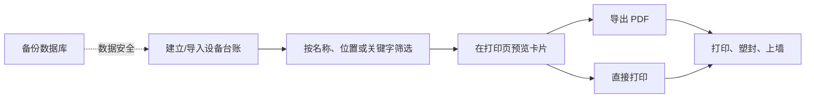

核心能力：

| 能力 | 说明 |
|---|---|
| 设备台账 | 新增、修改、删除；四列信息；按名称/位置下拉组合筛选，按关键字模糊查询；每页 20 条分页 |
| Excel | 下载导入模板，导入 `.xlsx`；把全部台账导出为 `.xlsx` |
| 卡片打印 | 按当前筛选结果生成 A4 卡片；每页 12 / 6 / 1 张三种版式；导出 PDF 或直接打印 |
| 打印设置 | 修改卡片头部的公司名和图标；版式本身固定，不提供模板编辑器 |
| 账号 | 首次启动生成两个初始账号；首次登录强制改密；管理员可新增、改角色、重置密码、删除账号 |
| 数据维护 | 手动备份、从备份恢复；备份是 SQLite 一致性快照 |
| 版本提示 | v1.4.0 起更新提示与安装全在桌面版原生完成：后台自动检查（启动后约 10 秒首查、之后每 24 小时），发现新版本弹原生对话框；Windows 安装版可一键「更新并重启」，macOS 交给 Sparkle 完成替换；Windows 菜单栏「帮助 → 检查更新」与 macOS 菜单栏「DevCard → 检查更新…」可随时主动检查。浏览器网络版不再提供更新提示与下载 |
| 关于入口 | v1.3.10 起：macOS 应用菜单首位「关于 DevCard」、Windows 菜单栏「帮助 → 关于 DevCard」，显示当前版本号与构建号，并可直达更新记录、用户手册与项目发布页 |
| 单机约束 | 同一数据目录只允许一个程序实例；数据全部保存在本地，不依赖服务器 |

### 1.2 界面分区

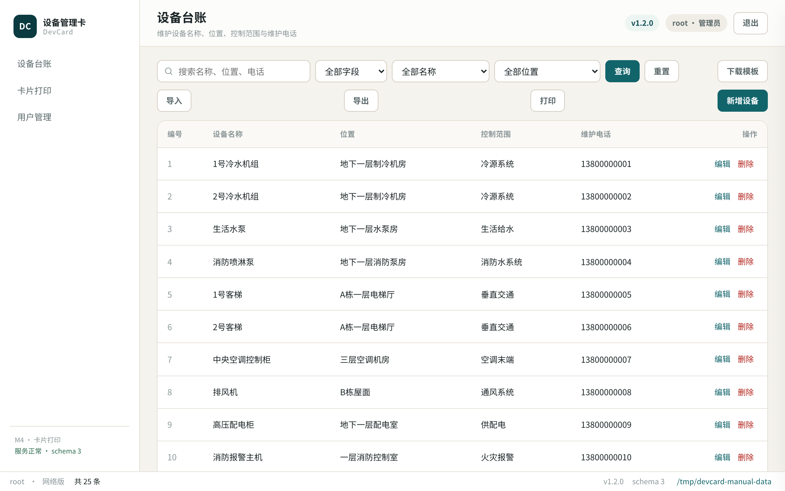

*图 1-1　设备台账主界面（真实界面渲染，演示数据）*

| 区域 | 位置 | 作用 |
|---|---|---|
| 侧栏 | 左侧 | 「设备台账」「卡片打印」「用户管理」三个入口；普通用户看不到「用户管理」；左下角显示服务健康状态 |
| 顶栏 | 上方 | 当前页面标题与说明；版本号；当前账号；「退出」（v1.4.0 起「有新版本」提示与「检查更新」按钮已从页面移除，更新改在桌面版原生菜单与弹窗） |
| 内容区 | 中间 | 台账列表、打印预览或用户管理表单 |
| 状态栏 | 最下方 | 当前账号、单机版/网络版、记录条数、版本、数据库结构版本、数据目录；服务异常时显示错误与「重试」 |

### 1.3 角色与权限

程序只有两种角色，权限差别集中在「用户管理」和「更新包下载/安装」：

| 功能 | 管理员（admin） | 普通用户（user） |
|---|---|---|
| 设备台账增删改查 | 可以 | 可以 |
| Excel 导入/导出 | 可以 | 可以 |
| 卡片打印、导出 PDF | 可以 | 可以 |
| 「用户管理」入口 | 可见 | 不可见（直接调接口返回 403「需要管理员权限」） |
| 新增/编辑/删除账号、重置密码 | 可以 | 不可以 |
| 修改公司名、更换卡片图标 | 可以 | 不可以 |
| 立即备份、恢复备份 | 可以 | 不可以 |
| 打开数据目录（用户管理页按钮） | 可以（仅 Windows） | 不可以 |
| 更新提示与安装（v1.4.0 起在桌面版原生完成） | 与登录角色无关：谁运行桌面版谁收到，普通用户也可点「更新」 | 同左 |

> 提示：角色只控制「管理动作」。普通用户仍然可以维护台账和打印卡片，适合只负责录入和上墙的同事。

### 1.4 单机版与网络版

- 双击桌面程序启动时，程序在本机 `127.0.0.1:18080` 起一个只供本机访问的本地服务，界面装在一个普通桌面窗口里；状态栏显示「单机版」。
- 用浏览器打开同一地址，或由运维以 `--server` 启动给内网使用，状态栏显示「网络版」。
- 两种方式用的是同一套页面、同一个数据库。网络版的部署、端口与防火墙设置不在本手册范围，见 `docs/部署文档.md`。

---

## 2. 安装与首次启动

### 2.1 macOS 安装

1. 取得 DMG：`devcard-1.3.12-macos-arm64.dmg`。
2. 双击打开 DMG，把 `DevCard` 拖进「应用程序」（Applications）。
3. 自 2026-11-17 起，macOS 包用 Developer ID 签名并经 Apple 公证 + staple，正常下载安装后首次打开**不需要**手动放行。
4. 若拿到的是 2026-11-17 之前基于 ad-hoc 签名的旧包，首次打开仍可能提示「无法打开，因为 Apple 无法检查其是否包含恶意软件」或「无法验证开发者」。这不是文件损坏，放行方式（任选一种）：
   - 在 Finder 里**右键**（或 Control-点击）`DevCard` →「打开」→ 再点「打开」；
   - 打开「系统设置 → 隐私与安全性」，在页面底部点「仍要打开」。
   系统会记住这次选择，以后可正常双击。
5. 仅支持 macOS 15 及以上、Apple Silicon（M 系列）机型；Intel Mac 不在支持范围。

> 2026-11-17 起的正式包为 Developer ID 签名 + Apple 公证 + staple（DMG 同样签名并装订票据），`spctl` 显示 `Notarized Developer ID`，首次打开无需放行；只有此前基于 ad-hoc 签名的旧包仍需按上面的方式手动放行。程序支持应用内更新提示与一键升级（macOS 的安装动作由 Sparkle 完成），升级方式见[第 10 章](#10-版本更新提示)。

### 2.2 Windows 安装

Windows 有两种形态，任选一种：

| 形态 | 程序位置 | 数据目录 | 自动更新 |
|---|---|---|---|
| 安装版 | `%LOCALAPPDATA%\Programs\DevCard`（每个用户安装，不需要管理员权限、不弹 UAC） | `%LOCALAPPDATA%\DevCard\data` | 支持（需要发布方提供 `setup.exe`） |
| 绿色版（程序内称「便携版」） | 解压到任意可写目录 | 程序旁 `data\` | 不支持，手动替换程序目录 |

**安装版步骤**

1. 运行 `devcard-<版本>-win64-setup.exe`，按向导完成。
2. 如果这台电脑没装过 Microsoft Edge WebView2 Runtime，向导「附加任务」页会出现「运行环境」分组下的「下载并安装 Microsoft Edge WebView2 Runtime（需要联网）」一项（默认勾选）。保持勾选，安装时会自动联网下载官方引导器并静默装好；下载或安装失败不会阻断主程序安装，会弹窗给出微软官方下载地址，手动装好后重新运行 DevCard 即可。已装过的电脑不显示这一项。
3. 如果出现「Windows 已保护你的电脑」（SmartScreen），点「更多信息」→「仍要运行」。当前安装包未购买代码签名证书，这一提示可能出现。
4. 安装完成后勾选启动，或从开始菜单打开 `DevCard`。
5. 卸载时只删除程序文件与快捷方式，**不会删除数据目录**；卸载结束页会提示数据仍保留在 `%LOCALAPPDATA%\DevCard\data`。静默卸载（`/SILENT`）不会残留临时文件。

**绿色版步骤**

1. 把 zip 解压到目标目录。不要放在 `C:\Program Files`（通常不可写），也不要放在会被网盘/桌面同步工具反复改写的目录。
2. 直接运行 `DevCard.exe`。数据会写在 `DevCard.exe` 旁边的 `data\`。
3. 绿色版没有自动安装能力，升级时手动替换程序目录，保留 `data\`。

> 同一个数据目录只允许一个实例。自 v1.3.4 起，重复启动（或另一个副本指向同一数据目录）不再新开窗口，而是**直接激活已经在运行的窗口**；旧版本会提示「同一数据目录已有实例在运行」并启动失败。

### 2.3 首次启动做了什么

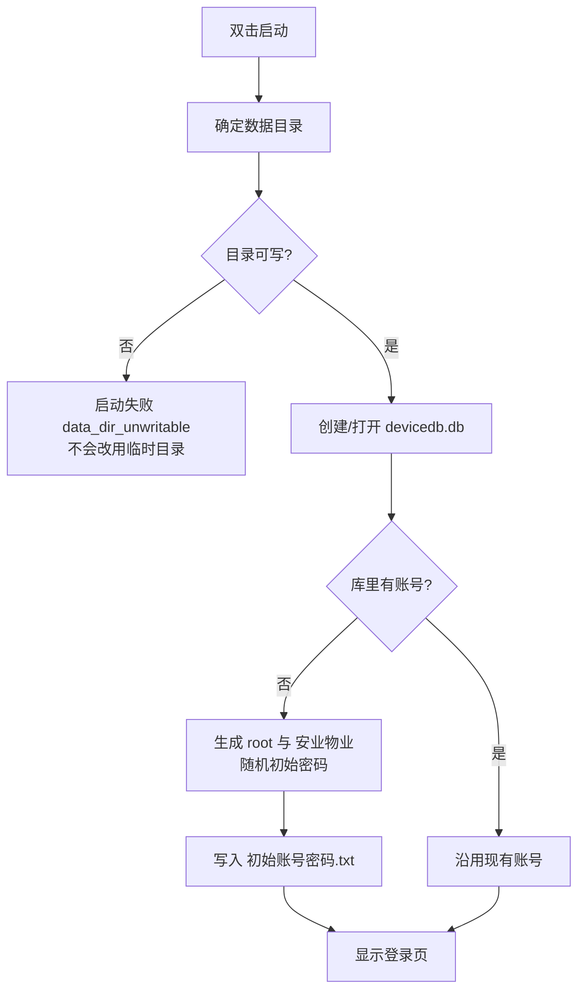

首次启动会在数据目录：

1. 创建 `devicedb.db`（台账、账号、设置都在里面）；
2. 生成两个账号：`root`（管理员）和 `安业物业`（普通用户），密码是随机生成的；
3. 把账号与初始密码写入数据目录下的 `初始账号密码.txt`。macOS 上该文件权限为 `0600`，只有当前系统用户能读。

**去哪里找这个文件**

- macOS：Finder →「前往」→「前往文件夹」（⇧⌘G）→ 输入 `~/Library/Application Support/Anye/DevCard`。
- Windows 安装版：文件资源管理器地址栏输入 `%LOCALAPPDATA%\DevCard\data`。
- Windows 绿色版：打开 `DevCard.exe` 所在目录下的 `data\`。

> 所有账号都完成改密后，`初始账号密码.txt` 会被自动删除。之后管理员再重置密码，也不会重新生成这个文件。

> **v1.3.8 起启动更快**：无论首次还是日常启动，主窗口与启动加载页都会**立即出现**（实测 Windows 首帧约 265ms 降至约 11ms，macOS 约 147ms 降至约 110ms），服务端初始化在后台完成，完成后自动进入应用，不需要等待或额外操作。

### 2.4 启动失败怎么办

程序启动失败会弹窗或输出「启动失败[错误码]: 说明」。常见情况：

| 提示/错误码 | 原因 | 处理 |
|---|---|---|
| `instance_in_use` | 同一数据目录已有程序在运行 | 关掉已打开的 DevCard 窗口；确认任务管理器/活动监视器里没有残留进程 |
| `data_dir_unwritable` / `data_dir` | 数据目录不可写，或无法创建 | 修目录权限；不要把数据目录放在只读盘、系统保护目录或已断开的网盘。程序**不会**偷偷改用临时目录 |
| `port_in_use` | 本机 `18080` 端口被占用 | 关闭占用该端口的程序后重试。桌面版固定使用 `18080`；命令行 `devcard-server` 可用 `--port` 改端口 |
| `legacy_db` | 检测到旧版数据库（只有 `tb_device`/`tb_user`，没有结构版本号） | 新版本不再支持旧库导入。请用旧版程序导出数据，或改用新库；不要手工改库 |
| `schema_newer` | 数据库结构版本高于当前程序 | 换用更新版本的程序，不要降级使用旧程序打开新库 |
| `font_missing` / `font_corrupt` | 随包打印字体缺失或损坏 | 重新安装/重新解压，不要手工改 `fonts\` 里的文件 |
| `bad_config` / `bad_listen` | 配置文件有错，或监听地址选不出来 | 只影响命令行/网络版；检查 `devcard-server.json`，删除错误键或修正地址 |
| `web_assets` | 内嵌前端与源文件不一致 | 重新安装或重新构建，不要手工替换程序内资源 |

找不到错误码时，按提示文字处理；仍无法启动时，记录弹窗原文、程序版本和数据目录路径再联系维护人员。

---

## 3. 首次登录、强制改密与账号管理

### 3.1 登录

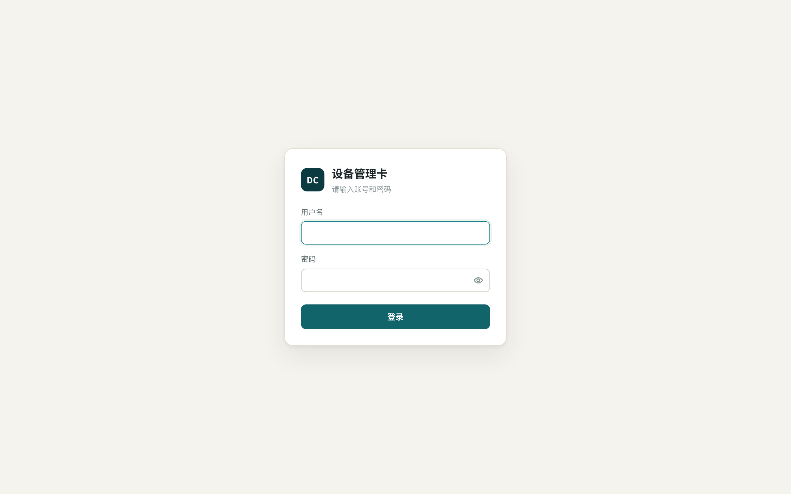

*图 3-1　登录页（真实界面渲染）*

1. 启动程序，出现登录页。
2. 输入用户名与密码。密码框右侧的眼睛按钮可在明文/掩码之间切换。
3. 点「登录」或按回车。
4. 登录失败时，表单下方会显示原因（例如「用户名或密码错误」）；不会把具体是用户名错还是密码错分开提示，这是有意的安全设计。

首次登录请使用 `root`（管理员）或 `安业物业`（普通用户），密码取自[第 2.3 节](#23-首次启动做了什么)的 `初始账号密码.txt`。

### 3.2 首次登录必须改密

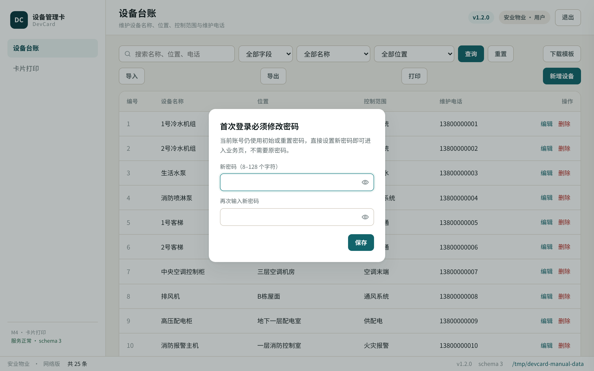

*图 3-2　首次登录强制改密（真实界面渲染）*

- 使用初始密码、或管理员刚重置过的密码登录时，程序会弹出「首次登录必须修改密码」，**不能跳过、不能取消**（这个窗口没有「稍后」按钮，按 Esc 也关不掉）。
- 当前账号仍处于「必须改密」状态时，直接设置新密码即可，不需要输入旧密码。
- 新密码长度 8–128 个字符（按字符计，不要求必须包含字母和数字的组合）。
- 两次输入不一致会提示「两次输入的新密码不一致」；保存成功后提示「密码已更新」，并进入业务页面。
- 服务端也会拦：未改密前调用其他业务接口一律返回 403 `must_change_password`，不是只在页面上藏入口。

> 如果只改了 `root` 的密码，`初始账号密码.txt` 仍会保留，因为 `安业物业` 还处于必须改密状态。两个账号都改完，文件才会自动删除。

### 3.3 用户管理（仅管理员）

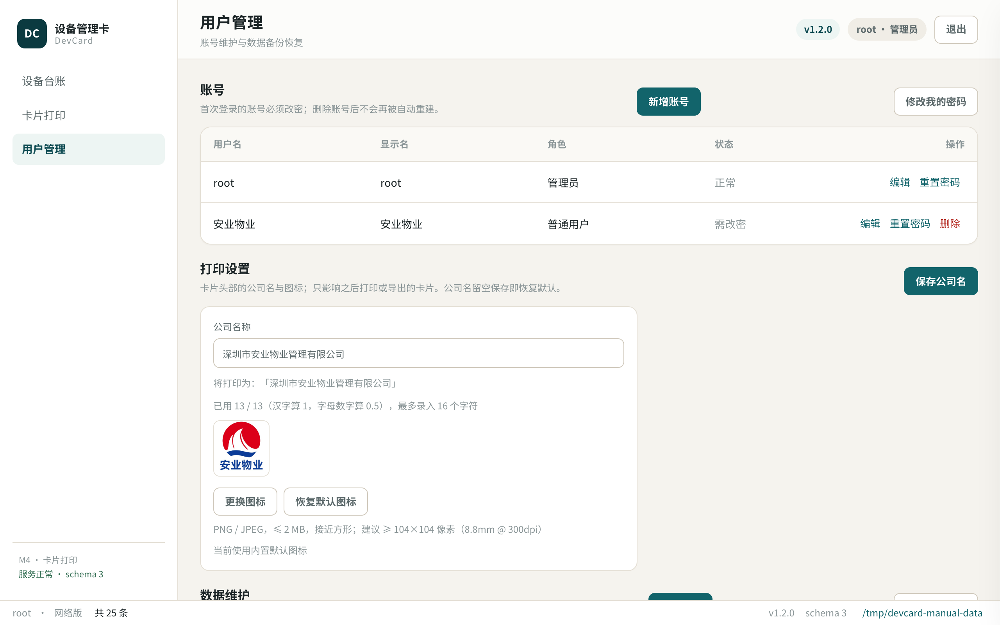

*图 3-3　用户管理页（真实界面渲染）*

「用户管理」页包含三块：账号、打印设置、数据维护。普通用户看不到这个入口。

**账号列表**

| 列 | 说明 |
|---|---|
| 用户名 | 登录名，创建后不可改；最多 20 个字符，不能包含控制字符或路径分隔符 |
| 显示名 | 界面上展示的名字，最多 20 个字符；留空时等于用户名 |
| 角色 | 管理员 / 普通用户 |
| 状态 | 「正常」「需改密」「锁定至 年-月-日 时:分:秒」 |
| 操作 | 编辑、重置密码、删除（自己那一行不显示删除） |

**新增账号**

1. 点右上角「新增账号」。
2. 填写用户名、显示名、角色、初始密码（8–128 个字符）。
3. 保存后提示「账号已创建」。新账号首次登录会被强制改密，和初始账号一样。

**编辑账号**

- 用户名不可改；可以改显示名和角色。
- 不能把最后一个管理员改成普通用户，否则提示「至少保留一个管理员账号」。

**重置密码**

- 点某行的「重置密码」，输入新密码（8–128 个字符），保存后提示「密码已重置」。
- 该账号下次登录必须改密；它已经登录的窗口会被踢回登录页。
- 重置**不会**提前解除已有的登录锁定：如果账号处于「锁定至 …」，仍需等到锁定时间结束。

**删除账号**

- 点「删除」，确认框文字为「确定删除账号「用户名」？删除后不可恢复，也不会自动重建。」
- 不能删除当前登录账号（提示「不能删除当前登录账号」）；不能删除最后一个管理员。
- 只要库里还有账号，下次启动不会重新生成初始账号。

**修改我的密码**

- 页面右上角「修改我的密码」：需要先输入原密码，再输入两遍新密码。
- 改密成功后，其他已登录窗口失效，当前窗口保留，提示「密码已更新」。

### 3.4 登录限制与常见提示

| 现象 | 实际规则 | 怎么办 |
|---|---|---|
| 「用户名或密码错误」 | 用户名不存在或密码不对 | 核对用户名、大小写和输入法；密码区分大小写 |
| 「登录失败次数过多，账号已锁定，请稍后再试」 | 同一账号连续输错 5 次，锁定 15 分钟 | 等待 15 分钟；或让管理员重置密码（但锁定时间不会因此提前结束） |
| 「失败次数过多，请 N 秒后重试」 | 网络版同一来源 IP 或同一用户名，5 分钟内失败 5 次，限流 60 秒（HTTP 429） | 等提示的秒数后再试；本机 `127.0.0.1` 不受这层 IP 限流影响 |
| 突然回到登录页 | 会话默认 12 小时无操作后过期；程序重启也会清空会话 | 重新登录；未保存的表单内容需要重填 |
| 突然回到登录页（接口返回 401「账号不存在」） | 当前登录的账号已被管理员删除 | 重新登录其他账号 |
| 导出、下载模板、上传 Logo 时突然回到登录页 | v1.3.6 起，这类接口遇到登录过期（401）统一跳转登录页，不再只弹一句「失败（401）」 | 重新登录后再做该操作；未保存的内容需重填 |

### 3.5 忘记密码怎么办

1. **还有其他管理员**：让另一位管理员进入「用户管理」→ 找到该账号 →「重置密码」，设置一个临时密码，再用它登录并改密。
2. **所有管理员密码都忘了**：
   - Windows 安装版：打开命令提示符，进入 `%LOCALAPPDATA%\Programs\DevCard`，执行
     `devcard-server.exe --set-password root`，按提示输入两遍新密码。账号不存在时会创建管理员账号；重置后下次登录必须改密。
   - macOS 版：安装包内没有单独的命令行入口，请维护人员用同版本的 `devcard-server`，加上
     `--data-dir "$HOME/Library/Application Support/Anye/DevCard"` 执行 `--set-password root`。
3. **实在无法重置**：从备份恢复（账号和密码也会恢复到备份时的状态），见[第 9 章](#9-备份与恢复)。

---

## 4. 设备台账：新增、修改、删除、查询与分页

### 4.1 台账列表


*图 4-1　设备台账（25 条演示数据，当前第 1 / 2 页）*

| 区域 | 说明 |
|---|---|
| 编号 | 数据库自增编号。删除记录后不会重排，也不会回填空缺 |
| 设备名称 / 位置 / 控制范围 / 维护电话 | 四个业务字段 |
| 操作 | 每行「编辑」「删除」 |
| 工具栏 | 关键字搜索、搜索字段、名称下拉、位置下拉、查询、重置、下载模板、导入、导出、打印、新增设备 |
| 页脚 | 共 N 条、第 X / Y 页、上一页/下一页 |
| 空状态 | 「没有匹配的设备，换个筛选条件或新增一条。」 |

列表默认按编号升序排列，每页 20 条。程序不提供列排序、批量删除或撤销删除。

### 4.2 新增设备

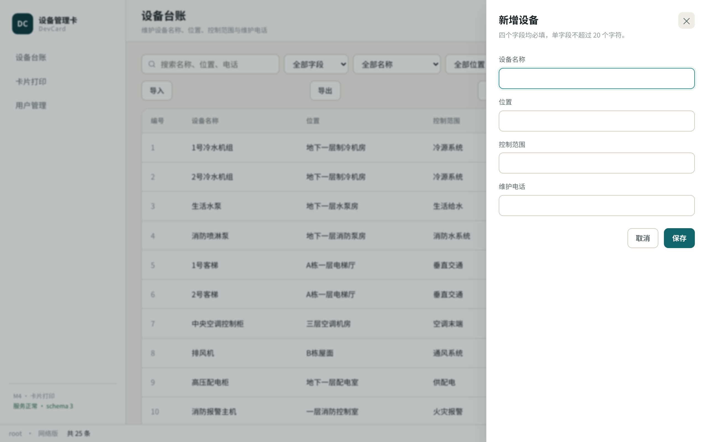

*图 4-2　新增设备抽屉（真实界面渲染）*

1. 点右上角「新增设备」，右侧滑出抽屉，标题为「新增设备」。
2. 四个字段**全部必填**，每个字段最多 20 个字符（按字符计，汉字算 1 个）。程序会自动去掉首尾空格。
3. 点「保存」。成功后抽屉关闭，提示「已新增设备」，列表回到第 1 页。

> 新增后列表回到第 1 页，而新记录按编号排在最后一页。如果台账条数很多，新增后需要翻到末页才能看到刚录入的设备。

**重复判断**：新增时，如果「设备名称 + 位置 + 控制范围」三项与已有记录完全相同（电话不同也算相同），会提示「你要添加的设备己经存在，请重新输入」，不会写入。编辑和 Excel 导入不做这个拦截（见[第 5.4 节](#54-导入报告与重复语义)）。

### 4.3 修改设备

1. 在列表行尾点「编辑」，抽屉标题变为「编辑设备」，四个字段带入当前值。
2. 修改后点「保存」，提示「已保存修改」，列表停留在当前页并刷新该行。

**多人同时改同一条时**：程序用记录版本号做乐观锁。如果打开编辑后，这条记录已被别人保存过，会提示「数据已被他人修改，请刷新后重试」。管理员会额外看到「是否强制覆盖」的确认框；强制覆盖会用你当前填写的内容盖掉别人刚保存的修改，并把被覆盖的版本、修改人和时间写入审计记录。普通用户只能刷新后重填。

### 4.4 删除设备

1. 在列表行尾点「删除」。
2. 确认框显示：「确定删除「设备名称」·位置？删除后不可恢复。」
3. 点「删除」后提示「已删除设备」。如果删掉的是最后一页最后一条，列表会自动回到上一页。

> 删除不可撤销，也没有回收站。重要数据请先备份，见[第 9 章](#9-备份与恢复)。

### 4.5 查询与筛选

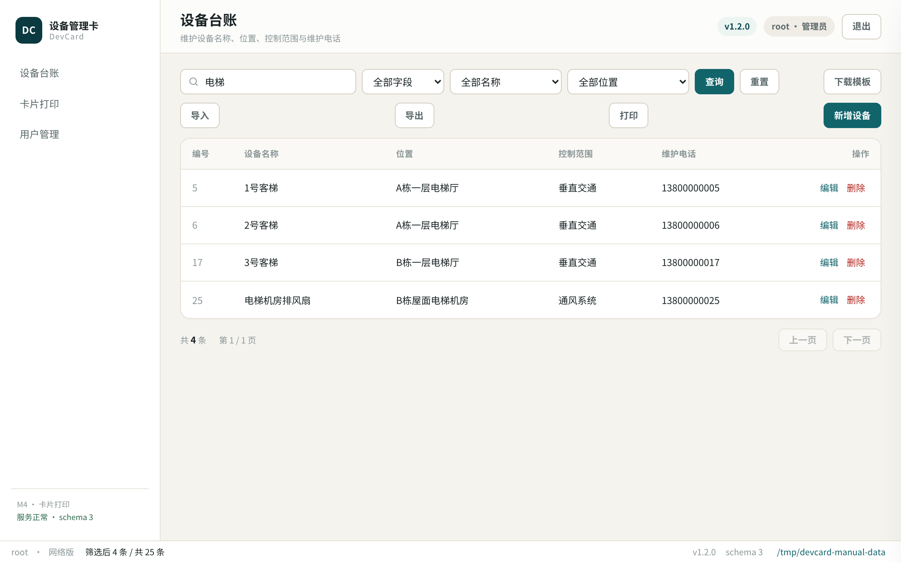

*图 4-3　在关键字框输入「电梯」，查询到 4 条（真实界面渲染）*

工具栏有两类筛选，可以组合使用：

| 控件 | 匹配方式 | 说明 |
|---|---|---|
| 关键字搜索框 | 模糊包含 | 输入「电梯」会匹配字段值中包含「电梯」的记录；`%`、`_` 按普通字符处理 |
| 搜索字段 | 限定关键字匹配哪一列 | 「全部字段」= 设备名称/位置/控制范围/维护电话；也可只查某一列 |
| 名称下拉 | 精确匹配 | 选项来自库里已有的设备名称；选「全部名称」不限制 |
| 位置下拉 | 精确匹配 | 选项来自库里已有的位置；选「全部位置」不限制 |

- 多个条件之间是「并且」关系：关键字、名称、位置同时满足才会显示。
- 点「查询」或按回车执行，结果从第 1 页开始显示。
- 点「重置」清空全部条件并回到第 1 页。
- 筛选结果为空时显示「没有匹配的设备，换个筛选条件或新增一条。」
- 新增、编辑、导入后，名称/位置下拉会自动更新。

### 4.6 分页与条数

- 每页固定 20 条，页脚显示「共 N 条」和「第 X / Y 页」。
- 「上一页」「下一页」在首页/末页会自动禁用。
- 底部状态栏同时显示条数：无筛选时是「共 N 条」；有筛选时是「筛选后 M 条 / 共 N 条」。
- 删除当前页最后一条时，程序会自动退到有效页，不会停在空白页。

### 4.7 字段规则一览

| 字段 | 手工录入 | Excel 导入 | 卡面显示 |
|---|---|---|---|
| 设备名称 | 必填，≤20 字符 | 必填；超过 10 字符截断 | 固定列宽，超出部分按版式裁切 |
| 位置 | 必填，≤20 字符 | 必填；超过 10 字符截断 | 固定列宽 |
| 控制范围 | 必填，≤20 字符 | 必填；超过 10 字符截断 | 固定列宽 |
| 维护电话 | 必填，≤20 字符 | 必填；超过 11 字符截断 | 按「前 3 + 空格 + 中 4 + 空格 + 后 4」分组显示；不识别区号横线 |

> 电话提示：卡面分组不解析 `0755-83001234` 这类带区号的写法，横线会被当成普通字符，显示效果可能不理想。建议录成 11 位连续号码，先在打印预览里确认再批量打印。

---

## 5. Excel 导入与导出

### 5.1 下载导入模板

1. 在台账工具栏点「下载模板」。
2. 浏览器/程序会保存 `设备导入模板.xlsx`，提示「已下载 设备导入模板.xlsx，可直接上传（空模板导入 0 行）」。
3. 模板有两个工作表：
   - **设备台账**：第一行只有四列表头，可直接填写；
   - **填写说明**：列名含义、长度限制与假号码示例。

模板的第一个工作表只有表头，所以原样上传会得到「导入成功 0 条」，这是正常现象。

### 5.2 导入步骤

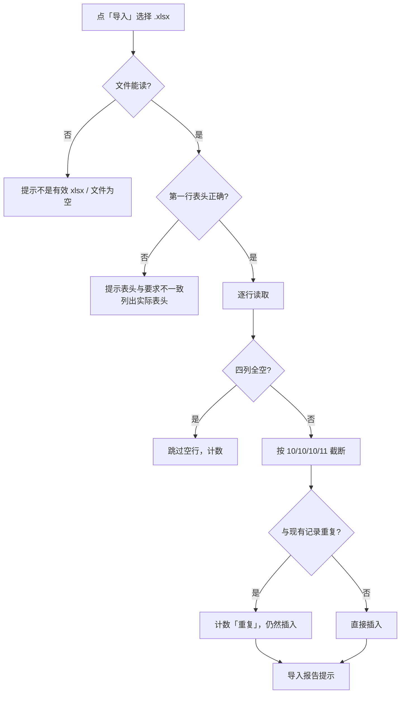

1. 点台账工具栏「导入」，选择 `.xlsx` 文件。
2. 程序只读**第一个工作表**，第一行必须是表头，顺序固定为：
   `设备名称`、`位置`、`控制范围`、`维护电话`。
3. 表头不一致时导入会整体失败，提示「导入文件的表头与要求不一致：第 1 行应为「设备名称 / 位置 / 控制范围 / 维护电话」，实际为「…」。请调整列顺序后重试，导入不会自动错位对齐。」
4. 导入成功后弹出汇总，格式为：
   「导入成功 N 条，跳过空行 X，与现有记录重复 Y 条（已保留），有 Z 行字段被截断」。
   （某一项为 0 时不会显示那一项。）

单个导入文件最大 8 MB。只支持 `.xlsx`（不支持旧版 `.xls`、`.csv`）。

### 5.3 导入时的字段处理

| 情况 | 行为 |
|---|---|
| 四列全空的行 | 跳过，计入「跳过空行」 |
| 任一列超过长度上限 | 按 UTF-8 字符截断：设备名称/位置/控制范围保留前 10 个字符，维护电话保留前 11 个字符；该行计入「有 N 行字段被截断」 |
| 与现有记录「名称+位置+控制范围」相同 | 计入「重复」，但**仍然插入**，不覆盖、不跳过 |
| 字段首尾空格 | 自动去掉 |
| 电话格式 | 导入不校验字符，只做长度截断；字母、横线等都会原样保存 |
| 表格中间有空行 | 空行跳过，后面的行继续导入 |

> 注意：手工录入允许 20 个字符，但导入上限是 10/10/10/11。把导出的文件原样再导入时，超过上限的字段会被截断。导出文件适合作为备份或查看，不适合作为「无损往返」的编辑格式。

### 5.4 导入报告与重复语义

导入是**追加**，不是同步或覆盖：

- 同一个文件导入两次，第二次会把同样的记录再插一遍，条数翻倍；第二次的汇总会把它们统计为「与现有记录重复 X 条（已保留）」。
- 程序不会按设备名称自动合并，也不会更新已有记录的电话或位置。
- 数据库层面没有唯一约束阻止重复；「重复」只是导入时的统计提示。
- 如果导错了，只能逐条删除，或从导入前的备份恢复（建议大批量导入前先点「立即备份」）。

### 5.5 导出

1. 在台账工具栏点「导出」。
2. 保存的文件名为 `设备台账.xlsx`，提示「已导出 设备台账.xlsx」。
3. 导出内容为**全部台账**，不是当前筛选结果；列顺序与导入表头一致：设备名称、位置、控制范围、维护电话。
4. 导出不包含编号、创建时间、修改时间、版本号或账号信息。
5. 文件落点按平台不同：**macOS 桌面壳**弹出系统保存对话框（可自选位置）；**Windows 桌面壳与浏览器**自 v1.3.6 起改走浏览器下载通道，文件保存到下载目录，可在浏览器/WebView 的下载记录中打开（Windows 路径兼容问题已修复，不再因保存路径导致导出失败）。

> 想只导出筛选结果，当前版本没有这个功能。需要按位置/名称分批时，只能先导出全部再在 Excel 里筛选。

### 5.6 导入常见错误

| 提示 | 原因 | 处理 |
|---|---|---|
| 「导入文件为空」 | 选了一个 0 字节文件 | 重新选择或重新下载模板 |
| 「无法读取该文件：不是有效的 xlsx（zip 结构不完整）」 | 文件不是真正的 xlsx，或扩展名被改过 | 用 Excel/WPS 另存为 `.xlsx` 再试 |
| 「xlsx 里找不到工作表」 | 文件结构异常 | 用 Excel 重新保存 |
| 「导入文件的表头与要求不一致…」 | 表头文字、顺序不对，或第一行不是表头 | 按模板第一行改好；程序不会自动按列名对齐 |
| 「导入成功 0 条」 | 只有表头，或所有行都是空行 | 正常现象；检查数据是否填在第一个工作表 |

---

## 6. 名片模板与打印设置

### 6.1 卡面是固定模板

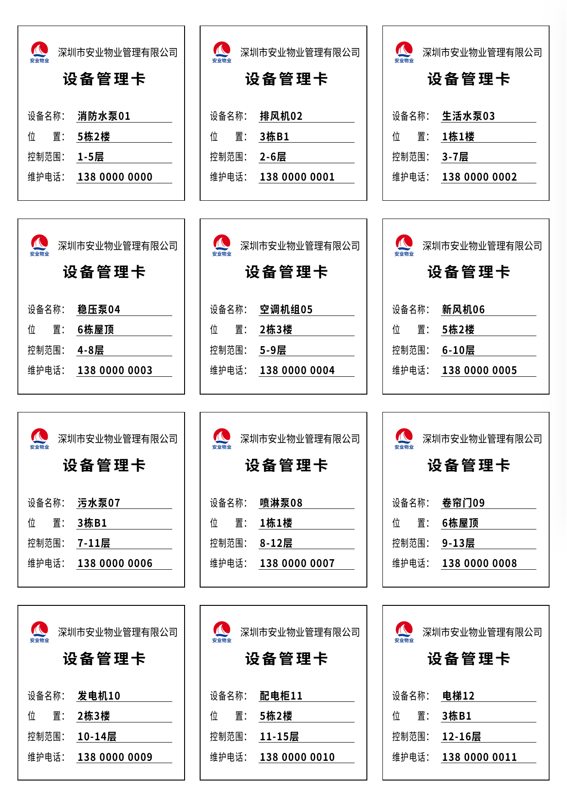

*图 6-1　程序真实导出的 17 条 2 页样张第 1 页（A4，3 × 4，共 12 张）*

卡片尺寸约 62 mm × 65 mm，A4 纸默认排 3 列 × 4 行。每张卡片固定包含：

| 区域 | 内容 |
|---|---|
| 左上角 | 公司图标（默认内置「安业物业」图标，可更换） |
| 图标右侧 | 公司名称（默认「深圳市安业物业管理有限公司」） |
| 中部标题 | 「设备管理卡」 |
| 四行字段 | 设备名称、位置、控制范围、维护电话；标签右侧有下划线式横线 |
| 边框 | 细黑边框，便于裁剪 |

> 版式本身**不能**在界面上拖拽、换行或改字号；当前版本没有「模板编辑器」。能改的只有公司名、图标，以及每页打印几张（12 / 6 / 1）。

### 6.2 修改公司名

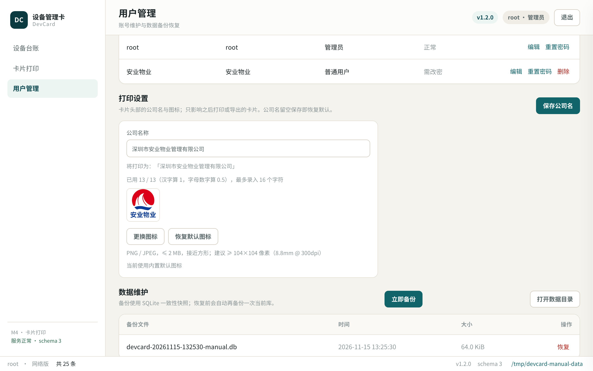

*图 6-2　打印设置与数据维护（真实界面渲染）*

1. 进入「用户管理」→「打印设置」。
2. 在「公司名称」输入框修改。
3. 输入时下方会实时显示「将打印为：「…」」，并按显示宽度计数：汉字算 1，ASCII 字母/数字/符号算 0.5。
4. 点「保存公司名」。保存成功后提示「公司名已保存」；如果超出 13 字宽，会提示「已保存；卡面只打印前 13 字宽，实际内容见预览」。

规则：

- 录入上限 16 个字符；卡面只保留前 13 个「显示宽度」。
- 超出部分不会打印，输入框下方会明确显示「超出 13 字宽的部分不会打印」。
- 留空保存会恢复默认公司名「深圳市安业物业管理有限公司」。
- 修改只影响**之后**的打印/导出；已经导出的 PDF 不会变。

### 6.3 更换卡片图标

1. 在「打印设置」→「图标」区域点「更换图标」。
2. 选择 PNG 或 JPEG 图片（不支持 SVG）。
3. 限制与提示：
   - 文件 ≤ 2 MB；
   - 建议接近方形；太扁或太窄会提示「图片偏扁或偏窄，缩放后会显得很小，建议换成接近方形的图」；
   - 建议至少 104 × 104 像素（约 8.8 mm @ 300 dpi）；低于该分辨率会提示「分辨率低于 104×104 像素，300 dpi 打印可能发虚」。
4. 更换成功提示「图标已更新」，并显示图标更新时间。
5. 点「恢复默认图标」可回到内置图标，提示「已恢复默认图标」。

图标文件实际保存在数据目录的 `assets/company-logo.png` 或 `assets/company-logo.jpg`。它**不在** `.db` 备份文件里，迁移或换电脑时要单独复制 `assets/`，见[第 9 章](#9-备份与恢复)。

### 6.4 生效范围

- 公司名、图标修改后，重新进入「卡片打印」页即可看到新预览。
- 已打开但未刷新的打印预览可能还是旧内容；点「返回台账」再点「打印」即可刷新。
- 打印设置按数据目录保存，同一台电脑上的所有账号共用一套设置。

---

## 7. 打印与导出 PDF

### 7.1 从台账到打印

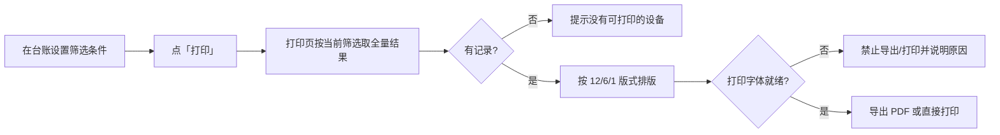

1. 在「设备台账」页先用关键字/名称/位置筛出要打印的设备。打印范围就是**当前筛选结果**，不是当前页。
2. 只想打其中几台？自 v1.3.4 起可以在列表行首**勾选**设备（支持全选，翻页勾选也保留），然后点工具栏的「打印选中（N）」，打印页只包含勾选的这几台；不勾选时仍按整个筛选结果打印。
3. 点工具栏「打印」，进入「卡片打印」页。
4. 页面顶部显示「当前筛选结果 N 条 · 每页 L 张 · 共 P 页」。
5. 选择版式，检查预览，再点「导出 PDF」或「直接打印」。
6. 点「返回台账」回到列表，筛选条件保留。

> 打印结果最多取 10000 条；超过时标题会追加「（超过 10000 条，已截断）」。正常物业台账远低于这个上限。

### 7.2 打印页与版式

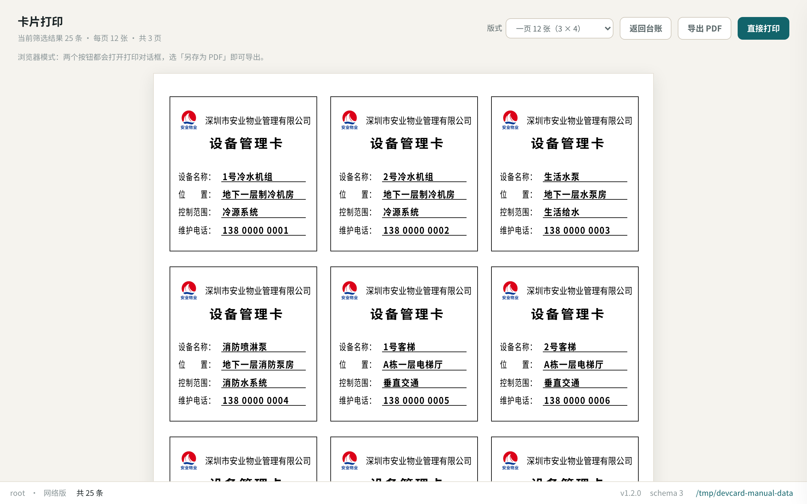

*图 7-1　卡片打印预览（25 条，每页 12 张，共 3 页；真实界面渲染）*

| 版式选项 | 每页张数 | 排布 | 适用场景 |
|---|---|---|---|
| 一页 12 张（3 × 4） | 12 | 默认，A4 三列四行 | 批量打印、常规上墙 |
| 一页 6 张（3 × 2） | 6 | 三列两行 | 卡片较少，或想留更大裁剪余量 |
| 一页 1 张 | 1 | 单张居中 | 单台设备补打、临时贴纸 |

- 预览会随窗口宽度缩放；打印/导出时按 1:1 的 A4 输出，预览缩放不影响成品尺寸。
- 当前筛选结果为空时，按钮禁用并显示「当前筛选没有可打印的设备，请返回台账调整筛选条件。」
- 页数按「记录数 ÷ 每页张数」向上取整。例如 17 条、每页 12 张 → 2 页（12 + 5）。

### 7.3 导出 PDF

在桌面壳（macOS `.app`、Windows 安装版/绿色版）里：

1. 点「导出 PDF」。
2. 弹出系统保存对话框，标题「导出卡片 PDF」，默认文件名 `设备管理卡.pdf`。
3. 选择位置并保存。成功后提示「已导出 N 页 PDF：<完整路径>」；取消则提示「已取消导出」。
4. 打开 PDF 检查页数、公司名、电话分组和裁切线后再打印。

在浏览器里（网络版，或直接访问 `http://127.0.0.1:18080/`）：

- 「导出 PDF」和「直接打印」都会打开浏览器打印对话框；
- 也可以直接按 ⌘P（macOS）或 Ctrl+P（Windows）打开同一个打印对话框；
- 在目标打印机里选择「另存为 PDF」即可导出，文件名由浏览器决定；
- 页面会提示「浏览器模式：两个按钮都会打开打印对话框，选「另存为 PDF」即可导出。」

### 7.4 直接打印

1. 点「直接打印」。
2. 打开系统打印面板，纸张为 A4；选择打印机、份数等。
3. 确认后开始打印。

程序只负责版面与打印任务，不控制打印机驱动里的双面、缩放、纸张来源等选项。批量打印前建议先打 1 页确认方向和边距。

> **验收现状（照实写）**：「导出 PDF」链路已长期验证；「直接打印」验证到能构造打印任务并打开系统打印面板，实际出纸依赖目标打印机，需在目标机器上先打一张测试页确认。Windows 壳的导出/打印桥已于 2026-11-26 在真机上端到端验证通过（打印对话框互斥与关闭后正确释放，可连续打印不再卡住，v1.3.6 起）。如点击无响应，可用浏览器打开 `http://127.0.0.1:18080/`，用浏览器打印作为兜底。

### 7.5 打印字体与生僻字

程序随包带了思源黑体/Noto Sans SC 子集字体，屏幕预览和 PDF 使用同一份，保证两个平台印出来一致。

- 如果整份字体缺失、损坏，或页面环境无法校验字体完整性，导出/打印会被**中止**并提示原因，不会退回系统字体硬凑一份 PDF。
- 如果只是个别字不在字体子集里：
  - 打印页顶部会列出「以下字符不在打印字体范围内：…（出现于：…）」；
  - 这些字会由系统字体渲染，字宽可能与预期不同；
  - 设备名称/位置/控制范围按固定列宽排版，不会因此阻止导出；
  - 公司名会按回退后的真实字宽再量一次：塞得进公司名框就允许导出，塞不进则阻止导出并提示。
- 想让两个平台完全一致，请尽量避免生僻字，或联系维护人员扩展字体子集后重新出样张。

### 7.6 样张文件

`assets/卡片打印样张-17条-2页.pdf` 是 17 条记录、2 页（12 + 5）的真实导出样张，可用来核对：

- A4 版面是否 3 列 × 4 行；
- 卡片尺寸、边框、公司名与图标位置；
- 电话分组、字段下划线、跨页是否有空白页。


*图 7-2　样张第 1 页（由上面的 PDF 渲染，未做界面修饰）*

---

## 8. 底部状态栏


*图 8-1　底部状态栏（演示环境；实际路径见第 11 章）*

状态栏从左到右依次是：

| 位置 | 显示内容 | 说明 |
|---|---|---|
| 左 | 当前账号的显示名 | 例如 `root`；显示名为空时显示用户名 |
| 左 | `·` 分隔符 | — |
| 左 | `单机版` / `网络版` | 有原生桌面壳时为「单机版」；纯浏览器访问时为「网络版」 |
| 中 | `共 N 条` 或 `筛选后 M 条 / 共 N 条` | 与列表页脚同源；无筛选时只显示总数；服务异常时变成 `—` |
| 右 | 当前版本号，如 `v1.3.12` | 手册对应 v1.3.12 |
| 右 | `schema 数字` | 数据库结构版本，只用于排查，不需要记 |
| 右 | 数据目录路径 | 点击可打开/复制，见下 |

**点击数据目录**

- 桌面壳：直接打开系统的文件管理器（Finder / 资源管理器）到数据目录。
- 浏览器：把路径复制到剪贴板，并提示「数据目录路径已复制：<路径>」；如果浏览器不允许剪贴板，则提示「数据目录：<路径>」。

**服务异常**

如果本地服务断开（程序崩溃、端口被占用、网络版服务端停止等），状态栏会变红并显示：

> 服务连接异常：<具体原因>

同时条数、版本、schema、数据目录变为 `—`，右侧出现「重试」按钮。点「重试」会重新拉取账号信息与列表；仍失败时按提示检查本地服务是否还在运行。

> 状态栏显示的「网络版」只代表当前页面是通过浏览器加载的，不代表数据在云端。数据仍在你打开的这个数据目录里。

---

## 9. 备份与恢复

### 9.1 备份包含什么

「立即备份」生成一个 SQLite 一致性快照（`VACUUM INTO`），不需要停程序。一个 `.db` 备份包含：

- 设备台账；
- 账号（含密码哈希、角色、是否需改密、锁定状态）；
- 设置（公司名、图标路径等）。

**不包含**：

- 自定义图标文件本身（在 `assets/` 下，不在数据库里）；
- 日志、`instance.lock`（v1.4.0 起 `manifest.json`、`updates/` 已随更新迁到桌面壳而不再出现在数据目录）；
- 已经导出的 PDF / Excel 文件。

> 只复制 `.db` 备份到新电脑，台账和账号会回来，但自定义图标会回落到内置默认图标。要完整迁移，请连 `assets/` 一起复制。

### 9.2 立即备份

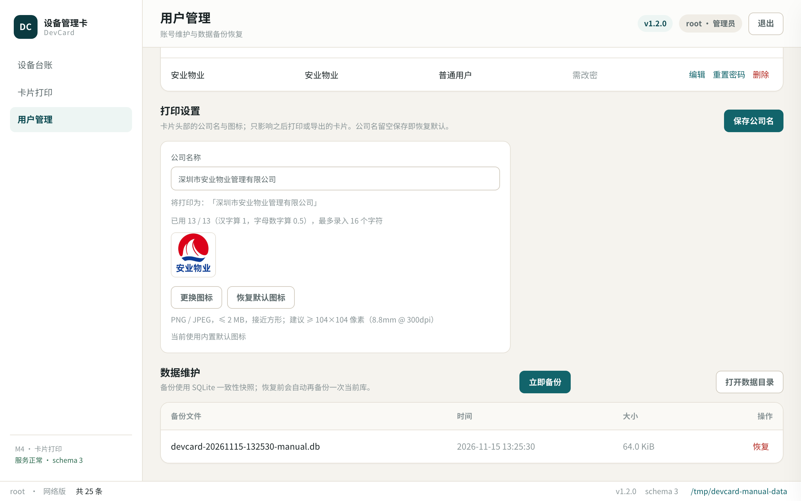

*图 9-1　数据维护与备份列表（真实界面渲染）*

1. 进入「用户管理」→「数据维护」。
2. 点「立即备份」。
3. 成功后提示「备份完成：devcard-<日期>-<时间>-manual.db」，列表新增一行，显示文件名、时间、大小。

备份文件规则：

- 位置：数据目录下的 `backups/`；
- 命名：`devcard-YYYYMMDD-HHMMSS-manual.db`（本地时间）；
- 同名冲突会自动追加 `-2`、`-3`；
- 恢复前自动生成的备份标签为 `pre-restore`；命令行备份标签为 `cli`；
- 程序不会自动定时备份，也不会自动清理旧备份。请自己定期点一次，并把 `backups/` 里的文件复制到其他磁盘或网盘。

> 备份文件包含账号密码哈希，按敏感文件管理，不要随手发到公共群。

### 9.3 从备份恢复

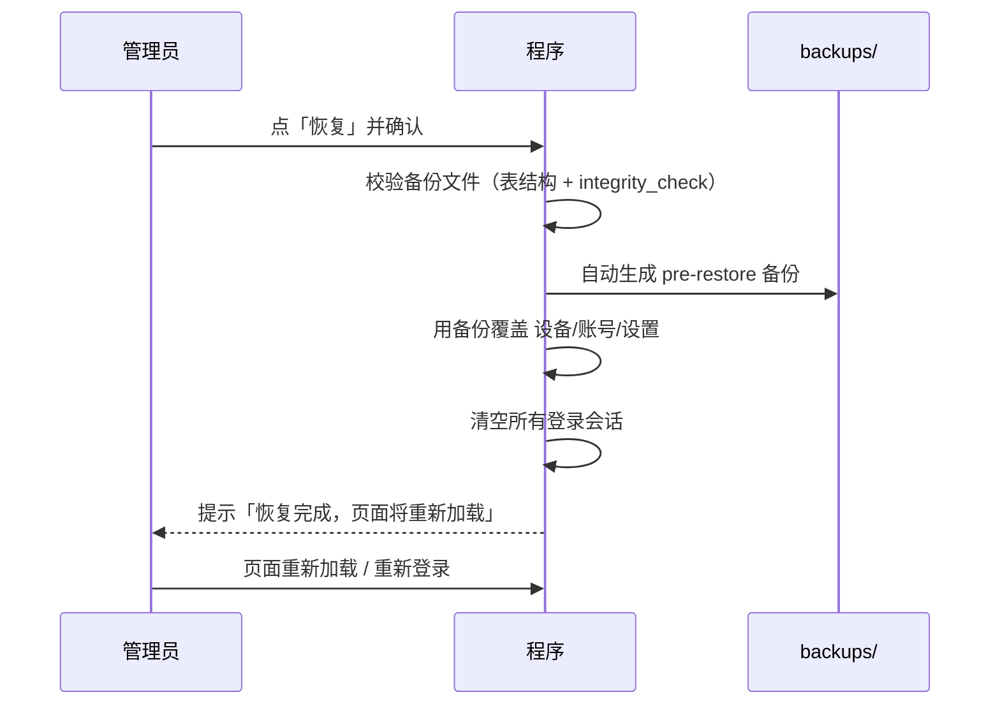

1. 进入「用户管理」→「数据维护」，在备份列表找到目标文件。
2. 点「恢复」，确认框文字为「确定用「文件名」覆盖当前数据库？恢复前会自动备份当前库。」
3. 程序会先校验备份：
   - 必须包含 `device`、`app_user`、`app_setting`、`schema_migration` 四张表；
   - `PRAGMA integrity_check` 必须为 `ok`；
   - 不合法时提示「备份缺少表 …」或「备份完整性检查失败: …」，不会动当前库。
4. 校验通过后，自动生成一份 `pre-restore` 备份，再用备份内容覆盖台账、账号和设置。
5. 提示「恢复完成，页面将重新加载。」页面自动刷新；所有登录会话已作废，必要时重新登录。

> **恢复会把账号和密码也恢复到备份时的状态**：备份之后改过的密码会失效。恢复后请用备份里对应的密码登录。恢复错了，可以在 `backups/` 里找到刚生成的 `pre-restore` 文件再恢复回去。

### 9.4 恢复外部备份 / 换电脑迁移

恢复只认数据目录 `backups/` 下的 `.db` 文件，不能直接从任意位置选文件。换电脑时：

1. 在新电脑安装并启动一次程序，完成初始登录（或先登录现有管理员）。
2. **退出程序**（避免数据库被占用）。
3. 把旧电脑的备份 `.db` 复制到新电脑的 `<数据目录>/backups/`。
4. 如果换过卡片图标，把旧电脑的 `<数据目录>/assets/` 整个复制到新电脑对应位置。
5. 启动程序 → 登录 →「用户管理」→「数据维护」→ 找到刚复制的文件 →「恢复」。
6. 恢复后页面重新加载；用备份里的账号密码登录，核对台账条数与图标。

> 更稳妥的迁移方式是关闭程序后**整目录复制**数据目录；但运行中直接复制 `devicedb.db` 可能得到不一致的快照，运行中请用「立即备份」生成的 `.db`。

### 9.5 命令行备份/恢复（维护人员）

适用于批量运维或界面打不开时，需先退出桌面程序：

```text
devcard-server --backup --data-dir "<数据目录>"
devcard-server --restore devcard-20261115-132530-manual.db --data-dir "<数据目录>"
```

- `--backup` 备份完成后退出；
- `--restore` 从 `backups/` 下按文件名恢复，恢复前同样会自动生成 `pre-restore` 备份；
- Windows 安装版的 `devcard-server.exe` 在 `%LOCALAPPDATA%\Programs\DevCard`；
- macOS 安装包内没有这个命令行程序，需维护人员使用同版本构建产物。

### 9.6 备份与恢复的限制

- 没有自动定时备份，没有云同步，没有备份保留策略。
- 备份列表按时间倒序显示，不提供删除按钮；清理旧备份需到 `backups/` 目录手动删除（建议先退出程序）。
- 恢复只恢复台账、账号、设置，不恢复审计日志等运行记录。
- 恢复前必须通过表结构与完整性校验；把随便一个 `.db` 改名放进来会被拒绝。

---

## 10. 版本更新提示

### 10.1 程序怎么知道有新版本

自 v1.4.0 起（mote 化重构），更新链路**只存在于桌面版（Windows / macOS）内部**：检测判据与编排状态机收在程序内核（core `UpdateEngine`），提示与安装走系统原生对话框；服务端与网页彻底退出更新链路，页面顶栏不再有「有新版本」提示和「检查更新」按钮。浏览器打开的网络版不参与自动更新，需要升级时请更新服务端部署的桌面程序或按发布页手动替换。

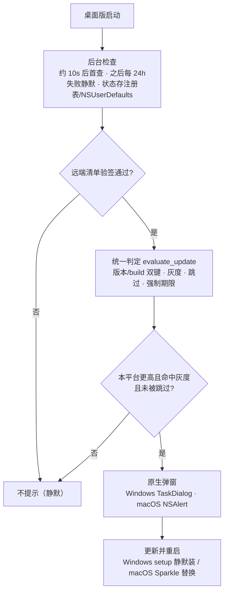

- **检查节奏**：桌面版启动约 10 秒后发起首查，之后每 24 小时再查一次；上次检查时间记在系统设置里（Windows 注册表 `HKCU\Software\DevCard`，macOS NSUserDefaults），失败也会记录，避免坏网络下反复打搅。
- **判据只有一份**：版本比较（version/build 双键）、灰度放量、「跳过此版本」、强制更新期限全部由程序内核统一计算，Windows 与 macOS 共用同一份代码；历史上「多端各写一份判定」的口径不一致问题从根源上消除。
- **远端清单**：地址固定为 `https://dl.xiaotu.online/devcard/updates/<channel>/manifest.json`（Schema v2，Ed25519 签名，验签不过视同没有更新）。清单内没有 `check_*` 字段。可用环境变量 `DEVCARD_UPDATE_URL` 覆盖（排障用）。
- **手动检查**：Windows 菜单栏「帮助 → 检查更新」与 macOS 菜单栏 `DevCard → 检查更新…` 立即检查一次，不受 24 小时间隔与「跳过」窗口限制；macOS 确认更新后由 Sparkle 原生窗口完成下载、EdDSA 验签、替换与重启。
- 超时、断网、DNS 失败、返回不是 JSON、版本号不合法，这几类失败与「没有新版本」在**后台检查**时完全一样：不弹窗、不报错、不影响台账（只有主动点菜单时才会明确告知失败）。内网连不上外网是常态，这是有意设计。

### 10.2 更新提示与原生弹窗

自 v1.4.0 起，更新提示是**桌面版的系统级对话框**（Windows TaskDialog / macOS NSAlert），不再依赖登录网页会话，也不区分管理员与普通用户——谁在这台机器上运行桌面版，谁看到提示。页面顶栏的 pill、「检查更新」按钮与更新弹窗已全部移除。

- 后台检查发现新版本时弹出「发现新版本 vX」对话框：显示当前版本、最新版本、安装包大小、更新说明链接（清单 `notes_url`）；手动检查时若已是最新会明确提示「已是最新版本」。
- 对话框按钮：

| 按钮 | 作用 |
|---|---|
| 更新（安装并重启） | **Windows 安装版**：下载 setup → 复验清单签名与 SHA256 → 静默安装 → 程序自动退出并由安装器拉起新版本。**Windows 绿色版**：下载 portable zip、打开所在文件夹并退出，需手动解压替换。**macOS**：确认后唤起 Sparkle 原生窗口，完成下载、EdDSA 验签、替换与重启 |
| 稍后 | 关闭弹窗，同时**跳过此版本 24 小时**：窗口期内后台不再提示同一版本（手动「检查更新」不受跳过限制）；强制到期后不可用 |
| 查看更新说明 | 用系统浏览器打开清单里的 `notes_url`（清单没有则不出现该按钮） |

- 下载过程有原生进度对话框（Windows）；下载中取消即删除残件，不影响程序继续使用。
- 灰度未命中（`rollout_percent` < 100 且本机抽样未命中）时后台判定为「暂无可用更新」，静默不弹；分批推送到期放量后自然会出现。

> **强制升级（v1.4.0 起由桌面版内核判定）**：发布清单给本平台段设置 `mandatory`（含 `mandatory_reason` 与 `mandatory_deadline`）后，低于要求版本的桌面版会收到「必须更新到 vX」弹窗并写明原因（安全漏洞修复 / 协议不兼容 / 法规或税控要求 / 低于服务端最低支持版本）；截止前仍可点「稍后」，到期后弹窗**不可关闭**，必须先升级。若本平台清单没有可安装产物，则只提示不阻塞（避免既升不了级又关不掉）。升级期限按 UTC 确定性解析，两端判定结果一致；未配置时不会有任何额外提示。

### 10.3 各平台更新步骤

**Windows 安装版（自动安装）**

1. 后台检查或「帮助 → 检查更新」发现新版本，弹出「发现新版本 vX」对话框。
2. 点「更新」：程序先显示下载进度，下载 setup 安装包并复验清单签名 + SHA256 + 字节数。
3. 校验通过后安装器静默运行（`/VERYSILENT /SUPPRESSMSGBOXES /NORESTART /CLOSEAPPLICATIONS /RELAUNCH=1`），本程序自动退出。
4. 安装器按原路径覆盖旧版本，装完自动重新启动 DevCard，启动日志与「关于」里即为新版本号。
5. 若安装失败（最常见是另一个实例占着程序文件，安装器退出码 5）：程序目录保持旧版本，下次启动仍是旧版并会再次提示。到任务管理器结束所有 `DevCard.exe` / `devcard-server.exe`，再点一次「更新」；不要手工删程序文件。
6. 升级中途断电/被杀无需特殊处理：Inno 自带事务与回滚，程序目录要么完整旧版要么完整新版，正常启动即可。

**Windows 绿色版（半自动）**

1. 弹窗点「更新」：程序下载 portable zip、校验通过后打开所在文件夹并退出。
2. 解压到新目录，把旧目录的 `data\`（以及自定义的 `devcard-server.json`）复制过去；**不要**复制旧的 exe/dll。
3. 启动新目录的 `DevCard.exe`。绿色版不替换自身程序文件。
4. 不想等后台检查，也可以直接打开下载页手动下载 zip，流程同上。

**macOS（原生提示 + Sparkle 一键安装）**

1. 后台检查发现新版本时弹出原生「发现新版本 vX」对话框（NSAlert）。
2. 点「更新」：版本判定已在程序内核完成，Sparkle 只负责下载、EdDSA 验签、替换与重启，在弹出的 Sparkle 原生窗口里确认即可。
3. 也可以随时用菜单栏 `DevCard → 检查更新…` 手动触发（立即检查，不受 24 小时间隔与跳过窗口限制）。
4. Sparkle 走 Developer ID 签名 + Apple 公证 + EdDSA appcast 验签，替换后通常无需手动放行。
5. 台账数据在用户数据目录，替换安装不会动它。
6. 手动兜底：打开下载页 `https://dl.xiaotu.online/` 下载 DMG，把 `DevCard` 拖进「应用程序」替换旧版本，退出重开即可。

> **历史说明**：macOS 1.2.1 之前不做自研自动替换（只读 DMG 无法原地写、替换会破坏 ad-hoc 签名）。2026-11-17 起具备 Developer ID 与公证后，改用 Sparkle 2.10.1 承担替换与重启，已端到端实测通过；1.2.2 起菜单栏补了「检查更新…」入口。**v1.3.8 起 Sparkle 降为纯安装执行器**（`SUEnableAutomaticChecks=false`，不再后台自查）；**v1.4.0 起检测与判定从服务端搬回程序内核**，提示改原生对话框，与 mote 的更新方案对齐。

### 10.4 下载与校验细节

- v1.4.0 起下载发生在桌面壳内：Windows 把安装包下到系统临时目录，安装完成或失败后清理；macOS 的下载由 Sparkle 自己管理。数据目录不再有 `updates/`。
- 校验三道：清单 Ed25519 验签（公钥编译进程序）→ 安装包 SHA256 与清单一致 → 字节数与清单一致；任一不符即失败，不会安装。
- 同一时间只允许一个下载任务；重复触发会先被忽略或提示稍候。
- **Windows 暂不购买 Authenticode 代码签名证书**（2026-11-17 决定），首次运行会被 SmartScreen 拦截（下载页有提示，可核对 SHA256 完整性）；macOS 侧自 2026-11-17 起有 Developer ID 签名 + Apple 公证。清单验签 + 产物双校验保证「未被篡改」，但不等于 Windows 安装包已通过代码签名认证，更新包仍应从可信发布地址获取。
- 「更新」一键安装只适用于 Windows 安装版；绿色版弹窗走「下载 zip + 打开文件夹」，需手动替换。

### 10.5 manifest.json 字段（v2）

v1.4.0 起本地投放清单已随 server 退出更新链路而移除——判定只吃远端清单。以下为清单本身的字段约定（桌面版内核解析）：文件名固定 `manifest.json`，UTF-8 JSON，必须带 Ed25519 签名。两平台共用一份，客户端只取当前平台段。**DevCard v2 清单强制 `platforms.macos + platforms.windows` 同时存在**（guard.py preflight 硬拦截，缺任一平台段直接 `die` 不让上传）。发布脚本（`publish_macos.sh` / `publish_windows.ps1` / `release-windows.yml`）用 `manifest_v2.py generate` 生成本次平台段后，必须加 `--prev <线上清单>` 合并另一平台段再整体重签。字段形状如下（占位值按本次发布实际产物替换）：

```json
{
  "manifest_version": 2,
  "product": "devcard",
  "channel": "stable",
  "key_id": "2026-11",
  "updated_at": "<ISO 8601 UTC>",
  "signature": "……（base64；对去掉 signature 后的规范化 JSON 签名）",
  "platforms": {
    "macos": {
      "version": "<x.y.z>",
      "build": <seq>,
      "min_os": "15.0",
      "rollout_percent": 100,
      "artifacts": {
        "dmg": {
          "url": "https://dl.xiaotu.online/devcard/devcard-<x.y.z>-macos-arm64.dmg",
          "size": <字节数>,
          "sha256": "<hex>"
        }
      }
    },
    "windows": {
      "version": "<x.y.z>",
      "build": <seq>,
      "min_os": "10.0",
      "rollout_percent": 100,
      "artifacts": {
        "setup":    {"url": "https://dl.xiaotu.online/devcard/devcard-<x.y.z>-win64-setup.exe",    "size": <字节数>, "sha256": "<hex>"},
        "portable": {"url": "https://dl.xiaotu.online/devcard/devcard-<x.y.z>-win64-portable.zip", "size": <字节数>, "sha256": "<hex>"}
      }
    }
  }
}
```

| 字段 | 必填 | 说明 |
|---|---|---|
| `manifest_version` | 是 | 固定 `2`，其他值不认 |
| `product` / `channel` | 是 | 发布工具按目录约定填写（`devcard`；`stable` 或 `beta`）。客户端不校验这两项 |
| `key_id` | 是 | 顶层字符串，当前 `2026-11`；客户端内置公钥与之配套，轮换密钥需随新版客户端发布 |
| `updated_at` | 是 | 顶层字符串，清单更新时间（ISO 8601） |
| `signature` | 是 | 顶层字符串，base64 的 64 字节 Ed25519 签名；验签失败一律不提示 |
| `platforms.windows` / `platforms.macos` | **DevCard 强制同时存在** | 客户端启动只取当前平台段；guard.py preflight 缺失任一段直接拦截不让上传 |
| `platforms.<os>.version` | 是 | 最新版本号，必须是 `x.y.z` 三位点分数字，不接受 `v` 前缀 |
| `platforms.<os>.build` | 是 | 发布号（`seq`）：来自 annotated tag `v<semver>+<seq>`，从 1 起、只增不减，macOS 与 Windows 同号。由 `cmake -DDEVCARD_BUILD=<seq>` 注入编译期宏 `DEVCARD_BUILD`（整数）与 `DEVCARD_BUILD_STR`（字符串），桌面版更新引擎 `compiled_build_number()` 读取；未注入时返回 0，自动跳过 build 比较。同版本重发时，只有清单 build > 本机构建号（且双方都 > 0）才提示更新。**发布链路**：`release_tag.py` 取号 → CMake configure 注入 → 二进制 → manifest.json build 字段四处同值。构建号注入验证见 `tools/release/verify_build_stamp.ps1`。 |
| `platforms.<os>.min_os` | 否 | 最低系统版本，发布工具填写；客户端当前不消费 |
| `platforms.<os>.artifacts.setup` / `portable` / `dmg` | 按需 | 产物 `url`（必须是 https）、字节数 `size`、`sha256`；缺失则该形态不能下载或安装 |
| `platforms.<os>.rollout_percent` | 是 | 发布工具必填，1–100；**由桌面版内核统一判定、两端一致生效**：按灰度比例（以本机安装 ID 分桶）决定是否提示更新，`0` 表示对所有人不提示（此前 0% 会被误判为全量发布，已修复） |
| `platforms.<os>.notes_url` / `mandatory` / `mandatory_reason` / `mandatory_deadline` | 否 | 更新说明地址与强制更新标记，按 Schema v2；**`notes_url` 已消费**（原生弹窗「查看更新说明」按钮的目标），由发布脚本随发布上传并写入；**`mandatory` 系列由桌面版内核消费**（命中即弹「必须更新」并写明原因、到期不可关闭，期限按 UTC 确定性解析）；`min_os` 客户端仍不消费 |

- 版本判定（v1.4.0 起统一在程序内核 core 计算，两端同一份结论）：本平台版本更高即提示；版本相同再看 `build`——清单 build 严格大于本机构建号（且双方都 > 0）才提示。本机构建号未注入（为 0）时回退到只比 version。
- 清单缺失、JSON 非法、签名不过、缺本平台段时只是不提示更新，不影响台账使用（宁可查不了也不冒进）。
- 「更新」按钮要求本平台 `artifacts` 带对应产物（Windows 安装版看 `setup`、绿色版看 `portable`、macOS 走 Sparkle appcast）；缺产物时弹窗只给「查看更新说明 / 打开下载页」。

### 10.6 更新提示不出现？

按顺序检查（v1.4.0 起适用于桌面版）：

1. 用的是不是**桌面版**：浏览器打开的网络版不再有更新提示，这是设计如此。
2. 当前版本是否已经不低于清单里本平台的版本（相同且 build 未增大不会提示）。
3. 是否点过「稍后」跳过了该版本：跳过窗口（24 小时）内后台不再提示同一版本；用菜单栏「检查更新」可无视跳过窗口立即查。
4. 清单是否验签通过：内容被改过却没有重新签名、或 `key_id` 与内置公钥不匹配，都会静默失败。
5. 清单是否包含当前平台段（Windows 是 `platforms.windows`）。
6. 检查节奏由桌面版管理（上次检查时间存注册表 / NSUserDefaults）：启动约 10 秒后首查、之后每 24 小时一次；不想等就用菜单栏「检查更新」立即查，不受间隔限制。
7. 断网/超时不会提示，这是预期行为；恢复网络后等下一个检查周期即可。
8. 清单里本平台 `rollout_percent` 是否小于 100：按灰度比例（本机安装 ID 分桶）抽样决定是否提示，未命中灰度不会提示，`0` 表示对所有人不提示。
9. 同版本重发时是否只增大了 `build`：清单 `build` 必须严格大于本机构建号才提示（判定只在程序内核算一份，两端口径一致）。

---

## 11. 数据目录与配置

### 11.1 数据目录在哪

| 平台/形态 | 数据目录实际值 | 说明 |
|---|---|---|
| macOS 桌面版 | `~/Library/Application Support/Anye/DevCard/` | `~` 是当前用户主目录；在终端里就是 `$HOME/Library/Application Support/Anye/DevCard` |
| Windows 安装版 | `%LOCALAPPDATA%\DevCard\data` | 通常为 `C:\Users\<用户名>\AppData\Local\DevCard\data` |
| Windows 绿色版 | `DevCard.exe` 同级的 `data\` | 例如 `D:\Tools\DevCard\data` |

macOS 桌面版固定使用上面的用户目录；Windows 安装版/绿色版按安装形态选择。数据目录确定顺序（仅命令行/网络版可覆盖）：

1. 命令行 `--data-dir <目录>`；
2. 环境变量 `DEVCARD_DATA_DIR`；
3. 配置文件 `devcard-server.json` 的 `data_dir`；
4. 形态默认（上面的表）。

四种来源都没有显式指定、且默认目录不可写时，程序会报 `data_dir_unwritable` 并停止启动，**不会**退回临时目录（避免出现一个空台账让你以为数据丢了）。

### 11.2 数据目录里有什么

| 文件/目录 | 内容 | 是否可删 |
|---|---|---|
| `devicedb.db` | 主数据库：台账、账号、设置 | 不要删；删了等于清空 |
| `backups/` | 手动备份、`pre-restore` 备份、命令行备份 | 可清理旧文件，建议保留最近几份 |
| `assets/company-logo.png` 或 `.jpg` | 自定义卡片图标 | 不要删；删了会回落到默认图标 |
| `instance.lock` | 多实例锁文件，含占用者 PID、启动时间、监听地址 | 不要手工删；程序会按 PID/超时自动接管 |
| `初始账号密码.txt` | 首次启动生成的初始账号与密码 | 全部改密后程序自动删除；不要长期保留 |

> v1.4.0 起更新链路迁到桌面壳：数据目录不再有 `updates/`、`manifest.json`、`app-started.marker`、`update-state.json`；旧版本升级上来时这些残留文件可直接删除，不影响使用。

### 11.3 配置文件

配置文件固定名为 `devcard-server.json`，默认放在 `devcard-server.exe` 同目录（可用 `--config` 或 `DEVCARD_CONFIG` 指定）。桌面双击启动的壳不走这个配置文件；它主要供命令行/网络版使用。

| 键 | 类型 | 默认 | 作用 |
|---|---|---|---|
| `data_dir` | 字符串 | 形态默认 | 数据目录；相对路径按 exe 所在目录解析 |
| `listen` | 字符串 | 自动选择私有网卡 | 网络版监听地址 |
| `port` | 整数 | `18080` | 监听端口，1–65535 |
| `allowed_hosts` | 字符串数组 | 空 | 额外允许的 Host 名（防 DNS rebinding）；用机器名/域名访问返回 421 时加进来 |
| `rate_limit_enabled` | 布尔 | `true` | 登录/改密失败限流总开关 |
| `rate_limit_max_failures` | 整数 | `5` | 同一键连续失败阈值 |
| `rate_limit_window_seconds` | 整数 | `300` | 计数窗口 |
| `rate_limit_lock_seconds` | 整数 | `60` | 限流锁定时长 |

配置写错（未知键、类型不对、`--config` 指向的文件不存在）时，命令行/网络版会以 `bad_config` 启动失败；桌面版不受影响。

### 11.4 打开数据目录

- **状态栏**：点击右下角的数据目录路径。桌面壳会打开 Finder/资源管理器；浏览器会复制路径。
- **用户管理页**：管理员点「打开数据目录」。这个按钮**仅在 Windows 版本提供**；macOS 点击会提示「打开数据目录仅在 Windows 版本提供」，请改用状态栏或 Finder 的「前往文件夹」。
- **手动**：
  - macOS：Finder →「前往」→「前往文件夹」→ `~/Library/Application Support/Anye/DevCard`；
  - Windows：资源管理器地址栏输入 `%LOCALAPPDATA%\DevCard\data`。

### 11.5 同一数据目录只允许一个实例

程序用三层判据（锁文件、数据库文件身份、库内心跳）保证同一个数据目录只有一个进程在写。第二个实例会启动失败并退出，提示 `instance_in_use`，里面带占用者的 PID、启动时间和监听地址。

- 这是有意的：两个进程同时写同一个 SQLite 库会互相覆盖。
- 需要同时跑两套台账时，用命令行/网络版分别指定**不同的数据目录和不同端口**；桌面双击版固定使用 `18080`，同一台电脑上不能同时开两份。
- 程序被强杀后留下的锁，会按 PID 与超时自动接管，不需要手工删 `instance.lock`；确实要手工清理时，先确认没有进程在使用该目录。

### 11.6 旧版数据不再支持导入

如果数据目录里的 `devicedb.db` 是旧版（只有 `tb_device` / `tb_user`，没有 `schema_migration`），新版本启动会直接报：

> 检测到旧版数据库（无 schema 版本号）。新版本不再支持旧库导入，请先用旧版程序导出数据或改用新库。

这是硬失败，程序不会在原库上建新表，也不会自动搬数据。旧库导入器与 `--import-legacy` 已从程序中删除，没有自动或手工迁移入口。

### 11.7 卸载与数据保留

- Windows 安装版：卸载只删除程序文件与快捷方式，数据目录 `%LOCALAPPDATA%\DevCard\data` 保留，卸载结束页会提示路径。
- Windows 绿色版：删除程序目录即可；如果想彻底清除，连同旁边的 `data\` 一起删。
- macOS：把 `DevCard` 拖进废纸篓只删除程序；数据仍在 `~/Library/Application Support/Anye/DevCard/`。彻底清除前请先备份。

---

## 12. 常见问题

**Q1：首次启动后找不到初始密码。**
看[第 2.3 节](#23-首次启动做了什么)的三个路径。如果 `初始账号密码.txt` 已经被删除，说明所有账号都已完成改密；用你改后的密码登录。确实忘了，按[第 3.5 节](#35-忘记密码怎么办)重置。

**Q2：登录提示「用户名或密码错误」，但密码肯定对。**
先确认用户名（`root` / `安业物业` / 管理员新建的账号）；再确认密码大小写和输入法。连续错 5 次会锁定 15 分钟，锁定期间密码正确也进不去。

**Q3：导入后条数变多了，是不是程序自动合并了？**
不会合并。导入是追加；同一个文件导入两次就会翻倍。重复记录只统计不拦截。导错了请从导入前备份恢复。

**Q4：导出 Excel 为什么不是当前筛选的结果？**
当前版本的「导出」固定导出全部台账，不受筛选影响。需要分批时，先导出全部再在 Excel 里筛选。

**Q5：导出被中止，或提示字体校验失败。**
说明随包字体没取到、字节数或 SHA256 与构建清单不符，或页面环境无法校验字体。先重启程序；仍失败请重新安装，不要手工替换字体文件。个别生僻字只提示、不中止；公司名因生僻字回退后超出框才会阻止导出。

**Q6：打印出来的电话分组很奇怪。**
卡面按前 3、中 4、后 4 分组，不识别区号横线。建议录 11 位连续号码；已录带横线的，先在打印预览里确认。

**Q7：点「打开数据目录」提示「仅在 Windows 版本提供」。**
这是 macOS 的已知差异。请点底部状态栏的数据目录，或用 Finder 的「前往文件夹」。

**Q8：启动时报「同一数据目录已有实例在运行」。**
已经有一个 DevCard 窗口/进程在使用这个数据目录。v1.3.4 起重复启动会直接激活已有窗口，一般不会再看到这个提示；若仍在旧版本上遇到，关掉旧窗口即可；如果界面已关闭但进程还在，到活动监视器/任务管理器结束残留进程。

**Q9：启动时报「数据目录不可用」。**
按提示修目录权限；不要把数据目录放在只读盘、系统保护目录或断开的网盘。程序不会自动换目录。维护人员可用 `--data-dir`、`DEVCARD_DATA_DIR` 或配置文件显式指定。

**Q10：macOS 首次打开提示「无法验证开发者」。**
自 2026-11-17 起的正式包已公证，正常不会出现；若仍出现（多为 2026-11-17 之前的旧包），右键「打开」→「打开」，或到「系统设置 → 隐私与安全性」点「仍要打开」。这不是文件损坏。

**Q11：Windows 首次运行出现 SmartScreen。**
点「更多信息」→「仍要运行」。安装包未购买代码签名证书，该提示可能出现。

**Q12：桌面版一直没有弹「发现新版本」。**
v1.4.0 起更新提示是桌面版原生对话框，页面顶栏不再有提示；按[第 10.6 节](#106-更新提示不出现)逐项检查；断网/超时不会提示，是预期行为。想立刻确认，用菜单栏「检查更新」（Windows「帮助 → 检查更新」/ macOS「DevCard → 检查更新…」）——主动检查失败会明确提示，不会静默。浏览器网络版不提供更新检查，属正常。

**Q13：卸载后数据还在吗？**
在。Windows 卸载只删程序目录；macOS 拖废纸篓只删程序。数据目录需手动删除。删除前先备份。

**Q14：换电脑怎么迁移？**
见[第 9.4 节](#94-恢复外部备份--换电脑迁移)：备份 `.db` + 复制 `assets/`，在新电脑放进 `backups/` 后恢复。

**Q15：能直接打开旧版（Qt 线）的数据吗？**
不能。新版本检测到旧库会报 `legacy_db` 并拒绝启动；旧库导入器已删除。请用旧版程序导出数据，或改用新库重新录入。

**Q16：程序图标是什么？**
1.2.1 起三端（macOS / Windows / 网页）统一使用 DC 字标图标（深青圆角底 + 米白 DC），四角透明由系统裁切。**1.2.2 起全套图标（含 macOS `.icns`、Windows `.ico`、浏览器 favicon、Apple Touch、PWA 图标、分享预览）都由同一份母版统一生成**，三端几何与色彩一致（此前 macOS 包内仍是旧母版）。这不影响卡片上的公司图标和打印。

---

## 13. 附录

### 13.1 快捷键与小技巧

| 操作 | 效果 |
|---|---|
| 在搜索框按回车 | 执行查询 |
| 在登录表单按回车 | 登录 |
| Esc | 关闭删除确认框、新增/编辑抽屉、账号弹窗、重置密码弹窗、更新弹窗；**不能**关闭首次强制改密窗口 |
| 密码框右侧眼睛 | 切换明文/掩码 |
| 点击状态栏数据目录 | 桌面壳打开目录；浏览器复制路径 |

### 13.2 启动失败码表（摘要）

| 错误码 | 含义 | 处理 |
|---|---|---|
| `instance_in_use` | 同一数据目录已有实例 | 关闭旧实例/残留进程 |
| `data_dir_unwritable` / `data_dir` | 数据目录不可写/无法创建 | 修权限或显式指定目录 |
| `port_in_use` | 18080 端口被占用 | 释放端口；命令行版可 `--port` |
| `legacy_db` | 旧版数据库 | 不再支持导入，改用新库 |
| `schema_newer` | 数据库结构版本高于程序 | 升级程序，不要降级打开 |
| `font_missing` / `font_corrupt` | 随包字体缺失/损坏 | 重装/重新解压 |
| `bad_config` / `bad_listen` | 配置或监听地址错误 | 修 `devcard-server.json` / 用 `--listen` |
| `web_assets` | 内嵌前端与源文件不一致 | 重装或重新构建 |

### 13.3 与使用有关的现状与限制

以下为仓库当前记录，照实列出，避免把「未验证」当成「已保证」：

- macOS 版自 2026-11-17 起为 Developer ID 签名 + Apple 公证 + staple（DMG 同样签名并装订票据），首次打开通常无需手动放行；2026-11-17 之前的 ad-hoc 旧包仍需手动放行。
- macOS 版已随包接入 DC 字标图标；Windows 版图标已接入（`shell/win/app.rc` 引用 `shell/win/DevCard.ico`，由 `make_icons.sh` 从母版统一生成），exe 与安装器均带图标。
- macOS 版自 1.2.1 起接入 Sparkle 2.10.1 完成下载 → EdDSA 验签 → 原子替换 → 重启，端到端实测通过（见改造技术方案 §10.4.2）。**v1.3.8 起 Sparkle 降为纯安装执行器**（后台自查已关闭，`SUEnableAutomaticChecks=false`）；**v1.4.0 起检测与判定在程序内核（core UpdateEngine）**，NSAlert 原生提示确认后由 Sparkle 唤起原生窗口完成安装；Windows 端同用这一内核，安装走 setup 静默直装。
- Windows 安装版的自动安装只接受 `setup.exe`；绿色版 zip 不支持自动安装。
- Windows 壳的导出/打印桥已于 2026-11-26 真机端到端验证通过：打印对话框互斥与关闭后正确释放、连续打印不再卡住、Excel 导出经下载通道正常落盘（v1.3.6 起）。
- 「直接打印」验证到能构造打印任务并打开系统打印面板；实际出纸仍依赖目标打印机驱动与纸张设置，首次使用请先打一张测试页确认。
- 旧版（Qt 线）数据库不再支持导入；旧版程序与迁移脚本已从仓库删除。
- Windows 侧没有代码签名；macOS 侧自 2026-11-17 起为 Developer ID 签名 + 公证。更新包只做 SHA256 与字节数校验，不能替代系统级信任。
- 没有自动定时备份；备份需要手动点「立即备份」。
- 应用没有列排序、批量删除、撤销删除、筛选结果导出、模板编辑器等能力。

### 13.4 相关文件

| 文件 | 用途 |
|---|---|
| `assets/logo.jpg` | 内置「安业物业」卡片图标源文件 |
| `assets/app-icon.png` | DC 字母版应用图标（1024×1024 PNG，深青圆角底 + 米白 DC；macOS 1.2.0 起随包） |
| `assets/卡片打印样张-17条-2页.pdf` | 真实导出的 17 条 2 页样张 |
| `assets/card-sample-page1.png` | 上述样张第 1 页渲染图 |
| `docs/部署文档.md`（仓库内） | Windows 部署、端口、防火墙、限流、升级步骤 |
| `docs/改造技术方案.md`（仓库内） | 架构、迁移、打印链路、更新机制的技术细节 |

---

**文档结束**。如果本手册的描述与程序实际界面不一致，以程序当前版本的实际行为为准；遇到无法启动、数据异常或打印版式问题时，请保留错误提示原文、程序版本、数据目录路径和一张现场截图，再联系维护人员。
